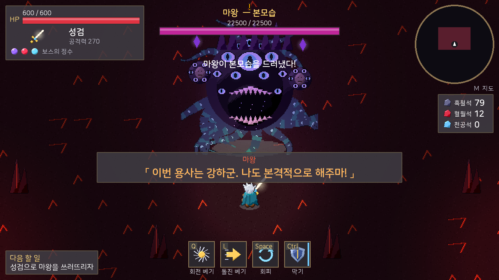
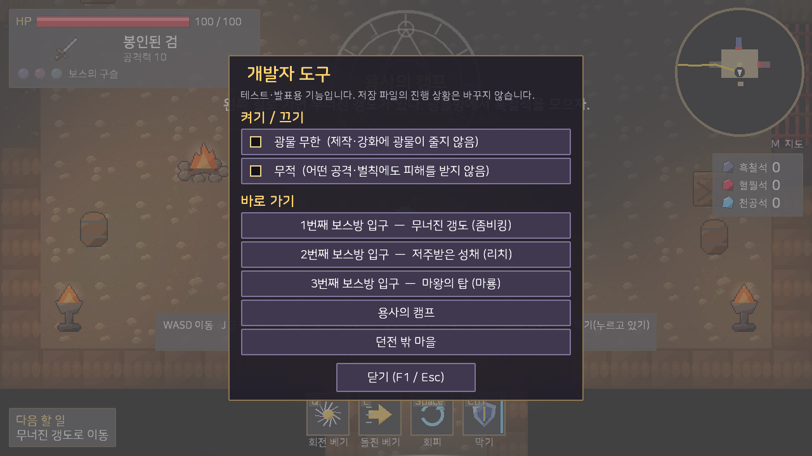
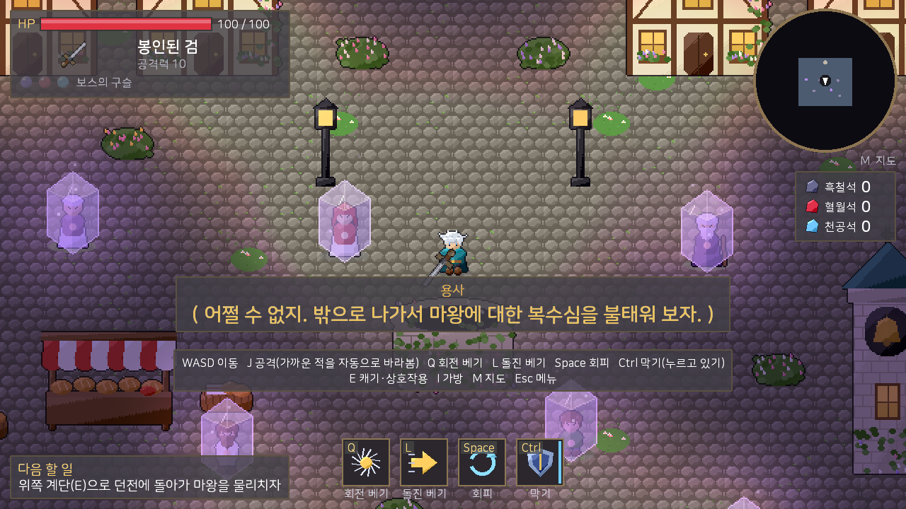
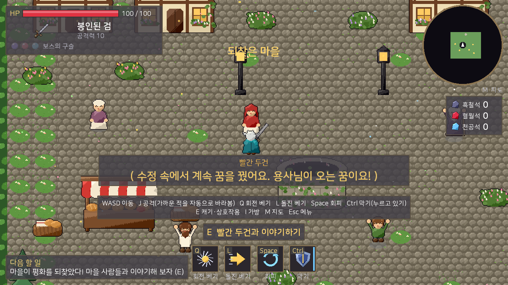

# 용사가 다한다

국립군산대 소프트웨어학과 2026-2 지능형 UI/UX 프로그래밍 · Java 17 · libGDX 1.14.2 (LWJGL3) · Gson · JUnit 5



## 실행

```bash
gradlew lwjgl3:run      # 게임 실행 (Windows: gradlew.bat lwjgl3:run)
gradlew core:test       # 규칙 테스트 (화면 없이)
gradlew lwjgl3:jar      # 실행 파일 하나로 → lwjgl3/build/libs/yongsa-0.4.0.jar
```

처음 실행할 때는 Gradle과 libGDX를 내려받느라 몇 분 걸린다. `gradlew.bat`만 치면 도움말만 나오니 반드시 `lwjgl3:run`까지 붙인다.
IntelliJ에서는 폴더를 열고 오른쪽 Gradle 탭 → `lwjgl3 > Tasks > application > run`.

## 조작

| 동작 | 키 |
|---|---|
| 이동 (8방향, 대각선도 같은 속도) | W A S D / 방향키 |
| 기본 공격 (바라보는 방향 부채꼴, 공격할 때만 범위 표시) | J |
| 회전 베기 (주변 전체 150%, 쿨 6초) | Q |
| 돌진 베기 (앞으로 돌진 200%, 쿨 8초, 돌진 중 무적) | L |
| 회피 (구르기, 무적) | Space |
| 막기 (누르고 있기, 앞쪽 200°만, 최대 3초) | Ctrl (또는 K) |
| 캐기 · 대장간 · 침대 · 포탈 · 문양 · 마을 계단 · 대화 (할 수 있을 때만 안내가 뜸) | E |
| 가방 / 지도 / 메뉴 | I / M / Esc |
| **개발자 도구** 열기/닫기 (테스트·발표용) | F1 |
| 창 안 버튼 이동·선택 | 방향키·Tab, Enter (마우스도 됨) |

**자동 바라보기**: 200px 안에 몬스터가 있으면 용사가 가장 가까운 몬스터를 자동으로 바라본다(걸어가도 몸은 적을 향함, 공격도 그쪽).
회피·돌진·빙결·기절 중과 **마왕의 눈알이 빛을 모으는 동안**은 예외 (눈을 등지는 건 직접 정해야 하므로).

**개발자 도구 (F1)**: 예전 F1~F5를 한 창에 모았다. 대장간 등 다른 창 위에서도 열린다.

| 항목 | 하는 일 |
|---|---|
| 광물 무한 (체크) | 제작·강화에 광물이 줄지 않는다. 끄면 실제 개수로, 저장에는 실제 개수 |
| 무적 (체크) | 모든 피해·눈알 벌칙 무시 |
| 강화 성공 100% (체크) | 하락·파괴 없이 언제나 성공 (끄면 원래 확률) |
| 1·2·3번째 보스방 입구 | 싸우던 방 초기화·던전 잠금 해제 후 문 앞으로 (걸어 들어가면 평소처럼 확인창) |
| 용사의 캠프 / 던전 밖 마을 | 바로 이동 |



## 이야기

평화롭던 마을 광장의 우물에서 해골의 왕(마왕)이 솟아올라 마을 사람들을 보랏빛 수정에 가둔다.
가보로 물려받은 **봉인된 검**을 지닌 용사가 우물 아래 던전으로 내려가, 세 던전의 주인을 쓰러뜨리고
**성검**을 해방해 마왕을 쓰러뜨린다. 마왕이 무너지면 수정이 부서지고 **속박된 사람들이 풀려난다**.
시작·엔딩은 이야기 그림 3장씩(`assets/story/`)으로 보여 준다.

## 게임 흐름

1. 캠프 → **무너진 갱도**: 잡몹방에 들어가면 문이 잠기고, 다 잡으면 열린다. 광물방에서 흑철석을 캔다(첫 광물방은 8개 이상 보장).
2. 캠프 대장간에서 **흑철검** 제작 → 강화(성공·유지·하락·파괴) → 장착.
3. 보스방 앞에서 확인창 → 보스 처치(보스마다 무너지는 모션) → 그 던전 테마의 **보물상자**가 나타난다. E로 열면 **그 던전 광물 30~40개**(무작위),
   **처음 잡았을 때는 보스의 정수도** 상자에서 튀어나온다. 처음 잡을 때만: 힘 흡수(최대 체력 증가), 흡수하지 못한 힘이 던전에 퍼져 잡몹 강화(체력 ×1.3, 공격 ×1.2), **캠프가 한 단계 밝아짐**.
   보스방 가운데에 캠프로 가는 **포탈**이 열린다. 열지 않은 상자는 저장된다.
4. 침대(E)에 누우면 **잠드는 모션**(화면이 어두워졌다 밝아짐) 뒤 회복. 잡몹·광맥과 함께 **보스도 다시 생긴다**(마왕 제외). 다시 잡아도 보물상자(광물 30~40개)가 나온다.
5. 저주받은 성채(혈월검) → 마왕의 탑(천공검) 순서로 반복.
6. 정수 셋을 모아 캠프로 → 바닥 문양 앞에서 E: **봉인된 검이 성검으로 해방** → 정수가 땅에 박히고 → 땅이 갈라져 추락 → **마왕의 심연**(따로 떨어진 전장)에서 마왕전.
7. 마왕은 성검으로만 피해를 줄 수 있다. 쓰러뜨리면 찢긴 공간이 닫히고 캠프로 가는 포탈이 열린다 → 엔딩 이야기 → 플레이 기록, "계속하기"로 이어서 플레이할 수 있다.

**던전 잠금**: 던전 방에 한 번 들어가면 뒤에서 입구가 닫힌다. **그 던전의 보스를 쓰러뜨리거나, 쓰러져야(사망) 캠프로 돌아갈 수 있다.** Esc 메뉴의 "던전 나가기"는 없앴다.
(무기·광물은 사망해도 그대로라서, 광물만 모으고 나오려면 쓰러져서 캠프로 돌아가는 수밖에 없다.)
**던전 밖 마을**: 캠프 아래(남쪽) 출구로 내려가면 던전을 나가 **마을**(같은 지도의 떨어진 구역, 미니맵·큰 지도도 마을만 보여 줌)로 간다.
- 마왕을 쓰러뜨리기 **전**: 출구에 닿을 때마다 용사가 *"밖의 모두를 위해서라도, 마왕을 물리치기 전까지는 나갈 수 없어!"* 같은 독백을 하고 되돌아선다.
  **다섯 번** 되돌아선 뒤 또 나가려 하면 *"어쩔 수 없지. 밖으로 나가서 마왕에 대한 복수심을 불태워 보자."* 하고 나간다(그 뒤로는 그냥 나간다, 횟수는 저장됨).
  마을은 보랏빛 저녁이고 마을 사람 6명이 **눈을 감은 채 수정 속에 갇혀** 있다(E: 살펴보기).
- 마왕을 쓰러뜨린 **뒤**: 바로 나갈 수 있다. 수정이 사라지고 한낮처럼 밝아지며, 사람들이 웃다가 팔을 들고 뛰고 꽃잎·색종이가 날린다. E로 한 사람씩 이야기한다.
- 마을 위쪽 **계단**(E)으로 던전에 돌아간다. 마을에서는 캠프처럼 체력이 차고, 마을에서 저장하면 마을에서 다시 시작한다.

| 마왕 전 (수정에 잠든 마을) | 마왕 뒤 (되찾은 마을) |
|---|---|
|  |  |

**캠프 밝기**: 보스를 하나도 못 잡았을 때는 어둡고, 보스(마왕 포함)를 처음 잡을 때마다 밝아진다 (30% → 48 → 66 → 84 → 100%).
**안개**: 던전은 지금 들어가 있는 방과 이미 비운 방만 보인다. 침대를 쓰면 다시 가려진다.
**다른 맵 가리기**: 던전 어디서 봐도 옆 구역(첫 번째 던전 광물방 옆의 마을, 두 번째 던전 광물방 옆의 마왕의 심연 등)은 까맣게 가려진다.
마을은 **던전을 나갔을 때만**, 마왕의 심연은 **마왕과 싸울 때만** 보이고, 그 안에 있을 때는 바깥이 보이지 않는다.
**지도**: 오른쪽 위 원형 미니맵, M 키 큰 지도. 둘 다 "다음 할 일"까지 가는 길을 노란 선으로 보여 준다.

## 검과 성검

| 검 | 공격력 | 흡혈 |
|---|---|---|
| 봉인된 검 (시작) | 10, 강화 불가 | 없음 |
| 흑철검 / 혈월검 / 천공검 | 22+3/강 · 55+5/강 · 110+8/강 | +6 0.5% · +7 0.7% · +8 1% · +9 1.25% · +10 1.5% (벨 때마다 용사 최대 체력 대비) |
| 성검 (해방 후) | **150 + (종류마다 가장 센 검의 공격력 합) × 0.4** | max(종류마다 최고 흡혈의 절반의 합, 가장 높은 흡혈 하나) |

- 각성 무기를 흡수해서 사라진 검도 그 단계 그대로 성검이 나눠 받는다.
- 흡혈은 **용사 최대 체력** 기준이다 (예: 최대 체력 700, +10 → 한 번 벨 때 10.5 회복). 한 번에 4%까지 (`hero.lifestealCapRatio`).
- 최종 공격력에는 흡수한 각성 무기 수 × 10% 보너스가 붙는다.

## 막기 (Ctrl)

- 누르고 있는 동안 앞쪽 200° 안에서 오는 공격(근접·돌진·투사체)을 막는다. 막는 동안은 천천히 걷고 바라보는 방향이 고정된다.
- 게이지 = 3초. 누르고 있으면 초당 1씩, 잡몹 공격을 막을 때마다 0.35씩 준다. 바닥나면 **막기 깨짐** → 2초 동안 못 막는다. 손을 떼면 0.6초 뒤부터 초당 1씩 찬다.
- **보스의 공격(몸통·돌진·보스가 쏜 탄)은 스치기만 해도 한 번 막으면 바로 막기가 깨진다** (그 한 방의 피해는 막는다).
- **보스는 회피(Space)·공격으로 밀리지 않는다.** 몸이 겹치면 용사 쪽이 밀려난다.
- 바닥·하늘에서 오는 공격(내려찍기, 뼈 가시, 번개, 촉수, 독구름)은 막을 수 없다 → 걸어서 피한다.
- 그 대신 잡몹·보스의 공격 예고와 쉬는 시간을 줄였다 (`windup`, `cooldown`).

## 보스

| 보스 | 체력 | 기믹 |
|---|---|---|
| 좀비킹 (갱도) | 2200 | **돌진 3연속**: 방향선 예고 → 달려든다 → 잠깐 숨 고르기 → 다시 조준. **세 번째 돌진 뒤 2.5초 기절**(머리 위 별, 공격 기회) |
| 리치 (성채) | 5200 | 원거리 탄 + 아래 표 |
| 마룡 (탑) | 12000 | **바람기둥**: 움직이다 맵 가운데로 나타나 사방으로 바람기둥 3겹. 맞으면 **피해는 없고** 날아오던 방향으로 **뒤쪽 벽까지 빙글빙글 구르며 날아간다**(날아가는 동안 조작 불가, 바람 줄기). **광폭화(체력 50%)**: 바람의 고치에 싸여 **20초 동안 공중**(어떤 공격도 안 맞음), 그동안 3.4초마다 **메테오** — 피할 곳은 맵의 작은 금빛 원 하나 — 그 위에 **반투명 보호막 돔**이 펼쳐져 메테오가 떨어질 때 번쩍인다. 고치 동안 **회피(Space) 쿨타임 0**, 내려오면 원래대로, 이후 **공격력 1.5배**. **독**: 아래 보며 포효 → 맵 세 곳에 용사 3배 크기 초록 독구름, 닿으면 초당 최대 체력 1%. **번개**: 위 보며 포효 → 10번 낙뢰(하늘을 가르는 굵은 벼락 + 섬광·충격파 고리·불꽃·화면 흔들림), 맞으면 감전(Q·L 봉인, 이동·평타·회피·막기는 됨). **얼음**: 엉덩이를 들고 꼬리에서 얼음 덩이 14개 → 맞으면 3초 빙결. **화염**: 먼저 **뒤돌아선 뒤** 3~5초 동안 빙글빙글 돌며 **바라보는 쪽으로** 화염 구슬을 뿌린다(나선), 맞으면 화상(초당 3) |
| 마왕 1페이즈 | **15000** | 리치 왕의 모습. 아래 표 |
| 마왕 2페이즈 | **22500** (1.5배) | 크툴루풍 괴물. 아래 표 |

### 마왕 1페이즈 (리치 왕)

| 패턴 | 내용 | 피하는 법 |
|---|---|---|
| 척추 채찍 | 척추를 뽑아 화면 절반 이상(반지름 430, 210°)을 휩쓰는 횡베기. 1초 예고(부채꼴 + 휩쓸 방향 화살표) | 막을 수 없다. 채찍이 지나가는 순간 **회피(Space) 무적**으로 넘기거나 범위 밖으로 |
| 머리 포탑 | 머리를 맵 구석에 던진다. 머리는 9초 동안 **유도탄**(1.1초마다)과 **레이저**(3초마다, 0.8초 예고)를 쏘고, **머리 없는 몸통은 1.7배 빠르게** 달려든다 | 레이저 줄 밖으로, 유도탄은 꺾이는 걸 보고 옆으로 |
| 뼛가루 폭풍 | 맵 전체에 6초 동안 초당 최대 체력 5% 피해. 예고 중에 **바위가 떨어진다** | **바람이 불어 가는 쪽 바위 뒤(밝게 표시된 그늘)** 에 서 있으면 안 맞는다. 끝나면 바위는 부서진다 |
| 붕괴 → 기습 | 용사가 210px 밖으로 1.8초 넘게 거리를 벌리면 뼈 무더기로 무너져 1.2초 **무적**, 용사 **등 뒤**(바라보는 반대쪽)에서 다시 모여 0.55초 예고 뒤 내려찍기 | 무너지면 바로 움직일 준비, 빨간 원이 뜨면 즉시 회피 |

### 마왕 2페이즈 (본모습)

| 패턴 | 내용 | 피하는 법 |
|---|---|---|
| 심연의 눈 (여러 개) | 허공(용사 근처 화면 안)에 거대한 눈 **3개**가 서로 다른 방향에 피어나 **0.9초 간격으로 차례로** 빛을 뿜는다. 동시에 사방 탄 | 빛을 뿜는 순간 **눈을 등지고** 있으면 무사. 바라보고 있으면 **현재 체력 절반 / 기절 1.6초 / 스킬 봉인 5초** 중 하나 |
| 반전 마법진 | 발밑에 7초짜리 마법진. 밟고 있는 동안 키가 뒤바뀌고, **빠져나온 뒤에도 5초 동안 좌우가 반전**된다(HUD에 남은 시간) | 바뀌는 키는 처음 밟을 때 정해져 **저장되고 그 뒤로 고정**(예: 좌↔우 + Q↔회피). 매번 같으니 익히면 된다 |
| **공간 절단** | 기형적인 팔·촉수가 전장 한쪽 끝을 **남은 전장의 20%만큼** 찢어 낸다(1.8초 예고: 잘릴 곳이 붉게 맥동, 발톱 자국). 찢긴 곳은 **어둡게 변해 지나갈 수 없는 공허**로 전투 내내 남고, **닿기만 해도** 지속 피해(초당 최대 체력 8%). 찢길 때마다 **공허가 번지는 범위(5→9→…→21px)와 피해(+25%씩)가 늘어난다**. 휩쓸린 용사는 남은 쪽으로 내던져지고 12% 피해. 본모습 15초 뒤 처음, 그 뒤 **55~65초마다**(재사용 1분 안팎) | 안전지대가 계속 좁아지는 타임어택. 마왕이 서 있는 쪽은 자르지 않는다. 너무 좁아지면(가로 300·세로 220px) 더 자르지 않는다 |
| 공허 균열 | 공간에 가는 틈을 낸다(1.3초 예고). 틈은 전투가 끝날 때까지 남고, 닿으면 초당 최대 체력 12% | 최대 8줄 |
| 공간 왜곡 촉수 | 한쪽 벽으로 촉수를 찌르면(보이는 쪽) **반대쪽 벽 = 용사 등 뒤**에서 튀어나와 가로로 친다 | 등 뒤 벽에 희미하게 열리는 보랏빛 틈을 보고 위아래로 비킨다 |
| 살점 해일 | 화면 절반 이상을 덮는 해일 3번. **회피·막기로는 못 피한다**(최대 체력 45%) | 빛나는 **균열**(5곳)에 서 있으면 산다. 쓴 균열은 닫히니 매번 다른 곳으로 |
| 군체 | 몸이 벌레·촉수 떼로 무너져 맵을 여러 번 쓸고 지나간다. 그동안 **모든 피해 면역** | 줄마다 있는 **빈틈**으로. 끝나면 원래 모습으로 돌아온다 |

### 리치 패턴

| 패턴 | 내용 |
|---|---|
| 뼈갑옷 | 최대 체력의 20%짜리 방어막. **깨기 전에는 리치 체력이 닳지 않는다**(보스 체력바 아래 뼈색 막대). 깨면 2초 휘청(공격 기회). 갑옷이 남아 있으면 다시 쓰지 않는다 |
| 뼈 가시 | 용사가 있던 자리마다 바닥 예고 → 0.9초 뒤 솟는다(따라가지 않음) |
| 소환 | **해골 기사 + 해골 병사**: 1번째 1·5, 2번째 2·10, 3번째 3·15, 그 뒤로는 최대 4·20. 리치가 쓰러지면 같이 무너진다. **해골 병사**는 앞으로 내지르는 **찌르기**만, **해골 기사**는 찌르지 않고 제자리에서 150° **크게 베기**, 앞에서 오는 용사의 공격을 40% 확률로 **막고(불꽃·"막음!") 곧바로 반격**한다(등 뒤는 못 막음) |
| **실명** | 뼈 가시·소환을 쓸 때 **5초 동안 맵 전체가 깜깜해진다**. 용사 발밑만 조금 보이고, **리치·작은 리치의 눈과 날아오는 마법 탄만 붉은·보랏빛으로 빛난다**. 바닥 예고는 보인다(피할 방법은 남김). 한 번 건 뒤 9초는 다시 걸지 않는다 |
| 늪 → 뼈창 | 용사 발밑 1곳 + 무작위 2곳에 **점점 넓어지는 늪**. 밟으면 초당 최대 체력 0.8% + **둔화**. 1.3초 뒤 리치에서 뻗는 **뼈창** 세 줄(예고 0.8초) |
| 순간이동 | 구석에 몰아 1.6초 넘게 바짝 붙어 있으면 멀리 순간이동하고 세 갈래 탄을 쏜다 (구석 몰이 방지) |

**둔화**: 이동 속도 30% 감소, 5초. 걸려 있는 동안 늪을 다시 밟아도 시간이 늘지 않는다.
늪 위에서 둔화가 풀리면 늪을 **2초 동안 계속** 밟고 있어야 다시 걸린다 (늪에서 나갔다 다시 들어오면 바로 걸린다).

- 마왕 1페이즈 패턴(채찍·머리·폭풍·붕괴)은 리치에게 옮기기 쉽게 `balance.json` 값으로만 켜진다 (패턴 이름 + `whip*`·`head*`·`storm*`·`collapse*`).
- 독·화상·감전은 5초, 걸려 있는 동안 다시 맞으면 5초로 돌아간다. 빙결은 3초, 풀린 직후 1초는 다시 걸리지 않는다.
- 마왕 대사: 2페이즈로 넘어갈 때 "이번 용사는 강하군. 나도 본격적으로 해주마!"(무적 상태로 체력이 다시 참), 죽을 때 "이런 풋내기에게 당하다니!",
  용사가 1페이즈에 죽으면 "한심하긴.", 2페이즈에 죽으면 "꽤나 즐거운 여흥이었다."
- 난이도 목표: 쉽지 않지만 소울류처럼 가혹하지는 않게. 예고는 모두 0.55~0.9초 이상 보여 주고, 큰 공격 뒤에는 보스가 멈춰 있는 틈이 있다.
  더 쉽게/어렵게 하려면 `balance.json`의 보스 `hp`·`attack`·`patternInterval`만 고치면 된다.

## 모션과 그림 (2026-10-13)

- **그림 다시 그리기** (참고 그림 10장): 용사(흰 머리·청록 망토·가죽 갑옷), 마왕 1페이즈(금관·보라 로브의 리치 왕, 양손 보랏빛 구슬), 좀비(찢어진 초록 옷·단검),
  좀비킹(녹슨 갑옷·왕관·보라 망토·대검), 리치(후드·뼈 왕관·지팡이), 해골 병사(투구·둥근 방패), 탑의 비룡, 마룡(검은 비늘·보랏빛 균열), 마왕 본모습(눈 여럿·별이 보이는 입·촉수),
  **해골 기사**(검은 가시 갑주·보라 눈·대검, 새 몬스터). `tools/chars.py`(용사), `tools/monsters.py`(잡몹), `tools/bosses.py`(보스).
- **적이 때리는 모션**: 잡몹은 걷기 2장 + 예고(무기 치켜듦) + 공격 그림. 공격 순간 궤적을 그린다 — 병사·좀비는 앞으로 뻗는 찌르기, 해골 기사는 초승달 베기. 기사는 막기 자세 그림도 있다.
  보스는 예고·공격·휘청·포효·뒤돌기·회전 그림 13장.
- **보스 죽는 모션**: 보스마다 무너지는 그림 3장(좀비킹은 무릎 꿇고 쓰러짐, 리치는 로브만 남고 무너짐, 마룡은 날개가 꺾이며 엎어짐, 마왕은 녹아내림) + 흔들림·먼지·재.
- **침대**: E를 누르면 용사가 침대에 누워 잠든다(zZ, 화면이 천천히 어두워졌다 밝아짐). 가운데쯤 회복·몬스터 재생성, 끝나면 일어난다. 자는 동안은 조작하지 않는다.
- **대장간 강화 모션**: 강화 탭 오른쪽에 용사가 직접 모루 앞에서 망치질한다(들기 → 내려치기, 불꽃). 결과에 따라
  **성공 = 양손을 불끈 쥐고 반짝**, **하락 = 고개를 푹 숙임**, **파괴 = 검이 와장창 깨져 파편이 튀고 무릎 꿇고 좌절**, 유지 = 어깨를 으쓱.
- **체력 숫자**: 용사 체력바·보스 체력바 **위에** 남은 체력(현재 / 최대)을 적는다.
- 리치가 부르던 **작은 리치는 빼고 해골 기사**를 부른다.

## 명세서 대비 결정 사항

| 항목 | 이번 구현 | 근거 |
|---|---|---|
| 분해 보상 | 4개 + 강화에 쓴 광물의 절반 | 2026-10-10 결정 |
| 강화 비용 | +0~2: 1개, +3~5: 2개, +6~9: 3개 | 명세서 A27 |
| 던전 입장 확인창(UI-07) | 뺌. 보스방 확인창(FR-던전-09)만 둠 | FR-맵-07 "걸어서 이동"과 충돌 |
| 보스 재생성 | 마왕 외 보스는 침대 뒤 다시 생김, 보상은 광물 4~5개만 | 2026-10-10 결정 |
| 최종 보스 위치 | 캠프 문양 아래 심연(별도 전장)으로 추락 | 2026-10-10 결정 |
| 각성 능력 | 흑철 충격파 / 혈월 폭주(처치 시 피의 폭발) / 천공 뇌격(25%로 번개). 흡혈은 강화 단계로 옮겼다 | 2026-10-10 결정 |
| 감전 | Q·L만 봉인. 회피(Space)·막기(Ctrl)는 된다 | "이동과 평타는 가능"을 넓게 해석 |
| 실명 중 바닥 예고 | 보이게 둠 | 예고까지 가리면 피할 방법이 없어 운이 된다 |
| 리치 구석 몰이 | 밀기 방지 + 붙어 있으면 순간이동 | 2026-10-10 피드백 |
| 해골 패턴 4종 | 마왕 1페이즈(리치 왕)에 넣음 | 요청 바로 다음이 "2페이즈 마왕"이라서. 리치로 옮기기 쉽게 값으로만 켜진다 |
| 눈알 벌 | 체력 절반 / 기절 / 스킬 봉인 중 무작위 하나 | "체력 절반이 까이거나 상태 이상" |
| 공허 | 즉사 대신 초당 최대 체력 12% | 한 번 실수로 끝나지 않게 (즉사로 하려면 `voidDamageRatio`를 크게) |
| 해일·메테오 | 회피 무적도 무시 | "일반 회피로는 절대 피할 수 없다" |
| 보스 보상 | 처치할 때마다 던전 테마 보물상자(광물 30~40개), 첫 처치는 정수도 상자에서 | 2026-10-13 결정 (예전: 첫 처치만 큰 보상, 재처치 4~5개) |
| 구슬 → 정수 | "보스의 구슬"을 "보스의 정수"로 이름을 바꿨다 | 2026-10-13 결정 |
| 캠프가 마왕 맵으로 물드는 연출 | 만들었다가 뺐다. 원래대로 땅이 갈라져 따로 된 심연으로 떨어진다 | 2026-10-13 결정 |
| 마을 | 던전 밖의 다른 구역. 마왕 전에는 5번 거절 후 체념하고 나간다 | 2026-10-11 결정 |
| 개발자 도구 | F1~F5 따로 쓰던 키를 F1 창 하나로 | 2026-10-11 결정 |
| 파괴 위험 확인창 | "게임을 다시 켤 때까지 이 확인창 띄우지 않기" 체크 후 강화하면 그 뒤로 묻지 않음. 저장하지 않으므로 다시 켜면 또 묻는다 | 2026-10-11 결정 |
| 키 배치 | 회피 Shift → **Space**, 공격은 **J**만 | 2026-10-11 결정 |
| 힘 흡수 장소(7.1) | "바로 흡수": 보스는 처치 즉시, 각성 무기는 대장간 강화 탭의 "힘 흡수" | `AbsorbService` 한곳에 모음 |
| 설정 저장 위치 | 세이브가 아니라 Preferences | 검토 의견 |
| 글꼴 | 나눔스퀘어라운드 (SIL OFL) | 명세서 4.3 |

수치는 모두 `assets/data/balance.json`에 있다.

## 구조

규칙(`config`, `model`, `world`, `combat`, `save`)은 그리기 코드와 분리되어 화면 없이 테스트된다 (NFR-05).
화면은 `GameSession`에 요청만 보내고 결과는 `GameEvent`로 받는다 (구현안 1장).

| 패키지 | 하는 일 |
|---|---|
| `config` | balance.json → `Balance` (Gson) |
| `model` | `GameSession`(조율), 강화·제작·분해·흡수 서비스, `Hero`(영구 능력치), `Inventory`, `Progress`, `Cutscene`, `Goal` |
| `world` | `WorldMap`(TMX 읽기), `Room`·`Door`·`Gate`·`Portal`, `CollisionWorld`, `VeinGenerator`(BFS), `Visibility`(안개), `RoomGraph`(길 안내), `CameraFollow` |
| `combat` | `HeroUnit`(8방향·회피·돌진·막기·상태이상·둔화·실명·기절), `Attack`(한 번에 한 대), `Monster`·`MonsterAI`, `Boss`·`BossPattern`(보스 기믹), `Hazard`(바닥 위험 지대), `Projectile` |
| `save` | `SaveData`, `SaveMapper`, `SaveManager`(임시 파일 후 바꿔치기) |
| `render` | `WorldRenderer`(2.5D·안개·예고·컷신), `LightMap`(빛·캠프 밝기), `MapPainter`(지도), `Assets`(manifest.json), `Fonts`, `SoundBank` |
| `ui` | `Hud`, `Minimap`(원형), `DevToolsWindow`(F1), `ForgeWindow`(탭 3개), `ConfirmDialog`, `BagWindow`, `MapWindow`, `PauseMenu`, `SettingsWindow`, `ResultWindow`, `KeyNav`(키보드 이동) |
| `screen` | `TitleScreen`, `StoryScreen`(이야기 그림), `IntroScreen`, `GameScreen`, `EndingScreen` |

### 팀 분담 (명세서 1.3) — 각자 맡은 파일을 이해하고 직접 커밋할 것 (NFR-12)

| 담당 | 파일 |
|---|---|
| 최해성 (맵·채집·저장) | `world/*`, `save/*`, `Settings`, `render/MapPainter`, `ui/Minimap`, `ui/MapWindow`, `ui/SettingsWindow`, `screen/TitleScreen`, `screen/IntroScreen`, `tools/gen_assets.py`, `tools/village.py`, `MapTest`, `VillageTest` |
| 박지용 (대장간·각성) | `model/Enhance*`, `SwordPower`(성검·흡혈), `Weapon`, `Inventory`, `CraftService`, `DismantleService`, `AbsorbService`, `AwakenAbility`, `DamageCalc`, `ui/ForgeWindow`, `ui/BagWindow`, `ui/ConfirmDialog`, `EnhanceTest` |
| 김선우 (전투·보스) | `combat/*`, `render/WorldRenderer`, `ui/Hud`, `ui/SkillSlot`, `ui/HpBar`, `ui/ResultWindow`, `screen/EndingScreen`, `SessionTest`, `PowerTest`, `LichTest`, `BossPatternTest` |
| 공통 | `model/GameSession`, `Progress`, `Goal`, `GameEvent`, `Cutscene`, `YongsaGame`, `screen/GameScreen`, `ui/UiSkin`, `ui/KeyNav`, `ui/GameWindow`, `ui/WindowHost` |

## 에셋 바꾸는 법

지금 게임 안 그림은 `tools/gen_assets.py`(+ `art.py`, `chars.py`, `props.py`)가 그린 픽셀 아트다. `python tools/gen_assets.py`로 다시 만든다.
같은 파일 이름으로 덮어쓰면 바로 바뀐다.

- **프레임 수**는 `assets/sprites/manifest.json`(이름 → 프레임 수)에 적는다. 그림은 프레임을 가로로 이어 붙인 PNG.
- **용사** `hero_down/up/side.png` 32×32 ×3 (대기, 걷기1, 걷기2). 옆모습은 오른쪽을 보게
- **보스** `boss_left`(좀비킹 96×96 ×3: 대기2, 돌진), `boss_right`(리치 96×112 ×3: 대기2, 시전), `boss_top`(마룡 176×144 ×5: 대기2, 아래 포효, 위 포효, 꼬리 들기), `demon_king`(128×128 ×2), `demon_eldritch`(176×176 ×2)
- **장식** `torch`·`brazier*`·`campfire`·`lantern`·`candelabra`(×3 불꽃), `tent`, `barrel`, `crate`, `weapon_rack`, `minecart`, `pillar*`, `bones`, `crystal_*`, `flesh_spike`, `banner`, `bed`(40×70), `forge`(112×96 ×3)
- **마을** `house_0/1`(112×128), `bell_tower`(64×176), `well`, `market_stall`, `bread_basket`, `flower_bush_0~2`, `lamp_post`(×3), `pine`, `exit_stairs`(96×48),
  `crystal_prison`(44×60 ×2, 반투명), `villager_<baker|redhood|child|elder|maid|boy>`(32×40 ×3: 웃음, 환호, 수정 속) — `tools/village.py`
- **해골 기사** `mob_knight` 48×56 ×5 (대기2, 예고, 베기, 막기). **보물상자** `chest_left/right/top` ×3 (닫힘·열림·빈 상자). **잠** `bed_sleep`. **대장간 용사** `hero_forge` ×7 (서기, 망치 들기, 내려치기, 성공, 하락, 파괴, 유지)
- **이야기 그림** `assets/story/intro1~3.jpg`, `ending1~3.jpg` (1280×720)
- **맵** `assets/maps/world.tmx`: Tiled로 열어서 고친다. `decor` 오브젝트(sprite, flat, solid, light, lightColor)는 장식과 빛을 둔다.
- **소리**: `assets/sounds/README.txt`의 이름으로 파일을 넣으면 바로 재생된다.

## 검증

- JUnit 90개 통과. 기존 항목(강화 확률·파괴·분해·각성, 방 잠금, 광맥, 안개, 저장, 회피 무적, 다음 할 일 등)에 더해:
  보스 재생성(광물 4~5개만, 체력·구슬·캠프 밝기는 한 번만), 잡몹 강화 1.3/1.2, 막기(앞은 막고 뒤는 못 막음, 3초 한도·깨짐·회복),
  감전(스킬만 봉인), 독(초당 1%, 다시 닿으면 5초), 봉인된 검 10, 성검 150 + 40%, 흡혈 표·성검 흡혈, 마왕 2페이즈(1.5배·무적·대사),
  마왕에게 죽으면 대사·독백, 뼈 가시는 예고 자리에서 솟음,
  보스는 회피·공격으로 밀리지 않음, 보스 공격·보스 탄은 한 번 막으면 막기가 깨짐, 뼈갑옷(체력 보호·깨지면 휘청), 둔화 규칙(밟아도 안 늘어남·풀린 뒤 2초), 둔화 30%, 실명 5초, 해골+작은 리치 소환, 구석에서 순간이동, F1 광물 무한(줄지 않음·끄면 실제 개수·저장에는 실제 개수),
  던전 잠금(들어가면 닫힘·보스 처치/사망 시 열림), 흡혈은 용사 최대 체력 기준, 마룡 고치(무적·회피 쿨 0·20초 뒤 공격력 1.5배)·메테오 안전 원·바람기둥 넉백,
  채찍은 가만히 있으면 맞음, 머리 포탑(레이저·유도탄·복귀), 폭풍 바위 그늘·바위 파괴, 붕괴 후 등 뒤 재조립, 눈알(바라보면 벌·등지면 무사),
  반전 키 고정·저장, 공허는 사라지지 않음, 해일은 균열로만 피하고 균열은 한 번만, 군체 면역·복귀, 왜곡 촉수는 등 뒤 벽에서,
  고치 20초, 바람기둥은 피해 없이 벽까지, 가까운 몬스터 자동 바라보기(눈알 예고 중 제외),
  개발자 도구(무적·광물 무한·보스방 입구·캠프·마을 이동), 마을(다섯 번 거절 후 여섯 번째에 체념하고 나감·그 뒤엔 바로, 마왕 뒤엔 바로 나감,
  마을 사람은 마왕 전 수정 속·뒤에는 대화, 계단으로 복귀, 마을 저장·불러오기와 거절 횟수 저장, 장식이 사람·도착 지점을 막지 않음).
  2026-10-13 묶음(`ChangeSetTest`): 좀비킹 세 번째 돌진 뒤 2.5초 기절, 세 보스 뒤 최대 체력 600, 마왕 체력 15000, 마룡 뒤돌아 회전하며 화염 구슬,
  바람기둥에 날아가기, 심연의 눈 여러 개, 반전 마법진 뒤 5초 좌우 반전, 공간 절단(남은 전장 20%·지나갈 수 없음·닿으면 피해·찢길수록 번짐·1분 안팎),
  마왕을 쓰러뜨리면 심연에 포탈, 침대 잠, 보물상자 저장, 강화 성공 100%, 해골 기사 베기(제자리)·막기·반격, 해골 병사 찌르기, 리치 소환 1·5 → 4·20.
- 개발 환경에서 화면 없이(Mesa 소프트웨어 렌더링) 이야기 → 캠프 → 세 보스의 기믹 → 해방 → 마왕 1·2페이즈 → 엔딩 이야기까지 스크립트로 플레이해 스크린샷으로 확인했다 (`docs/screenshots`).
