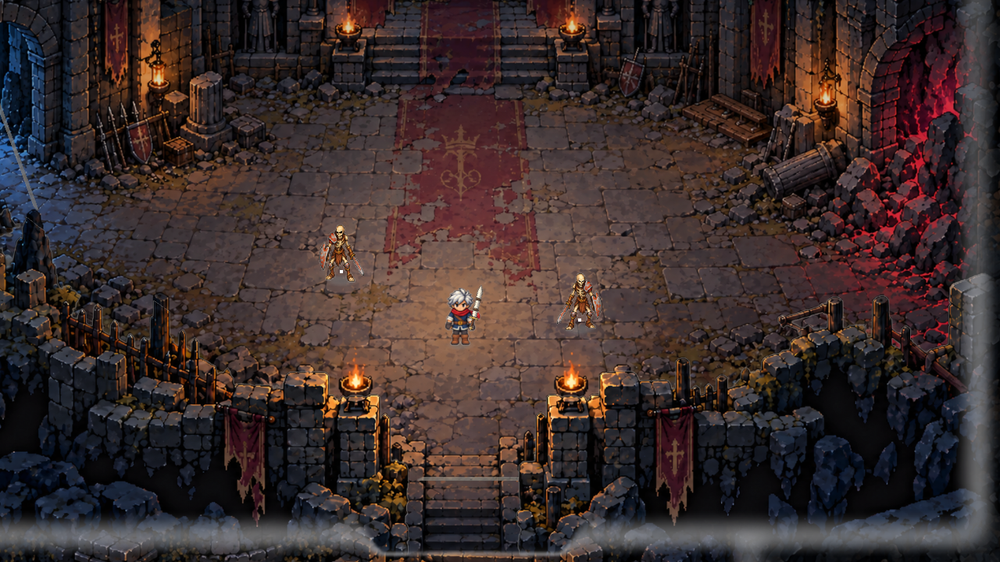
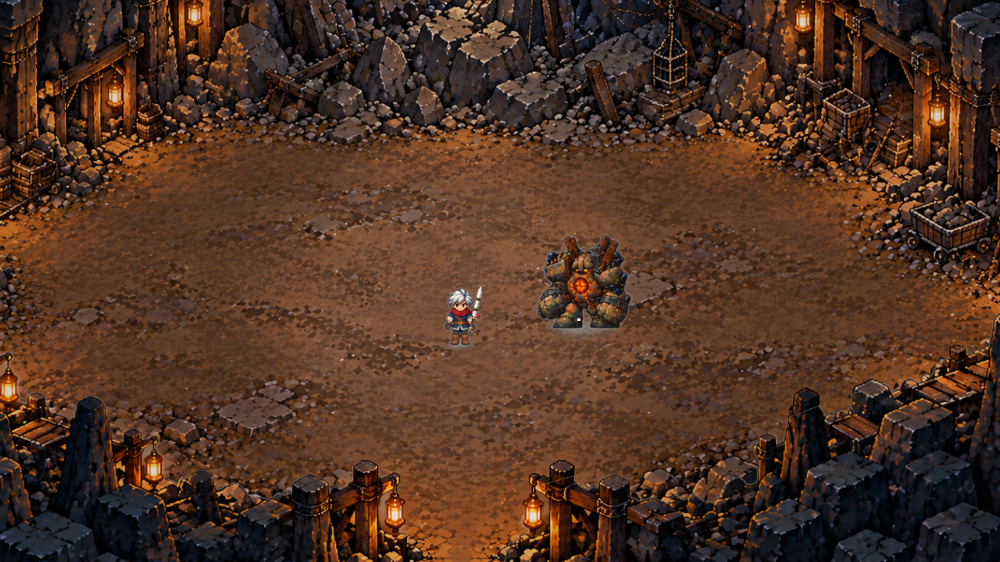
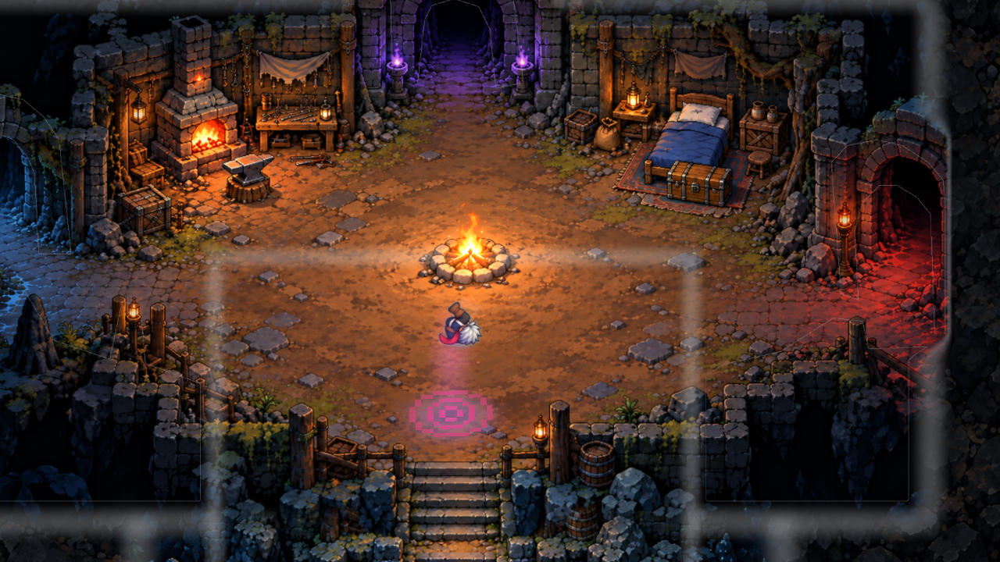
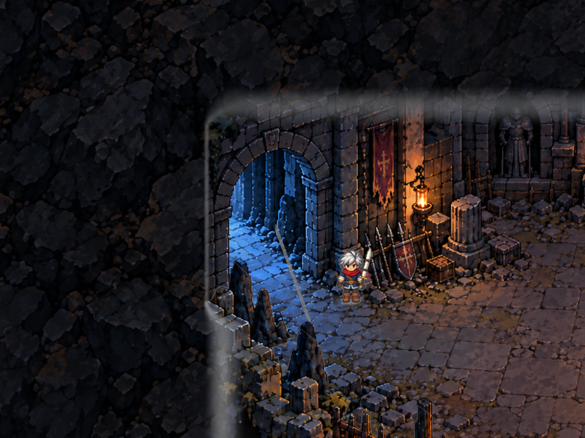
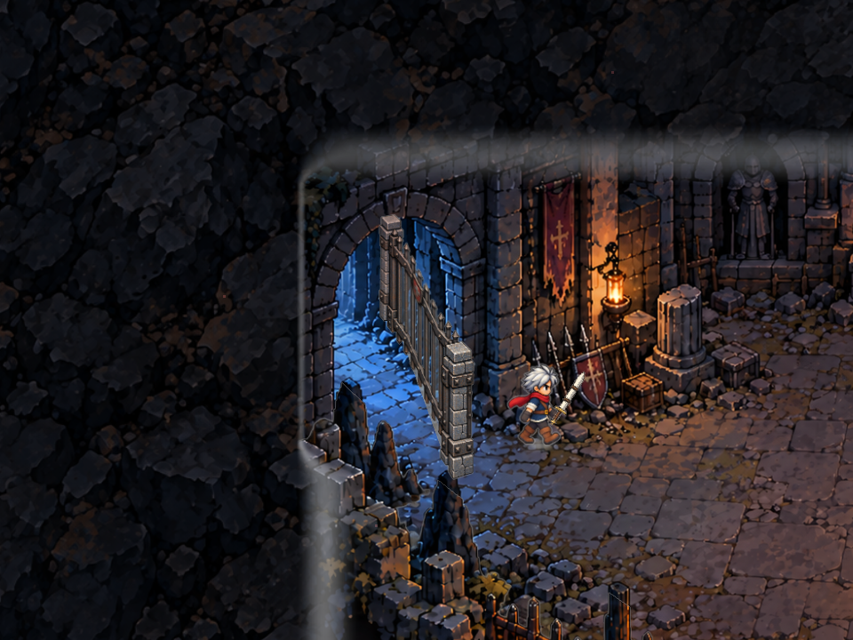
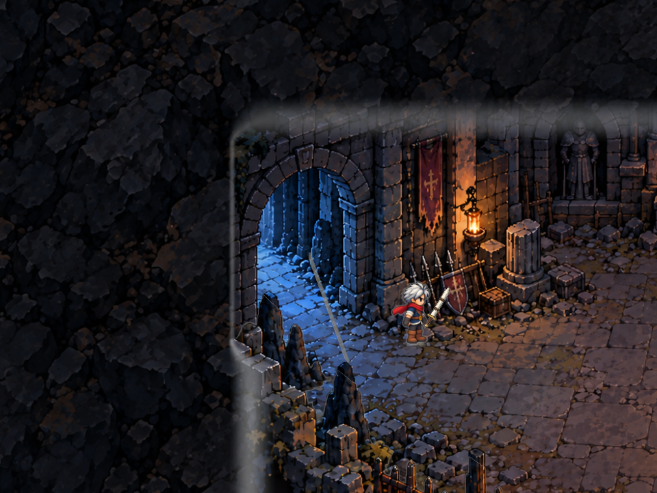

# 캐릭터 가독성·전투방 진입 — 2026-10-22

사용자가 선택한 개선안 1·2만 반영했다. 실제 Java 게임의 용사·적 렌더링과 전투방 문 동작을 수정했다.

## 1. 배경 속 캐릭터 가독성

용사·잡몹·보스 실루엣 바깥에 0.8 월드 픽셀의 낮은 불투명도 윤곽을 넣고, 실루엣 안쪽 명암을 조금 보강했다. 밝은 바닥에서는 어두운 윤곽, 어두운 배경에서는 안쪽 대비가 형태를 드러낸다. 기존 광원·앞쪽 가림·피격 색·소환 투명도를 그대로 적용한다.

발밑은 넓고 옅은 그림자와 작은 접촉 그림자로 나눴다. 박쥐는 더 작고 옅은 공중 그림자를 사용한다. 걷기·공격 자세·보스 동작 시트와 구르기 자세 혼합에도 같은 처리를 적용했다. 원본 그림·캐릭터 크기·발 좌표·충돌 범위·카메라 배율은 바꾸지 않았다.

| 이전 (`cc1c4b0`) | 변경 후 |
|---|---|
|  |  |

## 2. 문을 완전히 지난 뒤 전투 시작

기존에는 모든 문과의 직선거리로 전투 시작을 판단했다. 넓은 문 앞에서 옆으로 걷기만 해도 이 거리를 벗어날 수 있었다. 이제 실제 들어온 문의 **안쪽 방향 진행 거리**를 확인한다. 안전 도착 지점에서 반 칸 더 들어가며, 문턱에서 최소 2.6칸 떨어지고 다른 문의 닫힘 범위에도 발이 겹치지 않을 때 잠근다. 이때 적이 소환된다.

도착 직후에는 돌아갈 수 있다. 같은 방을 나왔다가 다른 문으로 다시 들어올 때도 진입 기준을 갱신한다. 문은 0.28초 동안 닫히고 0.36초 동안 열린다. 실제 통행 잠금은 전투 시작과 해제 시점에 즉시 반영한다.

| 던전 | 닫힘·열림 소리 |
|---|---|
| 광산 | 낮은 진동과 마찰음 |
| 성채 | 낮은 충격음과 짧은 금속 울림 |
| 탑 | 짧은 마력 음정 변화 |

기존 파형 합성 방식으로 추가했다. 닫힘은 내려가는 음, 열림은 가벼운 올라가는 음으로 구분한다. 웨이브 사이에는 문이 열리지 않으며 마지막 웨이브의 마지막 적을 처치하면 열림 소리와 ‘방을 정리했다 · 길이 다시 열렸다’ 안내가 나온다. 보스는 기존 결과 안내를 사용한다.

| 도착 직후 — 퇴각 가능 | 안쪽으로 진입 — 전투 잠금 | 처치 후 — 통행 재개 |
|---|---|---|
|  |  |  |

## 검증

- Java 17: `:core:test :lwjgl3:dist`, **121개 테스트 / 실패 0 / 오류 0**.
- 새 회귀 검증: 연결된 모든 전투방 입구의 안전 도착·진입, 네 방향 문, 넓은 문 앞 옆걸음, 진입 전 동굴로 퇴각, 한 마리 남았을 때 잠금 유지, 던전별 다중 웨이브·단발 효과음·해제.
- 실제 LWJGL 렌더: 변경 전후 각각 10화면(세 던전 잡몹·세 보스·캠프·구르기), 세 던전 문 동작 8단계씩 24화면.
- 캡처 검수 중 발견한 GPU 밉맵 경계선은 텍스처를 읽기 전 조각별로 조기 반환하던 셰이더 흐름을 수정해 제거했다. 자세 시트의 이웃 칸을 읽지 않도록 UV도 제한했다.
- 원본 PNG를 편집·재확대하지 않았다. 검수 화면은 실제 렌더의 원본 PNG다.
- 자동 검증과 고정 장면 렌더 기준이다. 실제 플레이에서 효과음 음량과 윤곽 강도의 최종 취향 조정은 가능하다.

`ReadabilityCapture.java`, `GateEntryCapture.java`는 숨긴 LWJGL 창과 별도 QA 저장 폴더를 사용한다. 실행 JAR을 클래스 경로에 두고 JDK 17로 컴파일한 뒤, 첫 번째 인수로 출력 폴더를 지정한다. 사용자 저장 파일은 사용하지 않는다.
