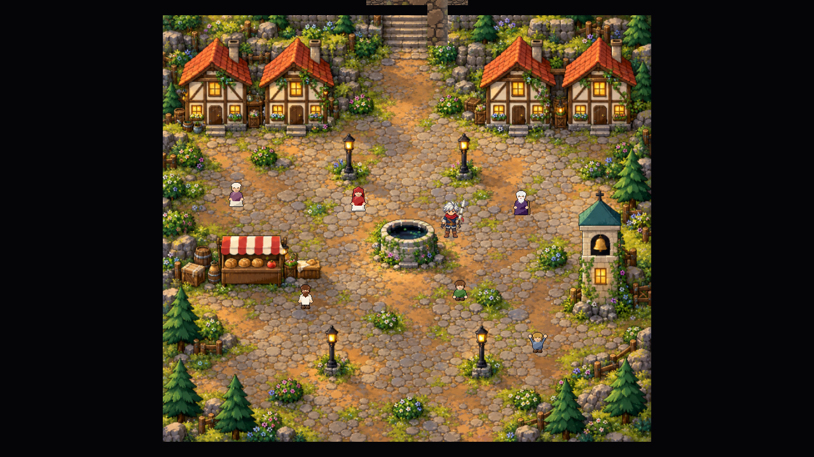
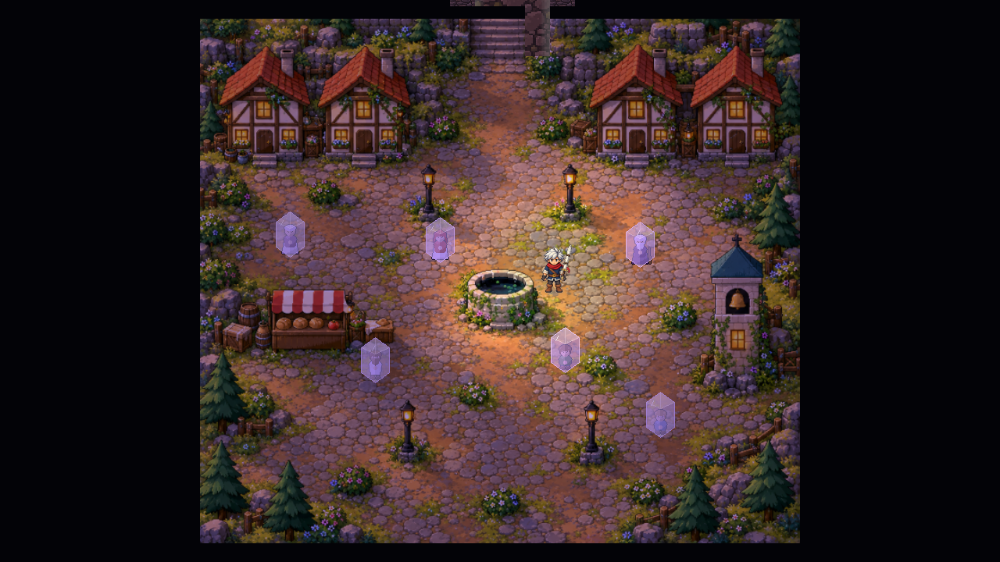
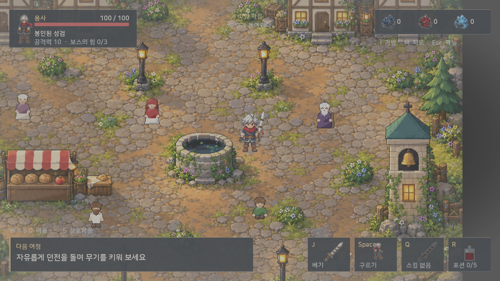
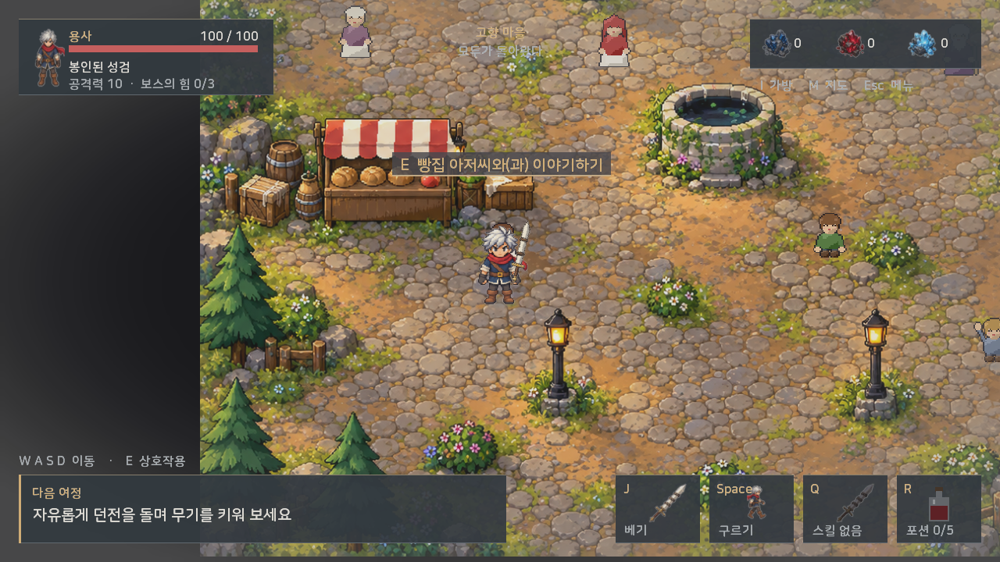
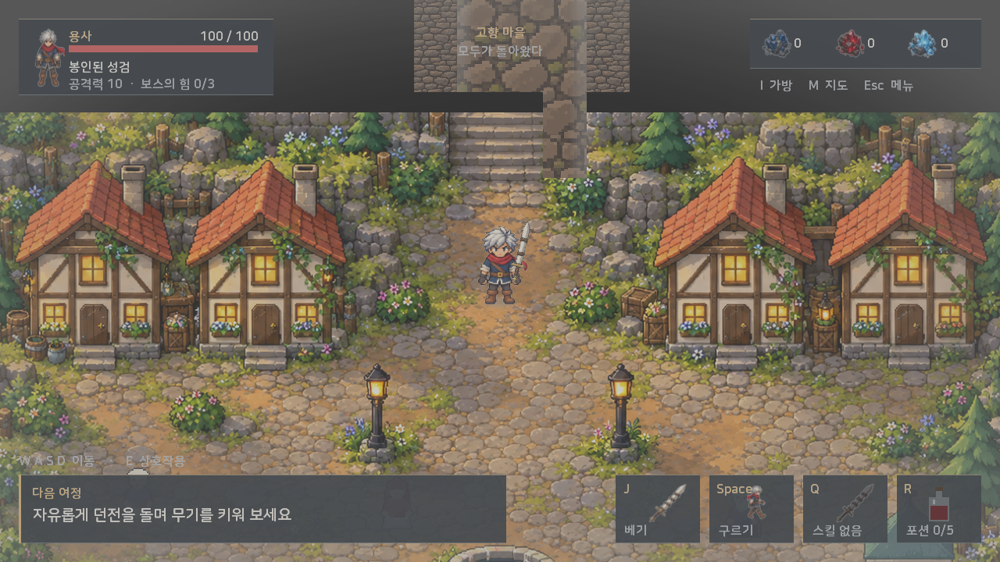

# 묶음 A 진행: 고향 마을과 흰머리 용사

기준: 팀 통합 PR #6이 병합된 `main` (`ab712f2`). 2026-10-15 사용자가 보스 규격 문제는 보류하고 마을부터 마무리하도록 요청했다. **A 전체 완료가 아니다.** 이 PR에 A2~A4 보스 작업을 나중에 이어 붙인다.

## 적용 내용

- A5: `assets/scenes/team/village.png`에 낮 풍경의 마을을 추가하고 `natural-room-scenes.json`의 `village` 장면에 연결했다. 기존 임시 그림은 이력/참고용으로 보존한다.
- 네 집, 북쪽 계단, 우물, 빵집 노점, 종탑, 가로등 네 개와 가장자리 소나무 배치를 살렸다. 주민이나 수정 감옥은 배경에 그리지 않았다.
- 바닥 경계와 20개 고정물의 충돌 다각형을 새 그림에 맞췄다. 나무 꼭대기·꽃밭 전체를 장애물로 삼지 않고 바닥의 고정물에 맞춘다. 이전 임시 데이터의 주민 위치 장애물은 제거했다.
- 마을 사람 여섯 자리, 북쪽 출구 `(0.50,0.06)`, 입장 위치 `(0.50,0.17)`, 24타일 마을 폭, 맵 링크는 유지한다.
- A1: 게임용 및 메뉴용 용사 시트의 머리 색을 흰색/은색으로 바꿨다. 두 시트 모두 1536×1024 RGBA, 기존 UV·파일명 유지. 6포즈와 붉은 목도리·남색 옷을 유지한다. 생성 편집이므로 비머리 픽셀이 완전히 동일하다는 뜻은 아니다. 50% 알파 경계 기준 기존 포즈의 외곽/발 차이는 최대 2px이며 게임용 500px 칸에서 월드 0.24px 이하다.

**후처리 확대 없음:** 마을 원본은 실제 생성된 1340×1174이다. 마을 명세는 약 8:7 비율에서 크기를 변경할 수 있으므로 `pixelWidth/pixelHeight`를 실제 값으로 설정했다. 그림 파일 자체는 늘리거나 줄이지 않았다. 게임은 기존 방식으로 월드 크기에 그린다. 이전 비율 대비 월드 높이 차이는 약 0.86px이다.

## 검증

- Java 17 `:core:test :lwjgl3:dist` 성공. 84개 테스트 통과, 실패·오류·건너뜀 0. 기존 지도·통로 연결 검사 포함.
- 외부 QA 실행기 [VillageCapture.java](VillageCapture.java)로 게임의 `Room.allowsFoot` 판정을 사용했다. 발 반경 10, 4 월드 픽셀 간격의 경로 탐색으로 입장점에서 주민 6명과 북쪽 출구에 접근할 수 있음을 확인했다. 우물 중심은 통과할 수 없다.
- 실제 Java GL 렌더러로 아래 5장을 캡처했다. 별도 세이브 디렉터리와 숨김 창을 사용한다. 게임 소스 `core/`, `lwjgl3/`는 바꾸지 않았다.
- 모든 배경 이미지 픽셀과 충돌선이 자동으로 일치함을 보장하는 검사는 아니다. 다각형은 그림을 보고 수동으로 작성했고, 경로·고정물 및 화면을 확인했다.







실행 방법(저장소 루트, Java 17):

```text
javac -encoding UTF-8 -cp lwjgl3/build/libs/yongsa-game-0.1.0.jar -d <QA classes> design/art-batch-a/VillageCapture.java
java -cp "lwjgl3/build/libs/yongsa-game-0.1.0.jar;<QA classes>" VillageCapture <출력 폴더>
```

## 남은 것

- **A2~A4 보스 3종은 보류.** 2048×1280을 요청했지만 1586×992로 출력됐다. 골렘 재생성도 같은 규격이었다. 요구된 256px 칸·발 위치를 충족하지 못하므로 게임 파일은 교체하지 않았다. 이는 생성기의 최대 해상도를 확인했다는 뜻은 아니다.
- 마을 주민/수정 감옥은 기존 임시 그림 그대로다. B에서 화풍을 맞춘다.
- 북쪽 계단 위 통로는 현재 게임의 자동 생성 타일로 그려진다. 캡처에서 보이는 통로 타일과 계단의 화풍 차이/덧그림 경계는 기존 렌더러 동작이며 이 미술 PR에서 코드로 고치지 않았다. 통로를 다듬을 때 함께 확인해야 한다.
- 앞쪽 나무·기둥의 동적 가림은 기존 방과 마찬가지로 별도 가림 레이어 연결이 필요하다(D).
- B/C/D는 미완료이며 이 PR은 그 묶음의 완료를 뜻하지 않는다.

이미지는 built-in `image_gen` 편집으로 만들었다. 입력·최종 프롬프트와 보류 사유는 [PROMPTS.json](PROMPTS.json), 파일 규격/해시는 [asset-check.json](asset-check.json)에 보존한다.
