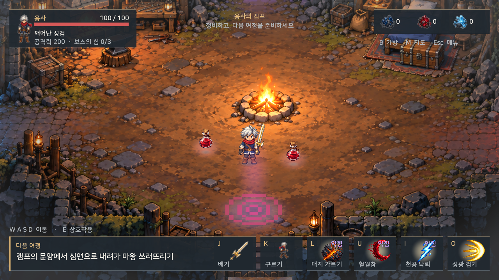
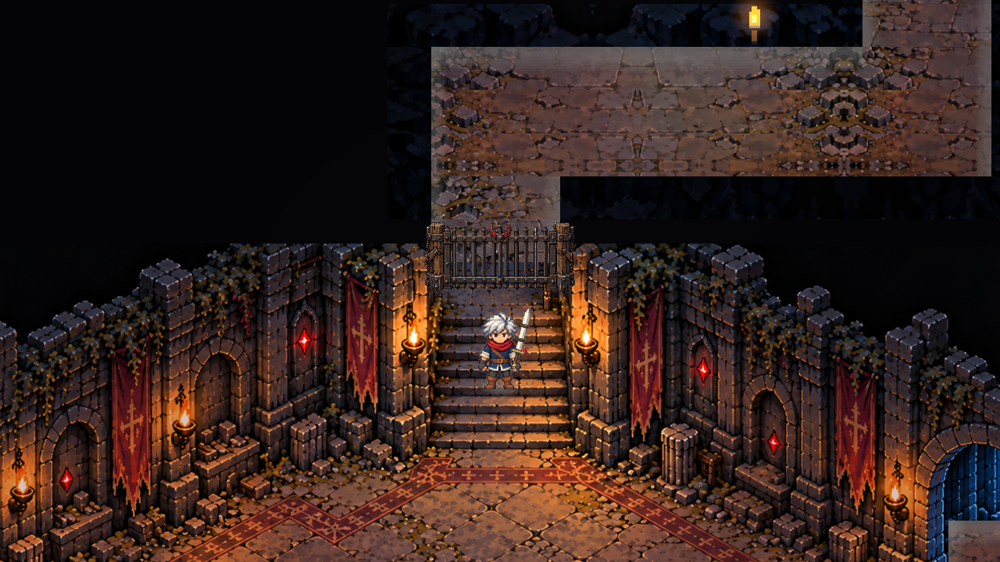
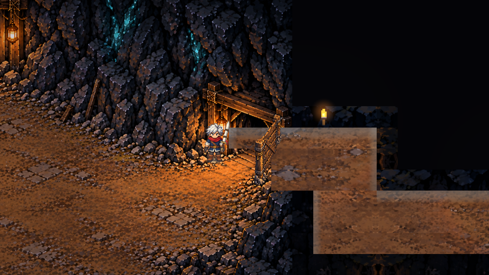

# 최신 A 묶음: 출구 · 스킬 아이콘 · 포션

2026-10-15 `claude/team-integration-m9u9aa`의 `99766c1`에 올라온 최신 ART_REQUESTS 기준이다. 이전 A1 흰머리 용사/A5 마을은 이미 팀 브랜치에 포함되어 있다. 이번 추가분은 새 A1/A5/A6이며, 보스 원본 3장은 그대로 둔다.

## 적용 파일

| 파일 | 용도 | 실제 원본 크기 |
|---|---|---|
| `assets/sprites/gate_LEFT.png`, `gate_RIGHT.png`, `gate_TOP.png` | 판자·쇠창살·마력 장벽 정면 | 1774×887 |
| `assets/sprites/gate_LEFT_side.png`, `gate_RIGHT_side.png`, `gate_TOP_side.png` | 같은 문들의 오른쪽 출구용 옆면 | 793×1983 |
| `assets/sprites/skill/icon_{cleave,crescent,strike,beam}.png` | L/U/I/O 스킬 아이콘 | 1254×1254 |
| `assets/sprites/potion.png` | 바닥 회복 포션 | 1086×1448 |

내장 image_gen 생성 원본 PNG를 그대로 복사했다. 확대·축소·크롭·색 보정 등 파일 후처리를 하지 않았다. 생성기는 프롬프트의 요청 해상도와 다른 크기를 반환했다. 문은 요청된 가로세로 비율, 아이콘은 정사각형, 포션은 3:4를 유지하며, 최신 코드가 전체 텍스처를 정해진 월드/HUD 크기로 그리므로 프레임 분할 오류 없이 사용할 수 있다. 아이콘 파일 크기는 요청서의 64/128 예시보다 크다. 게임 표시 크기는 기존 64px이다. 원본 메모리 사용은 11장 합계 RGBA 기준 약 66MiB이며 경량화는 별도다.

문·포션·아이콘은 모두 진짜 알파 채널을 가진다. `asset-check.json`에 크기·알파 분포·SHA256을 기록했다. 투명 효과를 위해 부분 알파도 보존했다. 문은 출구의 실제 폭에 맞춰 그려지고 옆면은 왼쪽 출구에서 런타임 반전된다. 게임의 문 잠금/해제·피격·스킬 효과 코드는 바꾸지 않았다.

## 실제 게임 확인

Java17 `:core:test :lwjgl3:dist` 성공. 최신 팀 기준 테스트 91개 통과. `PriorityArtCapture.java`는 외부 QA 실행기로 생산 코드를 수정하지 않으며 격리된 저장 경로를 쓴다. 전투 잠금 출구 6종과 포션/HUD 사용 가능·불가 상태를 실제 WorldRenderer/Hud로 그려 검수했다. 전투 플레이 녹화가 아닌 고정 상태 캡처다.

캡처에서 보이는 방 입구 바닥의 직사각형 덧그리기는 기존 통로 렌더러의 동작이다. 문 그림에 포함된 바닥이 아니다. 방과 통로 잇기 조각은 D 묶음에서 따로 다룬다.

## 남은 A 보스

골렘·기사·마왕 리치의 2048×1280 / 40프레임 교체본은 사용자 지시에 따라 보류 중이다. 앞서 나온 1586×992 원본을 늘여 넣지 않는다. 새 문서에서 리치가 최종 마왕으로 바뀌었으므로, 이전의 하늘색 탑 사제 컨셉을 그대로 적용해서는 안 된다. 마왕 2페이즈는 `boss_lich2.png`가 새 계약이다.

프롬프트는 `PROMPTS.json`, `PROMPTS-side.json`, `PROMPTS-icons.json`에 보존했다. 모두 내장 image_gen을 사용했고 API/CLI 생성은 사용하지 않았다.
