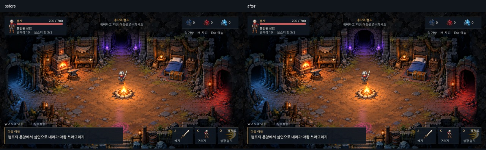
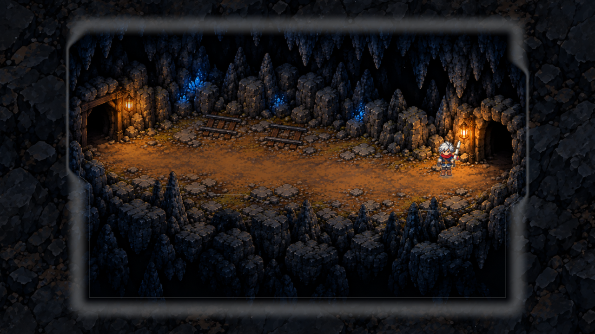
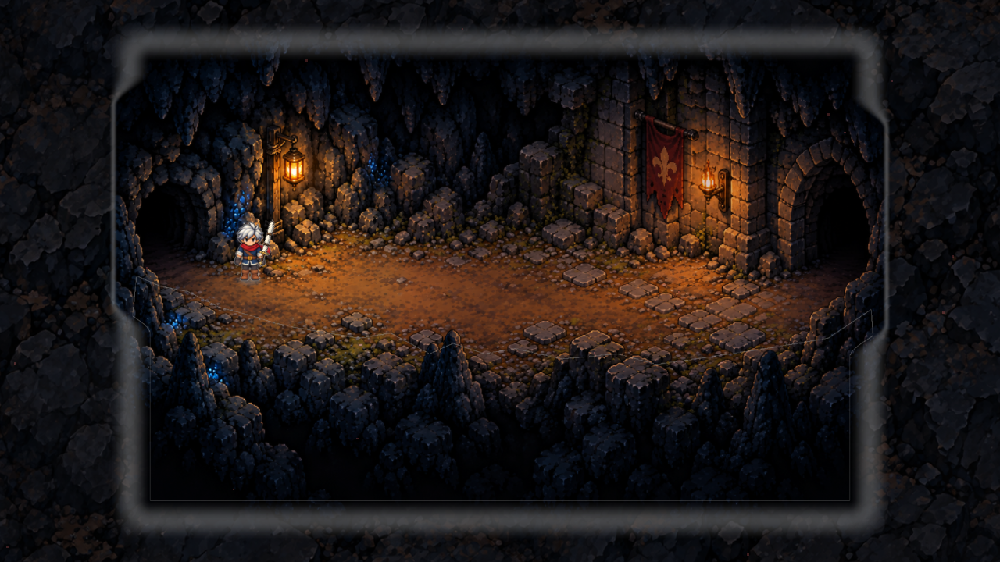
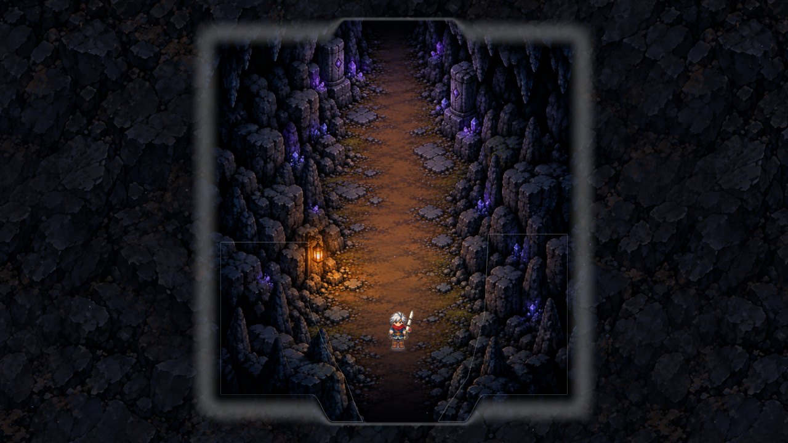

# 캠프 입구 문틀과 방향별 동굴 — 2026-10-21

캠프 입구가 바위에 잘려 보이던 원인은 별도 공간으로 전환하는 문이 가장자리 보호 대상에서 빠진 것이었다. `RoomJoinMask`가 외부 통로가 있는 문만 보호하고 있어서, 동굴 연결로 바뀐 세 입구의 기둥과 아치까지 넓게 흐려졌다. 전환문도 보호하고, 이동 방향과 그림의 가장자리가 다른 캠프 좌우 문은 실제 그림 가장자리를 기준으로 처리한다. 카메라 배율이나 캠프 원화·동선은 바꾸지 않았다.

세 동굴은 각각 다른 원화와 이동 방향을 사용한다. 전투 없는 짧은 공간을 직접 걷고, 어두운 끝을 통과하면 기존 던전으로 이어지는 구조와 양방향 왕복은 유지한다.

| 캠프 입구 | 동굴 안 이동 | 다음 맵을 암시하는 요소 | 그림 |
|---|---|---|---|
| 왼쪽 광산 | 오른쪽 → 왼쪽 | 낮은 레일 조각, 푸른 광석, 목재 지지대 | `cave-mine.png` |
| 오른쪽 성채 | 왼쪽 → 오른쪽 | 점차 나타나는 석조 벽·포석, 붉은 깃발·철제 횃불 | `cave-citadel.png` |
| 위쪽 탑 | 아래 → 위 | 보라색 수정, 문양이 있는 부서진 기둥 | `cave-tower.png` |

각 원화에 맞춰 바닥 경계·입구·도착 위치·앞쪽 바위 가림을 새로 지정했다. 좌우 통로는 24타일 폭, 위쪽 통로는 20타일 폭이며, 출입구 이름은 방향과 독립적인 `entry`·`exit`다. 장면은 29종, 배치된 방 28개·외부 통로 20개·양방향 별도 공간 연결 6개로 연결 수는 유지한다.

## 검증

- Java 17, `:core:test` **114개 통과**, `:lwjgl3:dist` 성공. 한글 경로의 테스트는 기존 로컬 ASCII classpath init script를 사용했다.
- 세 방향 실제 이동 입력·왕복·전환 이벤트·동굴 저장/재개를 검증했다. 성채의 완만한 바닥 굴곡은 중앙 바닥 → 문 앞 → 문 안 순서로 걸어 검사한다.
- 캠프 좌우 기둥과 위쪽 아치의 불투명도 회귀 테스트를 추가했다. 기존 방의 가장자리 혼합·잠금·통로 테스트도 통과했다.
- 기존 빌드와 새 빌드에서 실제 `GameScreen`/HUD 및 `WorldRenderer` 화면 각 10장. 캠프 전후 비교 4장, 새 동굴 인게임 화면과 이동 경계 그림 3종을 `review/`에 기록했다. 검수용 저장 폴더만 사용했다.

맵 버전은 10이다. 기존 저장의 장비와 진행 상태는 유지되지만, 기존 맵 마이그레이션 규칙에 따라 이어하기 위치는 캠프로 돌아가고 광맥 위치·바닥 포션이 초기화된다. 전체 수동 플레이·밸런스 재검수 결과는 아니다.

## 제작·재현

- [세 원본과 해시](generation.json), [최종 생성 프롬프트](prompts.json). **내장 image_gen** 사용. 광산·성채 1536×1024, 탑 1254×1254. 생성된 PNG를 그대로 `assets/scenes/natural-v1/`에 복사했다.
- `install.py`: 선택한 원본과 바닥·출입구·가림 데이터를 설치한다. 이전 `full-map-repair/install_tunnels.py`를 재실행했다면 이 스크립트를 마지막에 실행해야 한다.
- `CaveDirectionCapture.java`: 해당 버전의 배포 JAR로 컴파일한 뒤 실행한다. 맵 버전 상수가 있으므로 JAR를 바꾸면 검수 도구도 다시 컴파일한다.
- `build_review.py`: 실제 캡처로 전후 모음과 이동 경계 진단만 만든다. 게임 원화는 후처리하지 않는다.

세로 공용 동굴 `dark-cave-passage.png`는 이전 시안 기록으로 보존하고, 활성 맵에서는 세 새 장면으로 대체했다.
