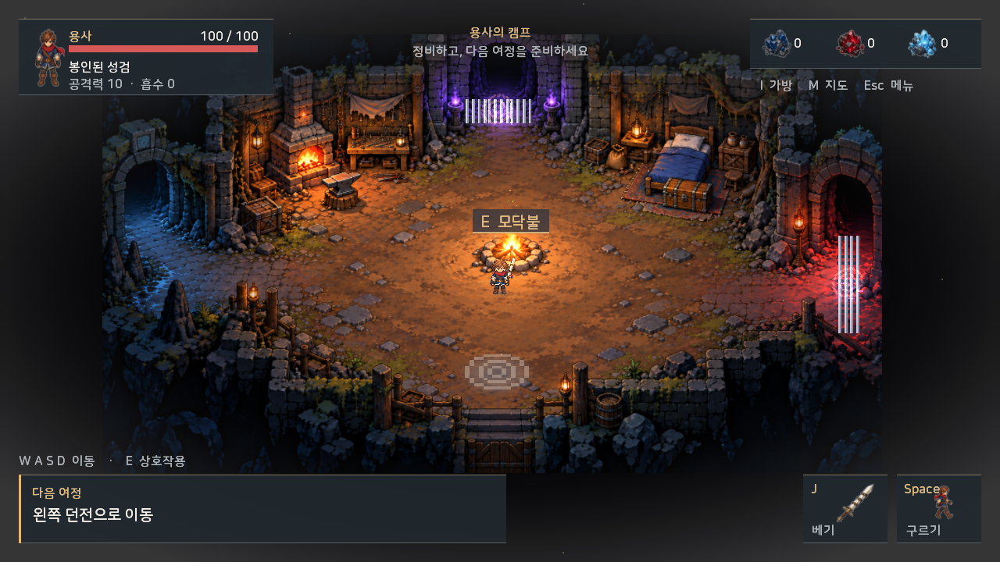
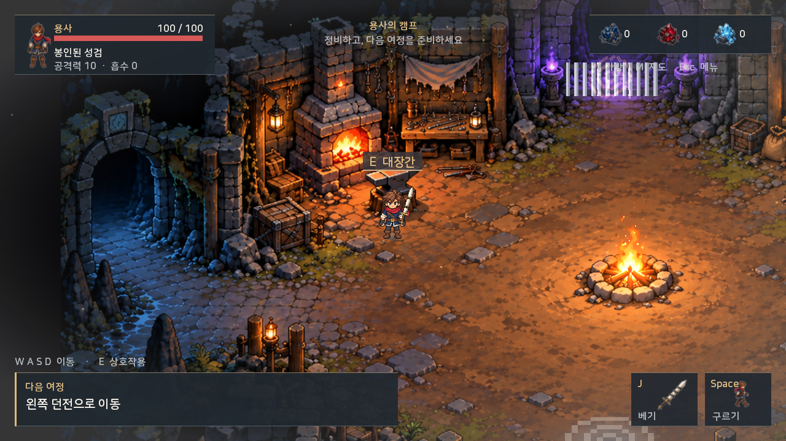
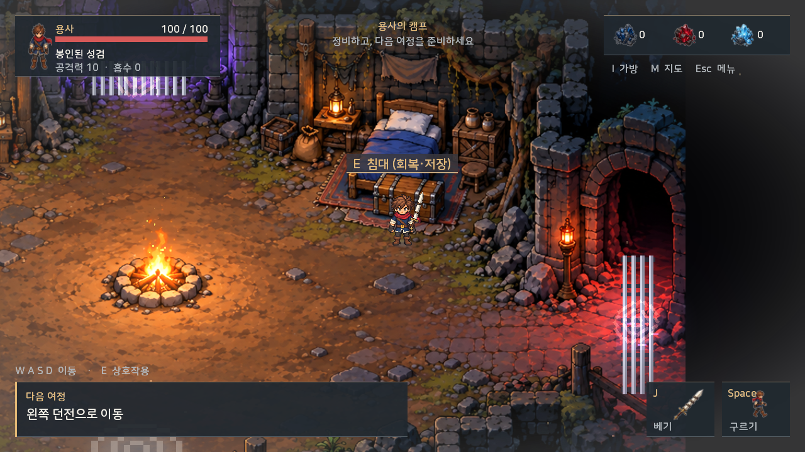

# 중앙캠프 실제 게임 적용

중앙캠프를 사각 타일 방에서 자연스러운 폐허 안뜰로 교체했다. 이동 경계, 시설 상호작용, 세 던전 출입구, 귀환·이어하기 위치까지 연결했다.

전경은 확인을 위해 65% 배율로 촬영했다. 게임 기본 배율 115%와 카메라 조작은 그대로다. 아래는 기본 배율의 실제 플레이 화면이다.

## 적용 파일과 좌표

- `assets/scenes/natural-v1/central-camp.png`: 1672×941 배경. 승인 캠프 참고 그림을 built-in imagegen으로 편집했다. 프롬프트는 [imagegen-prompt.txt](imagegen-prompt.txt).
- `assets/data/map.json`: `CAMP`를 `central-camp` 장면, 너비 32타일에 연결한다.
- `assets/data/natural-room-scenes.json`: 이미지 좌상단 (0, 0), 우하단 (1, 1). 바닥 다각형, 단단한 물체의 바닥 면적, 시설 중심·상호작용 크기, 시작점과 입구를 정의한다.
- `facilities[].baked`: 대장간·침대·모닥불은 배경에 포함돼 기존 소품 그림을 다시 그리지 않는다. 봉인 문양은 게임 진행에 따라 동적으로 표시한다. 시설 위치는 타일에 반올림하지 않는다.
- 씬 시설의 충돌은 `blocked` 다각형이 담당한다. 타일 소품의 충돌 사각형을 중복 적용하지 않는다.

| 시설 | 기능 |
|---|---|
| 왼쪽 위 모루 | E → 기존 제작·강화 창, 망치질 연출 유지 |
| 오른쪽 위 침대 | E → 회복·저장·기존 방 초기화 규칙 |
| 중앙 모닥불 | 접근 안내·기존 캠프 회복, 불티와 맥동하는 빛 |
| 아래쪽 문양 | 세 보스/봉인 해제 진행에 맞춰 심연 진입 |
| 왼쪽 파란 입구 | `CAMP.LEFT ↔ L1.east` |
| 오른쪽 붉은 입구 | `CAMP.RIGHT ↔ R1.west`, 왼쪽 보스 후 개방 |
| 위쪽 보랏빛 입구 | `CAMP.UP ↔ T1.south`, 오른쪽 보스 후 개방 |

아래 계단은 걸을 수 있고 끝에는 닫힌 나무 울타리가 있다. 모든 던전 문 잠금은 런타임 진행 상태로 결정한다.

## 기존 세이브와 코드

던전 배치·광맥은 바꾸지 않아 맵 버전을 올리지 않는다. 저장 위치가 새 캠프의 모닥불·벽과 겹치면 기존 유효 위치 검사로 새 시작점에 이동한다. 유효한 위치와 무기·보스·던전 기록은 유지한다. 심연 저장, 사망, 귀환도 새 캠프 시작점을 사용한다.

`GameSession.checkDoors()`는 이전 프레임의 방이 아니라 실제 발 위치의 방을 사용한다. 좌표를 옮겼을 때 이전 캠프 출구 판정이 던전까지 연장되어 잘못 이동시키는 문제를 방지한다.

## 검증

- `:core:test`: 전체 64개 통과. 이미지 크기, 바닥 연결성, 모든 문 도착·진입 지점, 실제 용사 크기의 시설 접근, 대장간 열기·침대 저장·심연 진입, 세이브 복귀를 검사했다.
- `:lwjgl3:dist`: Java 17 빌드 성공.
- `VisualSmokeLauncher <출력폴더> camp`: 실제 GL 캠프 화면을 재현한다. 사용자 세이브와 분리된 경로를 사용한다.
- 일반 실행 캡처의 오래된 보스방 ID `T7`을 현행 `T6`으로 갱신했다.

Windows 한글 경로에서 테스트 JVM이 실패하는 환경은 작업용 ASCII 클래스패스 init script로 검증했다. 이 스크립트는 로컬 검증 설정이며 게임 런타임 의존성이 아니다.

## 후속 시각 작업

사용자 요청에 따라 중앙캠프를 먼저 전달한다. 용사 외곽선·색조·픽셀 밀도를 배경과 맞추는 작업은 후속 변경이다. 배경 소품은 고정 그림이고 불티·조명·문양·잠금 표시는 동적이다. 소품 뒤에서 용사의 일부가 가려지는 정밀 전경 레이어는 별도 작업이 필요하다.
