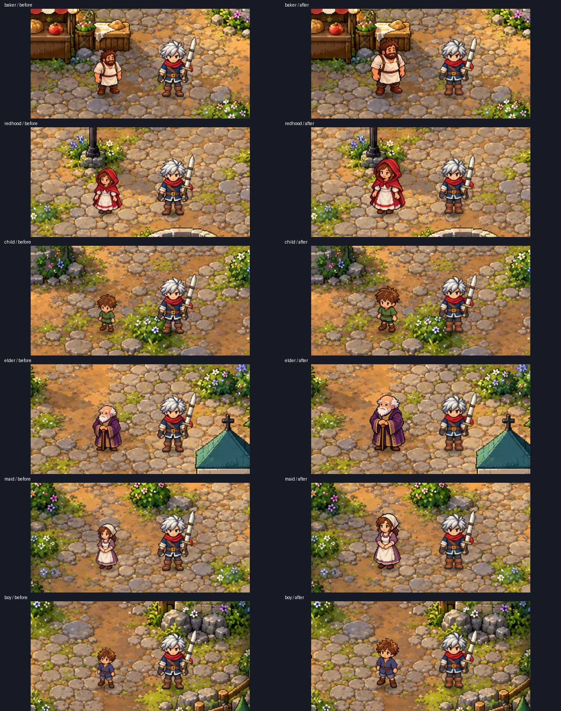
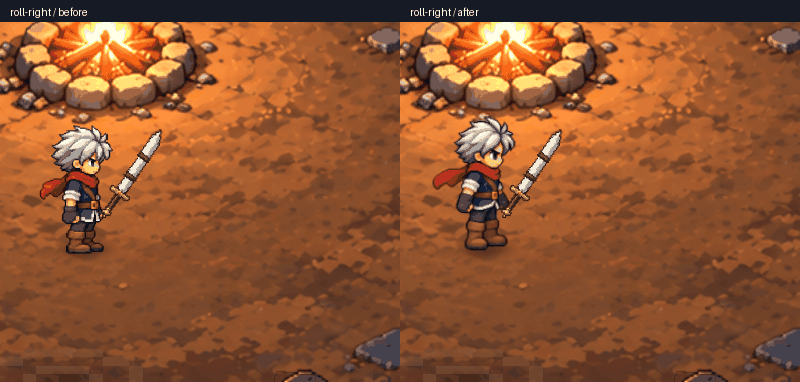

# 캐릭터 비율과 모션 — 2026-10-19

기존 `haeseong/game`의 광산 연결 개선(`1b516b3`) 위에 이어서 적용했다. NPC의 표시 크기와 용사의 동작을 함께 다듬었다.

## 비율



- 성인 NPC의 실제 몸높이는 약 47px에서 **58px**로 변경했다. 용사의 새 자세는 약 58~60px다.
- 아이는 원본의 작은 비율을 유지해 약 48px다. 성인/아이를 같은 키로 늘리지 않았다.
- 주민·수정 감옥·그림자를 같은 배율로 맞췄다. NPC 좌표, 바닥 충돌, 상호작용 거리는 그대로다.
- 구출 후 기쁨 동작은 1.6초마다 연속으로 크게 뛰던 방식에서 4.8초 주기의 작은 한 번의 뛰기로 바꿨다. 두 자세 사이를 보간한다.

[수정 속 NPC 비교](npc-trapped-comparison.jpg) · [기쁨 동작 비교](cheer-baker.gif)

## 용사 모션



- 흰머리·빨간 목도리·남색 옷을 유지한 **걷기 18자세, 구르기 18자세**를 제작했다. 앞/뒤/오른쪽은 각각 6프레임이며 왼쪽은 대칭으로 표시한다.
- 걷기는 실제 발이 이동한 거리로 재생한다. 벽에 막히면 멈추고, 느려지면 발걸음도 느려진다. 두 높이를 갑자기 바꾸던 상하 움직임은 연속 곡선으로 바꿨다.
- 구르기는 웅크리기 → 몸 말기 → 회전 → 착지 자세를 사용한다. 이동 방향을 유지하며, 잔상도 해당 구르기 자세를 따른다.
- 출발/착지와 NPC 자세 전환은 두 그림을 한 번에 섞는다. 겹치는 몸 부분이 반투명해지지 않도록 알파를 처리한다.
- 기본 공격·채굴·스킬의 검은 준비 → 타격 → 복귀 곡선을 따른다. 기존처럼 끝에서 갑자기 기본 각도로 돌아가지 않는다. 몸 찌그러짐과 검 확대도 시작/끝에서 자연스럽게 0으로 돌아간다.
- 구르기 이동 곡선을 프레임 구간별로 적분해 **30/60/144fps 모두 설정 거리 3칸(96px)**를 이동하게 했다. 입력 프레임의 추가 걷기와 마지막 프레임의 초과 이동을 제거했다.
- 구르기 시간 0.32초, 무적 0.24초, 추가 쿨타임 0.55초 및 공격 피해·판정 시점은 기존 값을 유지한다. 구르기를 시작하면 진행 중인 채굴 자세를 취소한다.

[걷기 비교](walk-right.gif) · [앞 방향 구르기](roll-down.gif) · [공격 비교](attack.gif) · [네 방향 구르기 프레임](roll-directions.jpg)

## 그림과 코드

| 파일 | 역할 |
|---|---|
| `assets/sprites/hero-motion/walk.png` | 걷기/서 있기, 1536×864, 256×288 칸 6×3 |
| `assets/sprites/hero-motion/roll.png` | 구르기, 같은 규격 |
| `HeroMotion.java` | 프레임 선택·검 동작 곡선 |
| `SpriteBlend.java` | 자세 전환 시 불투명한 몸 유지 |
| `WorldRenderer.java` | 표시 크기·발 기준·잔상·NPC 연결 |
| `GameSession.java` | 실제 이동에 맞춘 걷기 시계·일정한 구르기 거리 |

내장 **image_gen**으로 기존 용사를 참조해 투명 배경의 새 자세 시트 2장을 생성했다. [프롬프트와 생성 방식](generation.json), [원본](sources), [프레임 추출·배치 기록](packing.json)을 보존했다. 사용자가 허용한 시트 정규화 범위에서 `repack.py`가 프레임 추출·동일 배율 축소·발 기준 정렬만 수행한다. 웅크린 자세를 키워서 칸에 채우지 않는다.

## 검증과 재현

- JUnit **111개**와 배포 JAR 빌드 통과.
- 새 회귀 검증: FPS별 실제 구르기 거리, 이동 방향·채굴 취소, 벽 앞 걷기 정지, 기본 공격/채굴/스킬의 각도 연결.
- 같은 장면·난수 시드로 수정 전후 NPC 12장과 12개 연속 동작을 비교한다. 60Hz로 게임을 갱신하고 30fps로 화면을 기록했다. 각 동작에는 시작·동작·종료 구간이 포함된다. [캡처 목록](capture-report.json).
- 캡처는 실제 `WorldRenderer`를 사용하며, NPC 상태/위치를 배치하고 스킬·채굴의 표시 타이머를 설정한 검수다. 전체 게임 수동 플레이나 스킬 피해 검수는 아니다.
- 숨겨진 GL 창과 `build/character-motion-qa-save`를 사용해 실제 사용자 저장 파일에 접근하지 않는다.

```powershell
.\gradlew.bat :core:test :lwjgl3:dist --offline --no-daemon
javac -encoding UTF-8 -cp lwjgl3/build/libs/yongsa-game-0.1.0.jar -d build/character-qa design/character-motion/CharacterMotionCapture.java
java -Xmx1536m -cp 'build/character-qa;lwjgl3/build/libs/yongsa-game-0.1.0.jar' CharacterMotionCapture build/character-captures/after
```

선택적으로 두 번째 인자에 `'roll-.*'` 등 정규식을 주면 해당 동작만 확인한다. 이전 화면은 부모 커밋 `1b516b3`의 `WorldRenderer`, `GameSession`, `HeroActor`를 별도 QA 클래스 경로에 컴파일해 같은 캡처 도구로 얻었다. `build_review.py`는 두 버전의 캡처로 비교 GIF/JPG를 만든다. 그림 정규화 도구는 Pillow와 NumPy가 필요하다.
