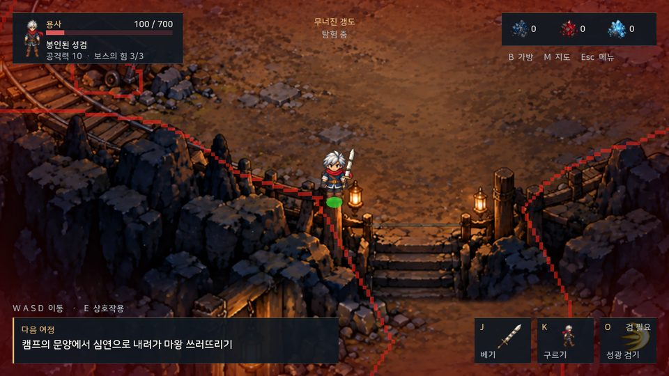
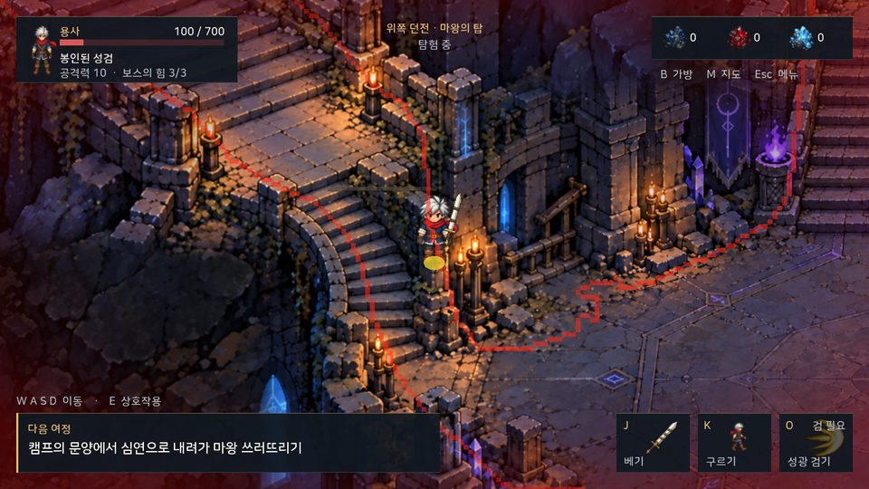
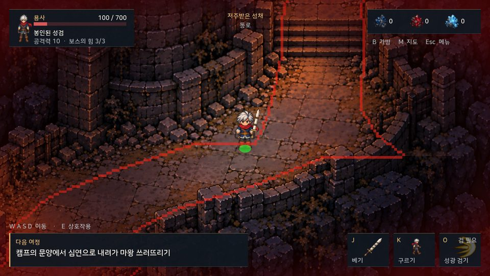

# 충돌 격자 보정 — 2026-10-26

그림은 하나도 바꾸지 않았다. 방·통로·이음 보수 그림의 바닥 다각형을 **4월드픽셀 칸의 충돌 격자 하나**로 굳히고, 이동 판정은 이 격자만 보도록 바꿨다. 낑김과 다음 맵으로 못 넘어가는 문제가 생기던 원인을 줄이는 것이 목적이다.

## 바뀐 것

- **격자 하나로 합친 바닥** (`WorldMap.paintedFree`, `bakeCell`): 예전에는 발 원이 다각형 *하나* 안에 통째로 들어가야 했다. 그래서 방 그림과 통로 그림이 맞닿는 선에서는 양쪽이 다 바닥인데도 막혔다. 이제는 점마다 "보이는 바닥인가"를 그림 순서(이음 보수 → 방 → 이음 가장자리 → 통로)대로 정해 격자에 적는다. 맞닿는 선은 그냥 이어진 바닥이 된다.
- **발 판정**: 발 타원(가로 9, 세로 6)의 가운데와 둘레 16곳이 모두 바닥 칸이어야 한다. 둘레 점이 발과 같이 움직이므로, 곧은 벽을 따라 걸을 때 칸 계단에 걸려 서지 않는다. 칸으로 굳힐 때 생기는 오차만큼 발을 조금 줄여 잰다 (가로 −2, 세로 −4픽셀).
- **닫힘은 그대로**: 닫힌 문, 던전 봉인, 전투 잠금, 광맥·시설 칸은 예전과 같은 코드로 막는다. 통로 칸은 자기 통로를 기억해서, 통로가 닫히면 막힌다.
- **격자는 걷는 곳만 계산**한다. 타일(32px) 하나를 처음 물어볼 때 그 안의 64칸을 만든다.
- **용사 안전장치** (`Physics`): 넉백·밀치기 등으로 발이 막힌 곳에 들어가면 24픽셀 안의 가장 가까운 빈자리로 꺼낸다. 한 방향으로만 걷다 모서리 끝에 걸리면 옆으로 최대 6픽셀 비켜 지나간다. 몬스터 움직임은 바꾸지 않았다.
- **F2: 충돌 격자 보기**. 게임 중 F2를 누르면 이동 경계(빨강)와 용사 발(초록, 막힌 자리면 노랑)을 그림 위에 겹쳐 그린다. 맵을 걸어 다니며 "보이는 벽"과 "실제 벽"이 다른 곳을 찾는 용도다.

## 실제 게임 화면 (F2 켠 상태)





세 번째 화면의 용사 머리 위 가로 경계는 이번 변경으로 생긴 것이 아니다. `exit-R5-R6` 이음 보수 그림의 바닥 다각형이 포장 바닥 일부를 빼고 있어서 예전에도 막히던 자리다. 다각형 데이터를 고칠 후보이며, F2가 이런 곳을 찾게 해 준다.

## 예전 판정과의 비교

맵 전체를 4픽셀 간격으로 찍어 용사 발(9×6)이 설 수 있는지 비교했다 (모든 던전·봉인이 열린 상태).

| | 설 수 있는 점 |
| --- | --- |
| 예전 다각형 판정 | 476,770 |
| 새 격자 판정 | 503,964 (+5.7%) |
| 새로 막힌 점 | 1,533 (0.3%) |
| 예전에만 막히던 12픽셀 이하의 좁은 띠 | 405점, 165곳 |

늘어난 대부분은 발 세로 폭을 줄여 벽에 2~4픽셀 더 붙을 수 있게 된 가장자리다. 마지막 줄은 양쪽이 다 바닥인데 그 사이만 막혀 있던 곳으로, 진짜 벽이라면 발 반지름 때문에 최소 18픽셀 띠가 생기므로 그림끼리 맞닿는 선의 **투명한 벽**으로 본다.

## 검증

- `gradlew :core:test :lwjgl3:dist`: **123개 테스트 통과** (기존 121개 + 새 2개), 배포 JAR 빌드 성공.
- 새 테스트 `CollisionGridTest`
  - 길목 20개 모두를 실제 `Physics.move` 걸음으로 처음부터 끝까지 지나간다.
  - 벽 속으로 밀린 용사가 다음 이동에서 가까운 바닥으로 돌아온다 (예전 코드에서는 실패한다).
- 위 화면은 `CollisionCapture.java`로 숨긴 창에서 찍었다. 별도 검수 저장 폴더를 쓴다.
- 자동 테스트와 화면 캡처까지만 했다. 처음부터 엔딩까지의 수동 플레이는 하지 않았다.

## 캡처 다시 찍기

`CollisionCapture.java`를 `lwjgl3/src/main/java/com/yongsa/lwjgl3/`에 복사해 빌드한 뒤 실행한다. 인자는 저장 폴더와 `이름:x,y` 목록이다.

```
java -cp lwjgl3/build/libs/yongsa-game-0.1.0.jar com.yongsa.lwjgl3.CollisionCapture build/collision-qa "tower:10983,7939"
```
