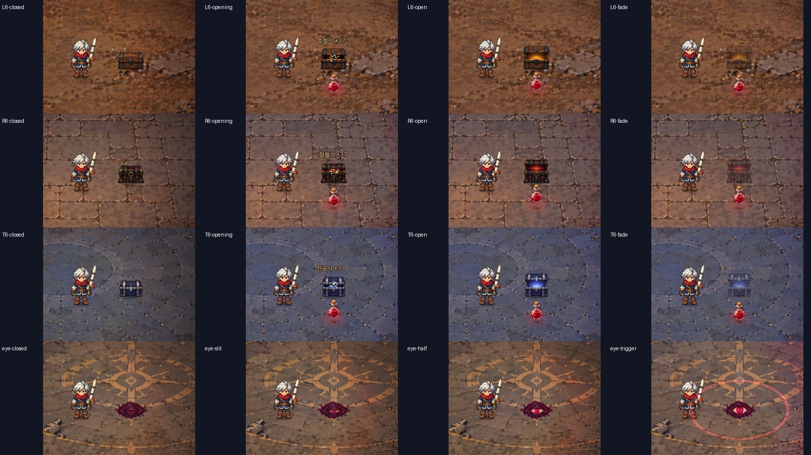
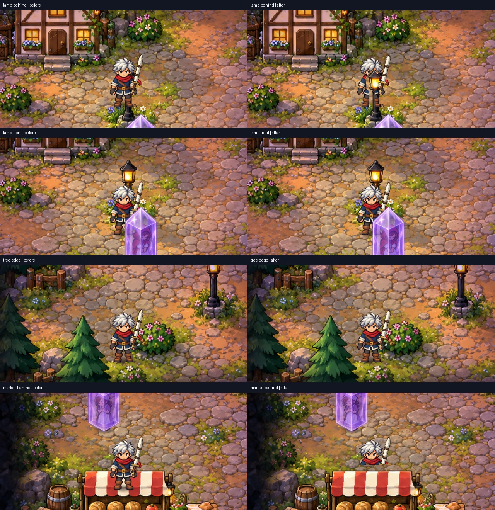

# 전투·보상 C / 앞쪽 가림 D — 2026-10-16

`haeseong/game` 누적 작업. 그림을 게임 렌더러에 연결했고, 아래 이미지는 실제 게임 코드의 캡처다.

## 상자와 마안



- 광산·성채·탑 상자: 닫힘 → 반쯤 열림(0.18초) → 열림 → 마지막 0.5초 동안 사라짐(전체 2.8초). 밑면은 고정되며, 개봉 불꽃을 줄여 뚜껑 동작이 보이게 했다.
- 기존 `GameSession.openChest`가 보상을 한 번 지급하고, 이벤트에 방·던전 ID를 실어 화면에서 애니메이션을 재생한다. 저장 형식과 보상 수치는 그대로다.
- 마안: 예고 진행에 따라 감김 → 실눈 → 반쯤 열림, 실제 발동 이벤트에 완전히 열린 눈을 0.45초 표시한다. 피해·시선 판정·발동 시간은 기존 규칙이다.

| 파일 | 시트 크기 | 칸 / 사용 |
|---|---:|---|
| `assets/sprites/rewards/chest_{left,right,top}.png` | 528×160 | 176×160, 가로 3칸, 게임에서 44×40 |
| `assets/team/sunwoo/chest_{left,right,top}.png` | 132×40 | 기존 호환용 44×40, 가로 3칸 |
| `assets/sprites/rewards/demon_eye.png` | 768×128 | 192×128, 가로 4칸 |
| `assets/sprites/demon_eye.png` | 192×32 | 기존 규격 48×32, 가로 4칸 |

도구는 **built-in image_gen**, 모드는 기존 그림을 참조한 편집/스타일 정합, 네 번 모두 투명 배경이다. [generation.json](generation.json)에 실제 프롬프트·참조·생성 파일명을 기록했다. 원본은 [sources](sources)에 보존했다. 참조한 이전 상자는 부모 커밋 `fe03921`에서 확인할 수 있다.

생성 크기가 요청 규격과 달라 사용자가 허용한 프레임 추출·크기 정규화만 `repack.py`로 수행했다. [packing.json](packing.json)에 원본 크기·추출 좌표·최종 배치가 있다. 고해상도 시트는 게임에서 축소하므로 월드 크기가 달라지지 않는다.

## 앞벽·소품 가림



기존 11장의 앞쪽 PNG에 더해, 별도 이미지가 없던 **14개 장면에 34개 영역**을 지정했다. 원본의 해당 픽셀을 정확한 위치에 덧그린다. 캠프 모루·앞벽, 광산·성채·탑의 앞벽·난간·기둥·제단, 마을 집·노점·우물·종탑·가로등·나무를 포함한다.

- `assets/data/scene-occlusion.json`: 원본 왼쪽 위 기준 정규화 좌표. `polygon`은 물체 영역, `depth`는 그 물체의 바닥 위치다.
- `SceneForegrounds`가 용사·적과 같은 y 정렬에 참여한다. 물체 뒤에 있으면 가리고 앞에 있으면 용사가 위에 그려진다.
- 뒤집힌 방은 원본 좌표를 함께 뒤집는다. 방별 캐시는 20초간 보이지 않으면 해제한다.
- 방·통로 블렌딩을 먼저 적용하고 불투명한 내부만 덧그린다. 가장자리를 두 번 겹쳐 네모 경계가 되살아나는 것을 막는다.
- 충돌·바닥 다각형·문 위치는 그대로다. 통로 그림의 추가 가림은 이번 데이터 범위에 포함하지 않았다.

[던전·캠프 비교](foreground-comparison-0.jpg) · [14개 장면 전체 화면](foreground-rooms.jpg)

## 검증

- 전체 JUnit **101개**, 배포 JAR 빌드 통과.
- 실제 렌더러로 C 16화면, D 30화면(14개 장면 + 8개 비교 쌍) 캡처.
- 상자 이벤트의 방·던전·좌표와 중복 보상 방지, 가림 영역의 오목한 출구·좌표·깊이, 모든 활성 방의 레이어 유무를 검증했다.
- `CampaignJourneyTest`: 같은 진행 상태로 세 보스 처치 → 상자 → 침대 → 단계별 저장/불러오기 → 다음 문 → 성검 해방 → 마왕 1·2페이즈 → 엔딩 이벤트 → 저장 재개 → 주민 6명 해방 대화.
- 통합 테스트는 이동 위치·보스 HP·장비를 설정하고 무적을 사용한다. 실제 피해/사망/페이즈/보상/저장 규칙을 호출하지만, 사람이 새 게임부터 플레이한 난이도·시간 검수는 아니다. 기존 사망·침대·저장 회귀 테스트도 통과했다.
- 캡처는 숨겨진 GL 창과 `build/*-qa-save` 전용 저장 경로를 사용한다. 사용자 저장 파일에는 쓰지 않는다.

재현(저장소 루트, Java 17):

```powershell
.\gradlew.bat :core:test :lwjgl3:dist --offline --no-daemon
javac -encoding UTF-8 -cp lwjgl3/build/libs/yongsa-game-0.1.0.jar -d build/qa-tools design/combat-rewards/CombatRewardCapture.java design/combat-rewards/ForegroundCapture.java
java -Xmx1536m -cp 'build/qa-tools;lwjgl3/build/libs/yongsa-game-0.1.0.jar' CombatRewardCapture build/rewards-captures
java -Xmx1536m -cp 'build/qa-tools;lwjgl3/build/libs/yongsa-game-0.1.0.jar' ForegroundCapture build/foreground-captures
python design/combat-rewards/build_review.py
```

초기 의존성 캐시가 없으면 Gradle의 `--offline`을 뺀다. Python 검수·정규화 도구는 Pillow가 필요하다. 캡처의 용사 위치·충돌 확인 결과는 `build/foreground-captures/report.json`에 기록된다.
