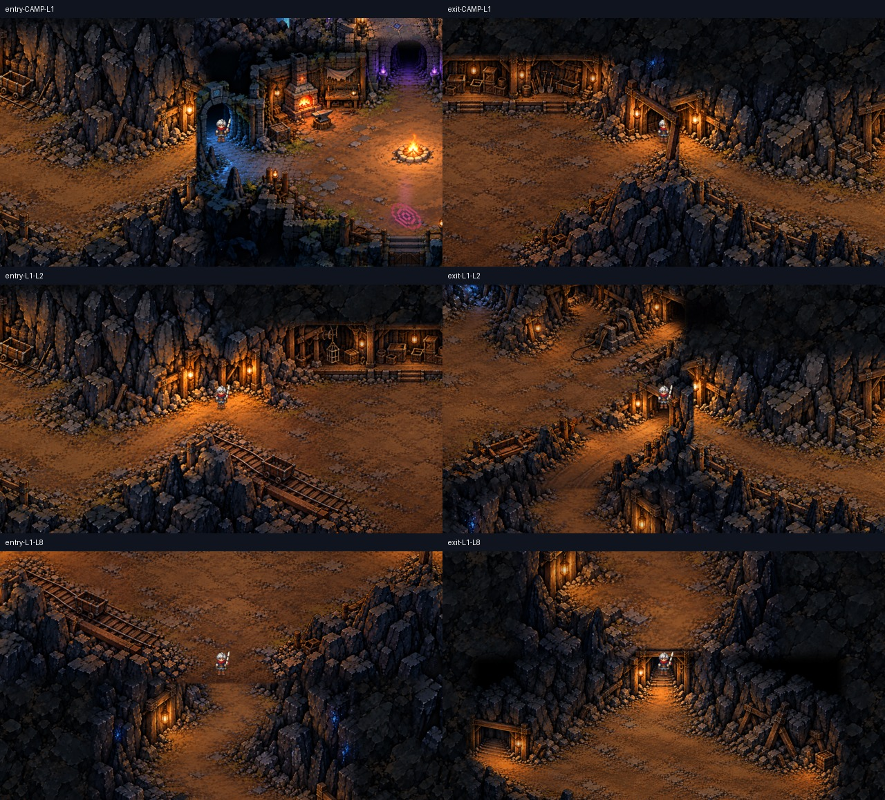
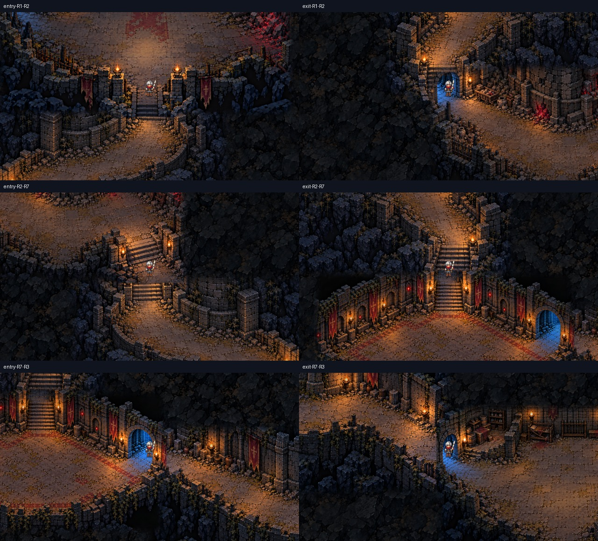
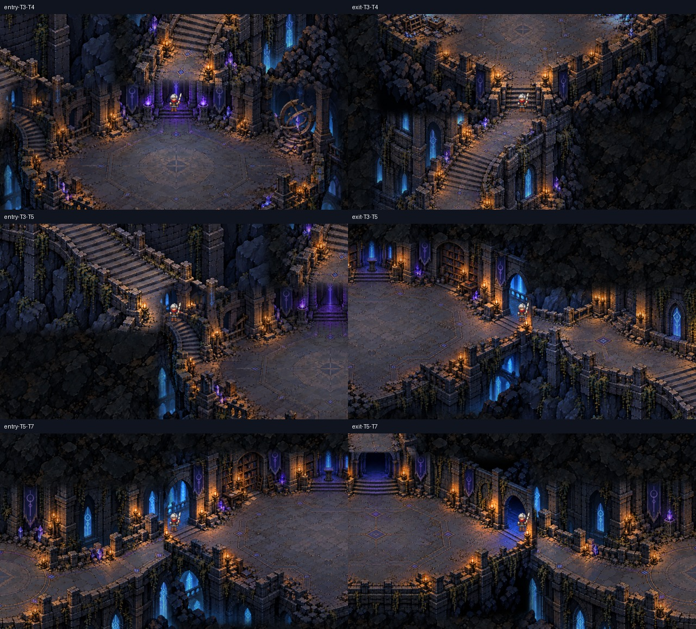

# 전체 맵 연결부 시각 점검 — 2026-10-20

> 이 문서는 수정 전 기록이다. **10월 21일 반영본**은 [전체 수정·동굴 입구·방 경계 검수](../full-map-repair/README.md)를 참고한다. 아래의 미수정 판정은 기준 버전의 상태를 보존한다.

**현재 맵에는 아직 그림이 이어지지 않는 곳이 남아 있다.** `haeseong/game`의 `4498574`를 빌드하고 실제 `WorldRenderer`로 방 25개, 통로 23개, 양쪽 연결부 46곳을 확인했다. 연결부마다 이동 가능 영역을 추가로 표시하여 **총 140장**을 검토했다. 아래 분류는 화면을 직접 비교한 시각적 판단이며, 수정 완료 수가 아니다.

| 지역 | 연결부 수 | 다시 그리기 | 부분 보정 | 현 상태 유지 |
|---|---:|---:|---:|---:|
| 광산 | 16 | 10 | 1 | 5 |
| 성채 | 14 | 8 | 5 | 1 |
| 탑 | 14 | 9 | 5 | 0 |
| 마을길 | 2 | 0 | 1 | 1 |
| **합계** | **46** | **27** | **12** | **7** |

지역별 수에는 캠프와 해당 던전 사이의 양쪽 입구를 포함한다. 한 통로에는 연결부가 두 곳 있으므로 **23개 통로와 46개 연결부를 중복해 합산하지 않는다.** `유지`는 이번 기준에서 큰 그림 단절을 찾지 못했다는 뜻이며 모든 플레이 상황이 검증됐다는 뜻은 아니다.

## 사용자가 보낸 두 장의 위치와 업로드 상태

두 스크린샷은 **CAMP→L1의 양쪽 연결부**다. 캠프 쪽은 파란 석문과 광산 길의 방향이 어긋나고, L1 쪽은 목재 문틀이 교차한다. **이 두 곳은 아직 그림을 고치지 않은 상태이며 업로드 누락이 아니다.**

기존 `1b516b3`에 적용한 새 그림은 `entry-L1-L2`와 `exit-L3-L5` 두 곳뿐이다. 이 커밋은 현재 GitHub PR #16 및 PC 체크아웃에 포함돼 있다. 이번 보고서와 A/B 후보는 게임 아트의 추가 수정이 아니다. 이전 PR #14의 맵을 포함한 현재 누적 작업은 **PR #16 / haeseong/game**에서 진행한다.



## 반복되는 문제와 수정 방향

1. **겹친 문틀·기둥:** 광산의 목재 입구와 성채·탑의 옆문이 서로 다른 방향으로 겹친다. 같은 카메라에서 양쪽 바닥을 포함한 연결 그림을 만들고, 통행선 가운데 남은 기둥을 제거해야 한다.
2. **길이 문 지붕에 닿음:** 위쪽 길의 바닥이 아래 방의 터널·아치 윗벽에서 끝난다. 두 공간의 바닥 높이를 정하고, 열린 계단이나 층계참으로 실제로 이어지게 다시 그려야 한다. 문 형태를 유지하려면 문 내부와 옆벽까지 함께 설계해야 한다.
3. **계단·레일이 끊김:** 계단 폭과 방향, 레일 궤적을 접점에서 맞춰야 한다. 원화의 노선 자체가 다르면 투명도나 색만 조절해서는 해결되지 않는다.
4. **보행 영역과 그림이 다름:** 초록 점은 `WorldMap.free`가 용사의 발 크기로 통행을 허용한 위치다. 일부 점은 그림의 문기둥·지붕·난간과 겹친다. 통행 가능 테스트가 통과하더라도 그림이 자연스럽다는 뜻은 아니다. 새 그림을 확정한 뒤 바닥 폴리곤과 가림 영역을 함께 맞춰야 한다.




## 수정 우선순위와 완료 기준

- **1순위:** 사용자가 보낸 CAMP↔L1 양쪽. 기존 캠프 석문 분위기를 살리면서 광산의 흙길과 하나의 공간으로 연결한다.
- **2순위:** 광산의 반복 문틀, 갱도 지붕, L3↔L4 레일 단절. 기존에 제대로 연결된 두 곳은 보존한다.
- **3순위:** CAMP↔R1·CAMP↔T1과 성채·탑의 아치/난간 중첩. 같은 통로 그림을 쓰더라도 양끝 접점은 각 방에 맞게 제작한다.
- **4순위:** 남은 계단·측벽·바닥 재질 12곳을 국소 보정한다. CAMP↔V의 캠프 계단 사이 목재면도 여기에 포함한다.

각 연결부는 양쪽 바닥의 높이·진행 방향이 이어지고, 캐릭터 발이 지붕·벽·기둥을 밟는 것처럼 보이지 않아야 한다. 같은 카메라의 수정 전후 화면, 이동 영역, 물체 앞뒤 가림, 전투 중 출구 잠금을 확인한 뒤에만 `수정 완료`로 바꾼다. 색을 섞거나 경계를 흐리는 보정만으로 완료 처리하지 않는다.

방 구분 표식의 [A/B 비교](../room-boundary-ab/README.md)는 별도로 보관했다. A는 현재의 열린 길, B는 짧은 깃발과 바닥 문턱을 더한 후보다. **B는 선택 대기이며 기본 게임에 적용하지 않았다.** 어느 쪽을 선택해도 아래 연결 문제의 수정은 필요하다.

## 연결부 46곳 개별 결과

`entry`는 연결 이름의 첫 방, `exit`는 둘째 방 쪽이다. 예를 들어 `entry-CAMP-L1`은 캠프 쪽, `exit-CAMP-L1`은 L1 쪽이다. 그림 번호는 각 모음 이미지 안에서 **왼쪽 위부터 가로 방향으로 1~6**이다.

| 위치 | 판정 | 확인한 문제 / 유지 이유 | 증거 |
|---|---|---|---|
| `entry-CAMP-L1` | 다시 그리기 | 캠프 석문과 광산 목재 입구가 겹치고 파란 석재 바닥이 옆 흙길로 이어지지 않음 | [화면 1](review/endpoint-01.jpg) · [이동 영역](review/floor-01.jpg) |
| `exit-CAMP-L1` | 다시 그리기 | 서로 다른 각도의 목재 문틀 두 개가 교차하며 기둥이 통로 중앙에 남음 | [화면 2](review/endpoint-01.jpg) · [이동 영역](review/floor-01.jpg) |
| `entry-L1-L2` | 유지 | 새로 그린 열린 통로. 중앙 문틀 교차가 해소됨 | [화면 3](review/endpoint-01.jpg) · [이동 영역](review/floor-01.jpg) |
| `exit-L1-L2` | 다시 그리기 | L2 쪽은 여전히 겹친 목재 입구와 암벽 돌출이 통행 지점에 남음 | [화면 4](review/endpoint-01.jpg) · [이동 영역](review/floor-01.jpg) |
| `entry-L1-L8` | 부분 보정 | 연결 바닥은 열려 있으나 방의 넓은 흙바닥에서 좁은 통로로 넘어가는 재질 경계가 남음 | [화면 5](review/endpoint-01.jpg) · [이동 영역](review/floor-01.jpg) |
| `exit-L1-L8` | 다시 그리기 | 위쪽 흙길이 아래 갱도 지붕 위로 덮임. 열린 계단으로 공간을 연결해야 함 | [화면 6](review/endpoint-01.jpg) · [이동 영역](review/floor-01.jpg) |
| `entry-L2-L3` | 유지 | 흙길 윤곽이 연속적이며 큰 문틀 교차나 단절 없음 | [화면 1](review/endpoint-02.jpg) · [이동 영역](review/floor-02.jpg) |
| `exit-L2-L3` | 다시 그리기 | 통로의 바닥이 북쪽 터널 지붕에서 끊기고 검은 입구 위를 걷는 모양 | [화면 2](review/endpoint-02.jpg) · [이동 영역](review/floor-02.jpg) |
| `entry-L3-L4` | 다시 그리기 | 위쪽 직선 레일과 아래 굽은 레일이 서로 다른 높이에서 끝남 | [화면 3](review/endpoint-02.jpg) · [이동 영역](review/floor-02.jpg) |
| `exit-L3-L4` | 다시 그리기 | 아래쪽 레일이 문턱 근처에서 끊겨 위쪽 바닥과 선로 높이·진행 방향이 맞지 않음 | [화면 4](review/endpoint-02.jpg) · [이동 영역](review/floor-02.jpg) |
| `entry-L3-L5` | 유지 | 열린 계단과 흙길이 이어지며 통행 폭도 읽힘 | [화면 5](review/endpoint-02.jpg) · [이동 영역](review/floor-02.jpg) |
| `exit-L3-L5` | 유지 | 이미 교체한 돌계단 연결. 위아래 바닥과 암벽이 이어짐 | [화면 6](review/endpoint-02.jpg) · [이동 영역](review/floor-02.jpg) |
| `entry-L5-L7` | 다시 그리기 | 서로 다른 입구의 들보·세로 기둥이 한 자리에 겹침 | [화면 1](review/endpoint-03.jpg) · [이동 영역](review/floor-03.jpg) |
| `exit-L5-L7` | 다시 그리기 | L7 쪽도 목재 문틀이 교차하고 중앙 암벽/기둥이 통행 실루엣과 충돌 | [화면 2](review/endpoint-03.jpg) · [이동 영역](review/floor-03.jpg) |
| `entry-L7-L6` | 다시 그리기 | 상부 바닥이 보스 전실의 갱도 지붕 위에 놓여 높이 전환이 설명되지 않음 | [화면 3](review/endpoint-03.jpg) · [이동 영역](review/floor-03.jpg) |
| `exit-L7-L6` | 유지 | 보스방으로 내려가는 열린 계단 연결은 큰 그림 단절 없음 | [화면 4](review/endpoint-03.jpg) · [이동 영역](review/floor-03.jpg) |
| `entry-CAMP-R1` | 다시 그리기 | 붉은 캠프 입구와 성채 회랑이 비스듬히 교차해 바닥과 옆벽의 방향이 달라짐 | [화면 5](review/endpoint-03.jpg) · [이동 영역](review/floor-03.jpg) |
| `exit-CAMP-R1` | 다시 그리기 | 상부 회랑 바닥이 파란 아치 위쪽 벽으로 이어져 출입 방향이 맞지 않음 | [화면 6](review/endpoint-03.jpg) · [이동 영역](review/floor-03.jpg) |
| `entry-R1-R2` | 유지 | 성채 방의 남쪽 계단과 굽은 회랑이 열린 바닥으로 이어짐 | [화면 1](review/endpoint-04.jpg) · [이동 영역](review/floor-04.jpg) |
| `exit-R1-R2` | 다시 그리기 | 회랑 계단 끝이 파란 아치의 윗벽에 닿음. 문 안으로 들어가는 길과 높이가 맞지 않음 | [화면 2](review/endpoint-04.jpg) · [이동 영역](review/floor-04.jpg) |
| `entry-R2-R7` | 부분 보정 | 계단 두 구간 사이의 바닥 폭과 양옆 돌담을 맞추면 연결 가능 | [화면 3](review/endpoint-04.jpg) · [이동 영역](review/floor-04.jpg) |
| `exit-R2-R7` | 부분 보정 | 상하 계단 사이에 짙은 수평 이음선과 옆 기둥 단절이 남음 | [화면 4](review/endpoint-04.jpg) · [이동 영역](review/floor-04.jpg) |
| `entry-R7-R3` | 다시 그리기 | 옆문 아치가 향하는 방향과 회랑 방향이 다르고 문기둥이 이동 축에 걸림 | [화면 5](review/endpoint-04.jpg) · [이동 영역](review/floor-04.jpg) |
| `exit-R7-R3` | 다시 그리기 | 회랑 바닥이 파란 아치 옆 윗벽으로 이어져 입구의 앞뒤가 맞지 않음 | [화면 6](review/endpoint-04.jpg) · [이동 영역](review/floor-04.jpg) |
| `entry-R3-R4` | 부분 보정 | 바닥은 열려 있지만 방의 부서진 벽 끝과 회랑 계단 머리의 돌담을 정리해야 함 | [화면 1](review/endpoint-05.jpg) · [이동 영역](review/floor-05.jpg) |
| `exit-R3-R4` | 부분 보정 | 계단 이음부의 기둥 끝과 수평 경계가 겹침. 계단 폭과 측벽 높이를 맞춰야 함 | [화면 2](review/endpoint-05.jpg) · [이동 영역](review/floor-05.jpg) |
| `entry-R3-R5` | 다시 그리기 | 파란 옆문과 오른쪽 회랑의 출입 방향이 어긋나고 기둥이 길 가운데 남음 | [화면 3](review/endpoint-05.jpg) · [이동 영역](review/floor-05.jpg) |
| `exit-R3-R5` | 다시 그리기 | 회랑이 방의 파란 아치 위쪽 벽에 닿아 바닥 높이가 맞지 않음 | [화면 4](review/endpoint-05.jpg) · [이동 영역](review/floor-05.jpg) |
| `entry-R5-R6` | 다시 그리기 | 상부 회랑 계단이 하부 아치 지붕으로 이어져 문 안쪽과 연결되지 않음 | [화면 5](review/endpoint-05.jpg) · [이동 영역](review/floor-05.jpg) |
| `exit-R5-R6` | 부분 보정 | 열린 계단끼리 연결되지만 중간 단의 폭과 색, 양옆 돌담 높이가 급변함 | [화면 6](review/endpoint-05.jpg) · [이동 영역](review/floor-05.jpg) |
| `entry-CAMP-T1` | 다시 그리기 | 탑 통로의 바닥이 캠프 보라색 문의 지붕으로 이어짐 | [화면 1](review/endpoint-06.jpg) · [이동 영역](review/floor-06.jpg) |
| `exit-CAMP-T1` | 부분 보정 | 열린 계단과 다리 연결은 가능하나 계단 아래 가로 경계와 오른쪽 기둥 끝을 정리해야 함 | [화면 2](review/endpoint-06.jpg) · [이동 영역](review/floor-06.jpg) |
| `entry-T1-T2` | 다시 그리기 | 방의 옆문 기둥과 다리 난간이 출입 지점에 중첩됨. 문에서 다리로 나가는 꺾임을 다시 설계해야 함 | [화면 3](review/endpoint-06.jpg) · [이동 영역](review/floor-06.jpg) |
| `exit-T1-T2` | 다시 그리기 | 방의 왼쪽 출입부 난간과 통로 끝이 겹쳐 영웅이 난간 위에 서 있는 모양 | [화면 4](review/endpoint-06.jpg) · [이동 영역](review/floor-06.jpg) |
| `entry-T2-T3` | 부분 보정 | 계단 위 바닥 폭과 기둥 연결을 맞춰야 함. 아치 지붕 중첩은 없음 | [화면 5](review/endpoint-06.jpg) · [이동 영역](review/floor-06.jpg) |
| `exit-T2-T3` | 부분 보정 | 두 계단 구간의 폭·진행 방향과 측벽을 이어주는 중간 층계참이 필요 | [화면 6](review/endpoint-06.jpg) · [이동 영역](review/floor-06.jpg) |
| `entry-T3-T4` | 다시 그리기 | 상부 통로의 바닥이 보라색 문의 지붕 위로 덮여 계단과 문 내부가 끊김 | [화면 1](review/endpoint-07.jpg) · [이동 영역](review/floor-07.jpg) |
| `exit-T3-T4` | 부분 보정 | 방 남쪽 계단 아래와 다리의 층계참 바닥·난간 경계를 정리해야 함 | [화면 2](review/endpoint-07.jpg) · [이동 영역](review/floor-07.jpg) |
| `entry-T3-T5` | 다시 그리기 | 통로 끝의 외벽·창문과 방 옆 계단이 중첩돼 서로 다른 높이의 바닥처럼 보임 | [화면 3](review/endpoint-07.jpg) · [이동 영역](review/floor-07.jpg) |
| `exit-T3-T5` | 다시 그리기 | 방 옆 입구의 난간과 회랑 끝이 겹치고 외벽 창문 앞이 출입구처럼 보임 | [화면 4](review/endpoint-07.jpg) · [이동 영역](review/floor-07.jpg) |
| `entry-T5-T7` | 다시 그리기 | 파란 창문과 난간이 출입 위치에 남음. 방에서 회랑으로 이어지는 열린 문턱이 필요 | [화면 5](review/endpoint-07.jpg) · [이동 영역](review/floor-07.jpg) |
| `exit-T5-T7` | 다시 그리기 | 옆문 앞 난간과 회랑 끝의 기둥이 겹쳐 캐릭터 발 위치에서 높이가 어긋남 | [화면 6](review/endpoint-07.jpg) · [이동 영역](review/floor-07.jpg) |
| `entry-T7-T6` | 다시 그리기 | 보스 전실의 파란 아치 위로 상부 회랑 바닥이 덮임 | [화면 1](review/endpoint-08.jpg) · [이동 영역](review/floor-08.jpg) |
| `exit-T7-T6` | 부분 보정 | 보스방 남쪽 계단과 회랑의 층계참 경계 및 측벽을 정리해야 함 | [화면 2](review/endpoint-08.jpg) · [이동 영역](review/floor-08.jpg) |
| `entry-CAMP-V` | 부분 보정 | 캠프 계단과 마을길 계단 사이에 가로로 걸친 목재면이 남아 바닥이 끊겨 보임 | [화면 3](review/endpoint-08.jpg) · [이동 영역](review/floor-08.jpg) |
| `exit-CAMP-V` | 유지 | 야외 흙길이 마을 북쪽 계단과 광장으로 이어짐 | [화면 4](review/endpoint-08.jpg) · [이동 영역](review/floor-08.jpg) |

## 방 25개와 통로 23개 내부

방 전체 화면과 통로 중앙 화면도 각각 확인했다. **이번 정적 화면에서 새로 지목한 구조적 단절은 위 연결부에 집중돼 있다.** 방 내부나 통로 중앙까지 일괄 교체할 근거는 찾지 못했다. 전경 물체 전부의 앞뒤를 걸어서 확인한 결과는 아니므로 가림 전체가 완벽하다고 판정하지 않는다. 광물방의 광석 가독성은 기존 남은 작업으로 유지한다.

| 방 | 원화 | 전체 화면 |
|---|---|---|
| `CAMP` | `central-camp` | [그림 1](review/room-01.jpg) |
| `L1` | `mine-mob-c` | [그림 2](review/room-01.jpg) |
| `L2` | `mine-ore-b` | [그림 3](review/room-01.jpg) |
| `L8` | `mine-junction` | [그림 4](review/room-01.jpg) |
| `L3` | `mine` | [그림 5](review/room-01.jpg) |
| `L4` | `mine-ore-a` | [그림 6](review/room-01.jpg) |
| `L5` | `mine-mob-b` | [그림 1](review/room-02.jpg) |
| `L7` | `mine-antechamber` | [그림 2](review/room-02.jpg) |
| `L6` | `mine-boss-a` | [그림 3](review/room-02.jpg) |
| `R1` | `citadel` | [그림 4](review/room-02.jpg) |
| `R2` | `citadel-ore-b` | [그림 5](review/room-02.jpg) |
| `R7` | `citadel-corner` | [그림 6](review/room-02.jpg) |
| `R3` | `citadel-mob-c` | [그림 1](review/room-03.jpg) |
| `R4` | `citadel-ore-north` | [그림 2](review/room-03.jpg) |
| `R5` | `citadel-mob-b` | [그림 3](review/room-03.jpg) |
| `R6` | `citadel-boss-a` | [그림 4](review/room-03.jpg) |
| `T1` | `tower-mob-c` | [그림 5](review/room-03.jpg) |
| `T2` | `tower-ore-b` | [그림 6](review/room-03.jpg) |
| `T3` | `tower` | [그림 1](review/room-04.jpg) |
| `T4` | `tower-ore-a` | [그림 2](review/room-04.jpg) |
| `T5` | `tower-mob-b` | [그림 3](review/room-04.jpg) |
| `T7` | `tower-antechamber` | [그림 4](review/room-04.jpg) |
| `T6` | `tower-boss-a` | [그림 5](review/room-04.jpg) |
| `V` | `village` | [그림 6](review/room-04.jpg) |
| `F` | `seal-hall` | [그림 1](review/room-05.jpg) |

| 통로 | 중앙 화면 | 양끝 수정 대상 수 |
|---|---|---:|
| `CAMP-L1` | [그림 1](review/passage-01.jpg) | 2/2 |
| `L1-L2` | [그림 2](review/passage-01.jpg) | 1/2 |
| `L1-L8` | [그림 3](review/passage-01.jpg) | 2/2 |
| `L2-L3` | [그림 4](review/passage-01.jpg) | 1/2 |
| `L3-L4` | [그림 5](review/passage-01.jpg) | 2/2 |
| `L3-L5` | [그림 6](review/passage-01.jpg) | 0/2 |
| `L5-L7` | [그림 1](review/passage-02.jpg) | 2/2 |
| `L7-L6` | [그림 2](review/passage-02.jpg) | 1/2 |
| `CAMP-R1` | [그림 3](review/passage-02.jpg) | 2/2 |
| `R1-R2` | [그림 4](review/passage-02.jpg) | 1/2 |
| `R2-R7` | [그림 5](review/passage-02.jpg) | 2/2 |
| `R7-R3` | [그림 6](review/passage-02.jpg) | 2/2 |
| `R3-R4` | [그림 1](review/passage-03.jpg) | 2/2 |
| `R3-R5` | [그림 2](review/passage-03.jpg) | 2/2 |
| `R5-R6` | [그림 3](review/passage-03.jpg) | 2/2 |
| `CAMP-T1` | [그림 4](review/passage-03.jpg) | 2/2 |
| `T1-T2` | [그림 5](review/passage-03.jpg) | 2/2 |
| `T2-T3` | [그림 6](review/passage-03.jpg) | 2/2 |
| `T3-T4` | [그림 1](review/passage-04.jpg) | 2/2 |
| `T3-T5` | [그림 2](review/passage-04.jpg) | 2/2 |
| `T5-T7` | [그림 3](review/passage-04.jpg) | 2/2 |
| `T7-T6` | [그림 4](review/passage-04.jpg) | 2/2 |
| `CAMP-V` | [그림 5](review/passage-04.jpg) | 1/2 |

`F`(봉인 홀)은 전체 방 화면에 포함했다. F→CAMP는 연속된 보행 통로가 아닌 일방향 이동이므로 23개 통로 수에는 포함하지 않는다.

## 검증 범위와 재현

- 기준 코드: `449857478a2d3343673b7fcd76acd6a7cf79bac6`. Java 17, 1280×720 실제 렌더러. 같은 기준으로 `:core:test :lwjgl3:dist` 빌드 성공, **111개 테스트 통과 / 실패 0 / 오류 0**.
- `FullMapAuditCapture.java`는 별도 저장 폴더를 사용한다. 모든 통로의 잠금을 풀고 몬스터를 제거한 상태로 캡처하므로 전투나 닫힌 문 상태의 화면 검수를 대신하지 않는다. 보스는 제거되므로 방 안 전투 구성 비교 자료가 아니다.
- 방은 전체 그림에 맞춘 카메라, 연결부는 동일한 줌 0.85, 통로 중앙은 줌 1.05다. 방 전체 축소 화면을 실제 플레이 캐릭터 크기로 해석하지 않는다.
- 이동 진단 46장은 입구 주변의 발 크기 통행 여부를 12 world-pixel 간격으로 표시한다. 140개 촬영 위치의 발 통행 결과는 모두 true였다. 이는 모든 지도 픽셀의 통행·가림을 검사했다는 뜻이 아니다. 기존 테스트가 별도로 통로 중심선을 촘촘히 검사한다.
- **이번 작업은 전체 맵의 그림 연결 점검이다.** 새 게임부터 엔딩까지의 수동 플레이, 전투 밸런스, 모든 이벤트·설정 UI 검수는 포함하지 않는다.
- 원본 140장과 촬영 좌표는 로컬 `outputs/full-map-audit/captures/`에 보관하고, Git에는 25개 검토 모음 이미지, [촬영 목록](inventory.json), [판정 원본](findings.json), 재현 코드를 보관한다. 좌표는 inventory의 camera/hero 값이다.

저장소 루트에서 현재 배포 JAR을 빌드한 뒤 실행한다. 아래 `<output>`은 원하는 검수 출력 폴더이며 사용자 세이브 폴더와 별개다.

```text
javac -encoding UTF-8 -cp lwjgl3/build/libs/yongsa-game-0.1.0.jar -d <classes> design/full-map-audit/FullMapAuditCapture.java
java -Xmx2g -cp "<classes>;lwjgl3/build/libs/yongsa-game-0.1.0.jar" FullMapAuditCapture <output>
python design/full-map-audit/build_review.py <output>
python design/full-map-audit/build_report.py
```

`build_review.py`는 촬영본의 검토용 축소 모음만 만들며 게임 그림을 가공하지 않는다. `build_report.py`는 수동 판정과 맵 목록을 문서로 옮긴다. 게임 에셋·동작·사용자 저장 파일을 변경하지 않는다.
