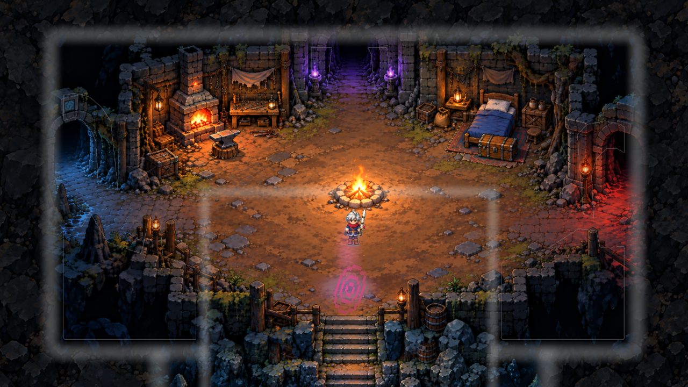
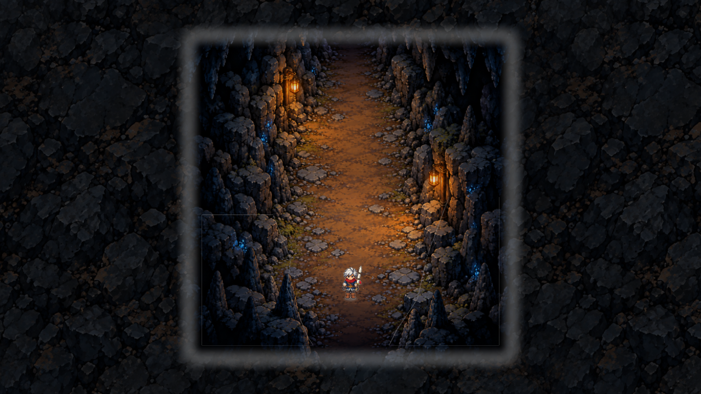
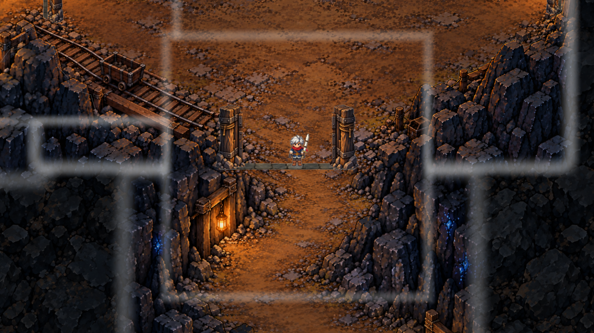
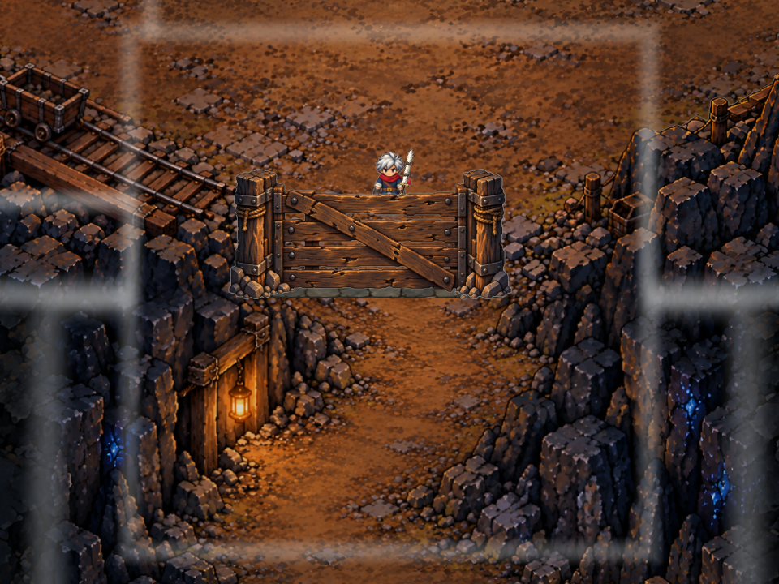

# 연결부 수정 · 어두운 동굴 입구 — 2026-10-21

> 10월 22일: 열린 문에서 임의로 잘라 쓰던 기둥 조각을 제거하고 바닥 문턱으로 정리했다. 성채 철문과 탑 통로 이동 경계 후속 수정은 [gate-floor-polish](../gate-floor-polish/README.md)를 참고한다.

> 후속 수정: 캠프 문틀의 가장자리 보호와 광산·성채·탑의 서로 다른 방향·원화는 [cave-directions](../cave-directions/README.md)에 반영했다. 아래 공용 세로 동굴은 이전 버전의 기록이다.

캠프의 푸른 석문·붉은 석문·보라색 입구를 원래 그림으로 되돌렸다. 문 뒤의 길을 캠프 밖에 길게 돌아가게 그리는 대신, **기존 입구 → 어둠 속 화면 전환 → 직접 걷는 짧은 동굴 → 기존 던전 첫 방**으로 연결한다. 세 방향 모두 같은 방식이며 되돌아올 수도 있다.

## 이번 반영 범위

- 앞선 점검에서 수정 대상으로 잡은 39곳 중 **33곳은 연결부 그림과 이동 경계를 교체**했다. 나머지 **6곳은 캠프의 세 연결 통로 양 끝**으로, 별도 동굴 공간으로 대체했다. 이전에 적용했던 광산 그림 2장은 유지하여 활성 연결부 그림은 총 35장이다. 위치별 처리는 [resolved-sites.json](resolved-sites.json)에 기록했다.
- 기존 방 25개에 전투 없는 동굴 3개를 추가했다. 외부 통로는 23개에서 20개, 별도 공간을 잇는 양방향 연결은 6개다. 던전 내부의 방 배치와 전투·보상 규칙은 유지한다.
- 열린 방 경계에는 낮은 돌 문턱과 기둥이 남고, 전투 시 같은 위치에서 판자·쇠문·마법 장벽이 올라온다. 캠프에는 원래 입구 기둥이 있으므로 기둥을 중복 배치하지 않는다.
- 출구가 비대칭이면 바닥 양쪽 끝의 실제 중앙에 문을 놓는다. 넓은 옆 방향 출구에서도 기둥 높이를 통로 폭과 함께 늘리지 않는다. L2 입구와 T3 계단의 기준점도 새 그림에 맞췄다.
- 새 바닥 다각형에 맞춰 이동 경계·미니맵 타일·통로 경로를 갱신했다. 겹친 그림의 앞쪽 가림 순서를 맞추고 캠프 입구 아치와 동굴 바위에 가림을 추가했다. 멀어진 연결부 텍스처는 메모리에서 해제한다.
- 동굴에서는 해당 공간의 지도를 보여준다. 맵 버전은 9이며, 이전 버전 저장의 위치·방 기록은 기존 마이그레이션 규칙으로 정리된다. 장비·진행 상태는 기존 저장 규칙을 따른다.

## 검증

Java 17에서 core:test와 lwjgl3:dist 성공, **113개 테스트 통과**. 세 입구의 실제 이동 입력, 화면 전환 이벤트, 동굴 왕복, 동굴 저장·재개, 잠긴 던전 입구, 전투 중 저장, 기존 20개 통로의 이동 여유 폭과 잠금 우회 차단을 검사했다.

검증 명령은 `gradlew.bat :core:test :lwjgl3:dist --offline --no-daemon --continue`이며, 이 PC의 한글 경로에서는 기존 로컬 init script로 테스트 클래스 경로를 영문 임시 폴더에 복사했다. 소스·테스트 내용·게임 자산은 바꾸지 않는다.

실제 WorldRenderer로 방 28개·통로 20개·출입구 52개와 출입구별 이동 경계 화면을 합쳐 **152장**, 별도로 강제 잠금 화면 **46장**을 생성했다. [검수 요약](review/capture-summary.json)과 [열린 입구 모음](review/open-01.jpg), [닫힌 문 모음](review/closed-01.jpg)에서 시작하면 된다. 마을 연결의 강제 잠금 2장은 진단 전용이며 정상 플레이에서는 전투로 잠기지 않는다.

자동 검증과 위치별 렌더 검수 결과다. 새 게임부터 엔딩까지의 수동 플레이·경제 밸런스 검수 결과를 의미하지 않는다.

## 그림과 재현 자료

- 새 동굴: assets/scenes/natural-v1/dark-cave-passage.png (1254×1254 원본).
- 연결부 33장: assets/scenes/joints-v2/. 돌 문턱: assets/sprites/room-threshold.png.
- [선택 원본·해시](generation.json), [장소별 생성 요청](prompts.json), [입구 결정과 동굴·문턱 프롬프트](entrance-art.json).
- 모두 내장 image_gen으로 제작했다. 생성 PNG를 그대로 복사했으며 외부 프로그램으로 그림을 늘리거나 잘라 다시 만들지 않았다. 게임에서 텍스처 영역과 가림을 추출하고 배치한다.
- geometry.py / install_geometry.py는 연결부 경계, install_tunnels.py는 별도 공간 및 가림, align_mine_gate.py와 align_stair_door.py는 재배치된 문 기준점을 재현한다. RepairRoutes.java는 실제 충돌에서 통로 중심 경로를 다시 찾는다.
- FullMapAuditCapture.java와 GateCapture.java는 별도 검수 저장 폴더를 사용한다. build_review.py는 캡처를 검수용 모음 그림으로만 축소하며 게임 그림은 바꾸지 않는다.

과거 U자형 입구 후보는 사용자의 10월 21일 피드백에 따라 제외했다. generation.json의 superseded 항목과 prepare_sites.py / approach_guide.py는 그 후보의 기록이다. 게임에 다시 설치하지 않는다.
