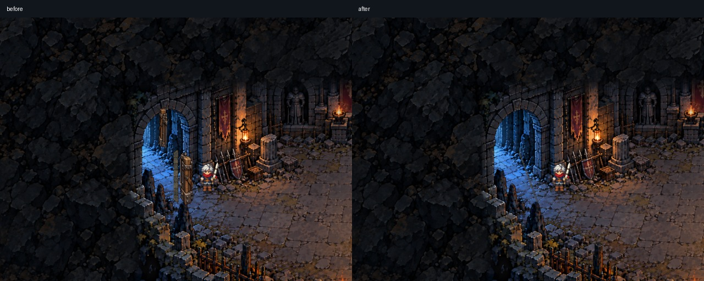
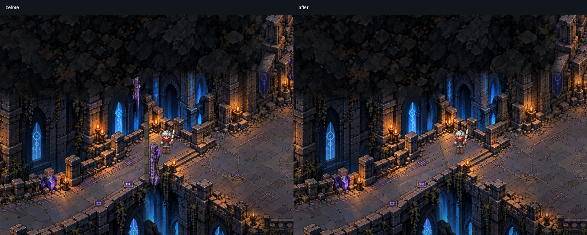
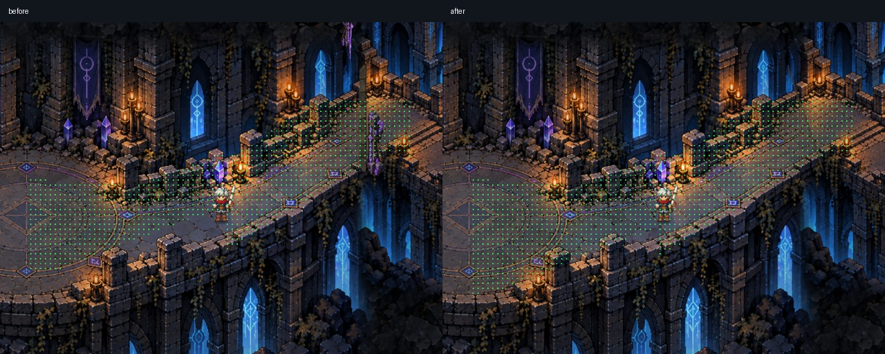
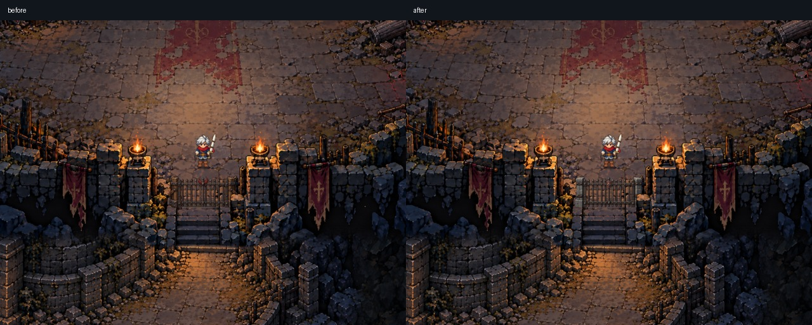
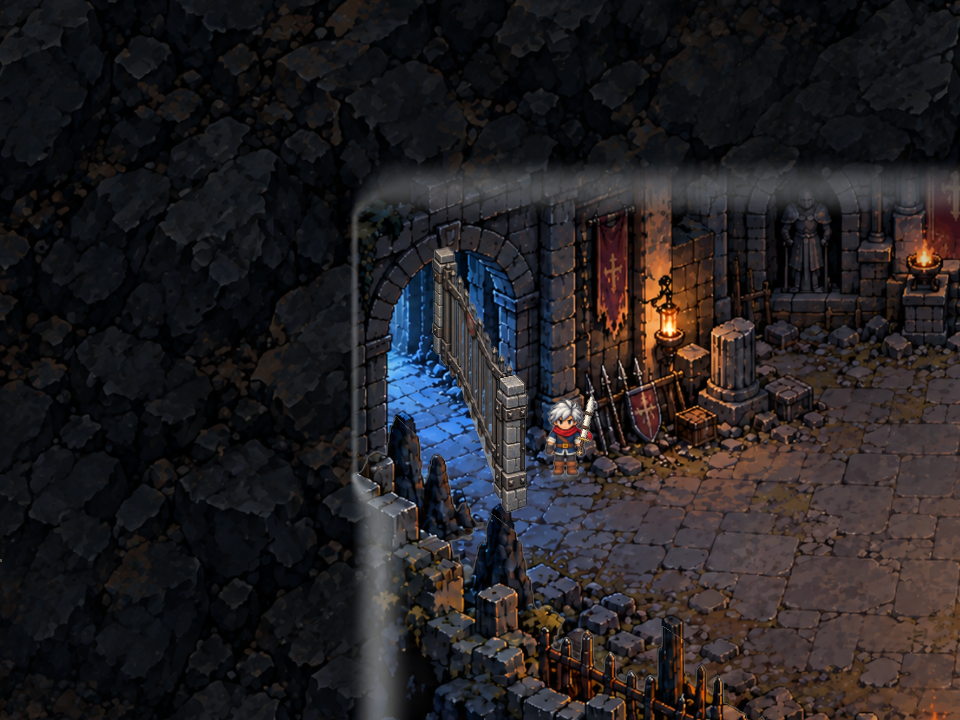

# 열린 문 조각·탑 길 이동 경계·성채 철문 수정 — 2026-10-22

열린 입구에 따로 서 있던 나무 문 조각과 보라색 장벽 조각을 제거했다. 닫힌 문 그림의 양 끝을 임의 다각형으로 잘라 열린 기둥처럼 쓰던 것이 원인이었다. 이제 열린 상태에서는 원래 배경의 문틀·계단과 얇은 바닥 문턱을 사용한다. 옆 방향 문턱도 세운 돌기둥처럼 보이지 않도록 높이를 줄이고 바닥 원근에 맞춰 기울였다. 전투 중에는 완성된 문 전체가 나타나며 기존 잠금·해제 동작을 유지한다.

## 그림상 열린 탑 길

제보 위치는 T1↔T2 다리에서 새 연결 그림으로 넘어가는 바닥이다. `tower-bridge`의 난간 안쪽 포장 바닥이 기존 이동 다각형 밖에 남아 있었다. 실제 포장 범위에 맞춰 아래쪽 경계를 넓혔으며 같은 그림을 쓰는 T5↔T7에도 적용한다. 난간과 절벽 면은 계속 막는다.

새 연결 그림의 부드러운 가장자리에서도 이전 벽 판정이 남았다. 완전히 불투명한 내부는 기존처럼 새 그림의 경계를 쓰고, 혼합 구간에서는 새 바닥이 충분히 보이고 발이 들어갈 때 통행을 허용한다. 캠프 시설의 고정 충돌과 전투 잠금은 유지한다. 기존 통로를 일찍 닫아 버릴 수 있는 일괄 경계 교체는 사용하지 않는다.

## 두 번째 던전의 문

성채는 광산의 통나무 지지대 대신 **회색 석재 기둥·짙은 철창·붉은 방패 문장**으로 변경했다. 정면과 옆면을 모두 교체했고 광산 판자문과 탑 마법 장벽은 유지했다.

## 검증 범위

- Java 17의 `:core:test :lwjgl3:dist` 성공. **117개 테스트, 실패·오류 0개**.
- 새 회귀 검증: 제보한 바닥을 실제 이동 입력으로 양방향 통과, 두 탑 다리의 넓어진 포장 바닥/절벽 구분, 연결 그림 가장자리의 통행과 전투 잠금.
- 기존 20개 외부 통로의 연속 통과·양방향 이동·잠긴 문 우회 차단과 캠프 시설 접근 검증도 통과.
- 실제 WorldRenderer로 변경 전후 각 **96개 화면**: 중복된 편도 링크의 문을 제외한 열린/닫힌 상태 94개, 제보한 탑 바닥 일반/이동 가능 영역 2개. [열린 경계 모음](review/open-01.jpg), [닫힌 경계 모음](review/closed-01.jpg), [검수 요약](review/summary.json).
- 연결 그림 35개와 외부 통로 20개의 충돌 표본을 조사했다. 원본 그림 위에 찍은 빨간 점은 겹치는 다른 그림이나 혼합 가장자리의 판정 차이도 포함하므로, 개수 자체를 미수정 버그 수로 해석하지 않는다. 최종 합성 화면과 실제 이동 결과를 함께 확인한다.
- 별도 검수 저장 폴더만 사용했다. 맵 배치와 저장 버전은 10을 유지한다. 전체 새 게임부터 엔딩까지 수동 플레이를 대신하는 검증은 아니다.

## 자산과 재현

- `assets/sprites/gate_RIGHT.png`: 1774×887 RGBA 정면 원본.
- `assets/sprites/gate_RIGHT_side.png`: 793×1983 RGBA 옆면 원본.
- 내장 **image_gen**으로 편집했고 투명도를 포함한 생성 PNG를 바이트 그대로 복사했다. [프롬프트 두 개](prompts.json), [원본 위치·규격·SHA-256](generation.json).
- `install_floor.py`: 탑 다리 경계만 재적용한다. 과거 전체 맵 생성 스크립트를 실행했다면 이 수정도 마지막에 적용한다.
- `FloorAudit.java`, `review_floor.py`: 실제 이동 가능 영역 표본과 진단용 원본 오버레이.
- `GatePolishCapture.java`, `build_review.py`: 실제 게임 렌더링과 전후 비교. 비교용 이미지 처리만 수행하며 게임 PNG를 자르거나 변형하지 않는다.

이 문서의 열린 문 처리가 [10월 21일 연결부 문틀 처리](../full-map-repair/README.md)를 대체한다.
