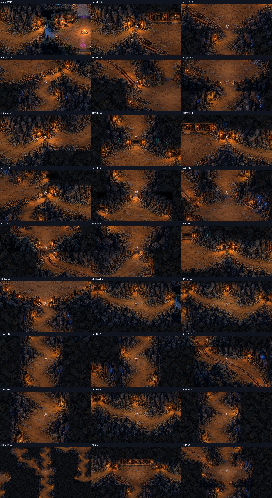
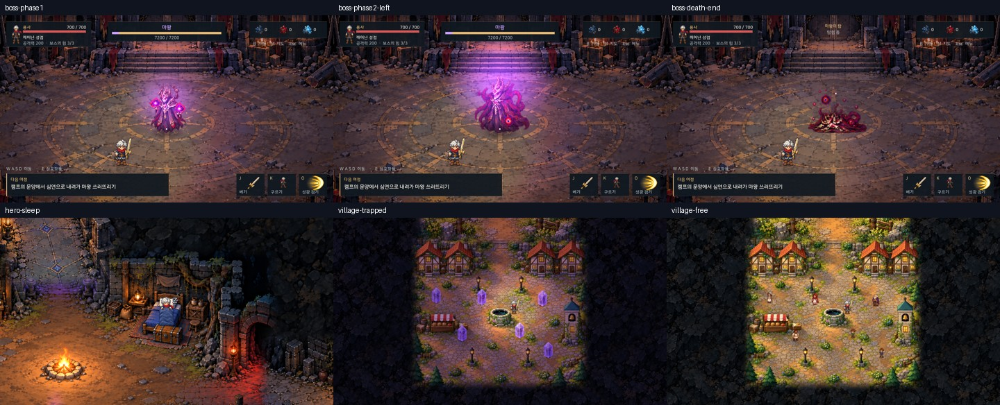

# 해성 게임 통합 검증 — 2026-10-16

`haeseong/game`에서 클로드 통합본 `95ce69a`, 맵 PR #14 `5372e64`, 이야기 그림 PR #15 `7be4428`을 함께 빌드했다. 이 문서의 화면은 합친 게임의 실제 `WorldRenderer`로 새로 캡처했다.

- `gradlew.bat :core:test :lwjgl3:dist --offline --no-daemon`: **96개 테스트 통과**, 실패·오류·건너뛴 테스트 0, 배포 JAR 빌드 성공.
- 광산 연결부 입구·중간·출구와 주요 방 **27화면**, 이야기 스프라이트 **22화면**을 캡처했다.
- 숨겨진 GL 창과 `build/map-qa-save`, `build/story-qa-save`를 사용했다. 사용자 저장 파일을 읽거나 덮어쓰지 않았다.
- 텍스트 병합 충돌은 없었다. 보스 2페이즈의 다른 시트, 사망 그림, 수면·주민 그림이 새 맵과 함께 렌더링되는 것을 확인했다.
- 이번 검증은 자동 테스트와 렌더링 확인이다. 엔딩까지의 전체 수동 플레이와 각 구간의 미술 다듬기는 [남은 작업](../../docs/REMAINING_WORK_2026-10-16.md)으로 유지한다.

## 광산

## 마왕·수면·주민

재현에는 [맵 캡처 실행기](../painted-map-links/PaintedLinksCapture.java)의 `-Dyongsa.captureFilter=.*L.*` 필터와 [이야기 캡처 실행기](../story-sprites/StorySpriteCapture.java)를 사용한다. 원본 PNG는 `build/integration-qa/` 아래의 로컬 검수 자료이며 저장소에는 요약 JPG를 보관한다. [담당자별 브랜치와 받는 방법](../../docs/BRANCHES.md).
