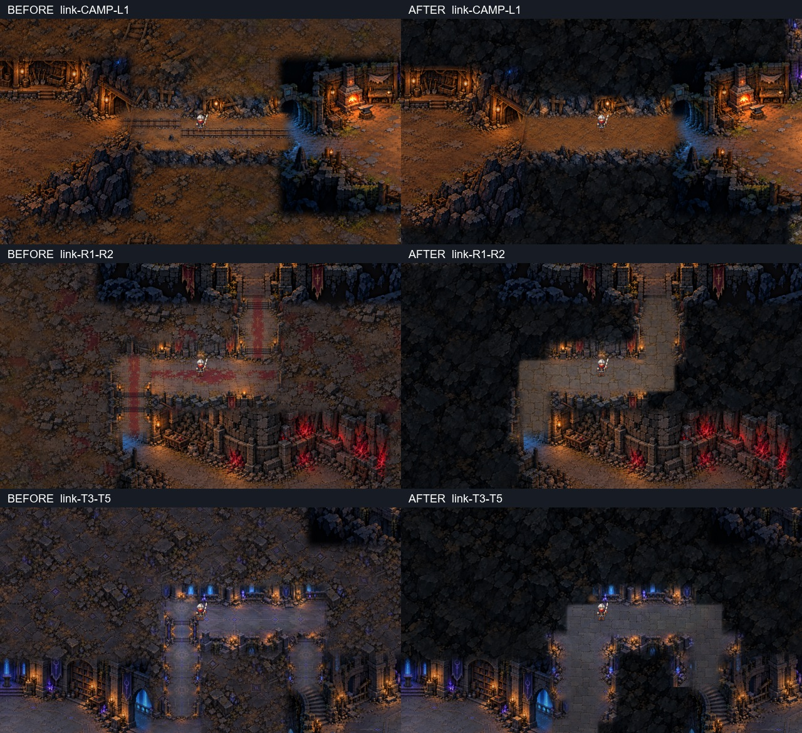

# 맵·통로 연결 다듬기 (2026-10-15)

기준: `claude/team-integration-m9u9aa`의 `95ce69a`. 이번 사용자 요청은 맵과 길을 실제 게임에서 자연스럽게 고치는 것으로, 이전 그림 전용 작업표보다 넓은 범위의 배치·렌더러 수정을 포함한다.



## 바뀐 점

- 방 25개, 걸어서 이동하는 통로 23개, 던전 해금 순서는 유지했다. 방 10개의 위치를 타일 단위로 맞춰 출구 사이의 짧은 지그재그를 줄였다. 방 수를 늘릴 필요 없이 연결이 정리됐다.
- 통로 꺾임 **37 → 13**, 4칸 미만 직선 구간 **10 → 1**, 통로 중심선 총 길이 **472 → 446칸**. 남은 짧은 구간은 L4 입구 앞 3칸이다. R1은 아래 광물방으로 갈 공간을 확보하려고 기존 위치를 유지했다.
- 주변의 반복되는 레일·카펫·큰 잔해를 어두운 암반으로 바꿨다. 실제 걸을 수 있는 길과 막힌 주변이 구분된다.
- 길 그림의 벽·등불은 살리고, 흙·성채 돌·탑 돌 바닥을 월드 좌표에 맞춰 이어 붙인다. 꺾일 때 바닥 그림이 회전하거나 계단·레일이 겹치는 현상을 줄였다. 벽은 모서리 전에 끝나고, 바닥은 가장자리와 방 입구에서 부드럽게 섞인다.
- 탑 세로 길의 바닥 폭 기준을 바로잡았다. 그림의 벽까지 바닥 폭으로 세던 부분을 수정했다.
- 새 원본 이미지 4장: `terrain-bedrock.png`, `floor-mine.png`, `floor-citadel.png`, `floor-tower.png`. 캠프 흙길은 갱도 흙 재질을 공유한다. 이미지 원본을 리사이즈하거나 재가공하지 않았으며, 블렌딩은 게임 렌더러에서만 한다. 생성 프롬프트는 `generation.json`에 기록했다.
- 중간 Pixmap 해제를 추가하고, 기존의 화면 전체 테마 혼합 격자를 단일 암반 배경으로 단순화했다. 바닥의 혼합 좌표는 맵 생성 시 계산한다.

## 저장 호환성

맵 버전은 6에서 7로 올렸다. 예전 저장은 **무기·광물·보스/방 클리어 기록을 유지하고 캠프에서 재개**한다. 이전 좌표인 광맥 자리와 바닥 포션은 초기화한다. 바닥 포션을 남겨 두면 옮긴 방 바깥에 보상이 뜰 수 있기 때문이다.

## 검증

- `./gradlew.bat :core:test :lwjgl3:dist --offline --no-daemon`: **93 tests, 0 failures**, 실행 JAR 빌드 성공.
- 모든 23개 통로 양방향 보행, 통로끼리 겹침, 전투 잠금·던전 해금, 방 도착점, 광맥 위치를 기존 테스트로 확인했다.
- 방 그림의 범위 이탈/겹침과 버전 6 저장의 진행도 보존 검사를 추가했다.
- 테스트가 직접 읽는 `assets/data/*.json`을 Gradle 입력에 등록해 JSON만 고쳐도 검사가 다시 실행된다.
- 실제 `WorldRenderer`에서 1280×720 화면 **34곳**을 전후 캡처했다. 전투 없는 고정 장면이며, 전체 플레이 완료를 대신하는 검사는 아니다.
- [전체 화면 1](review/after-contact-1.jpg), [전체 화면 2](review/after-contact-2.jpg), [전체 화면 3](review/after-contact-3.jpg). 원본 레이아웃은 `before/layout.json`, `after/layout.json`.

재현 (저장 파일은 `build/map-qa-save`에 분리, 창·오디오 비활성):

```powershell
New-Item -ItemType Directory -Force build/map-qa
javac -encoding UTF-8 -cp lwjgl3/build/libs/yongsa-game-0.1.0.jar -d build/map-qa design/map-continuity/MapContinuityCapture.java
java -Xmx2g -cp 'build/map-qa;lwjgl3/build/libs/yongsa-game-0.1.0.jar' MapContinuityCapture design/map-continuity/after
```

## 다음 작업

통합 상태와 남은 그림·연결 작업은 [남은 작업 목록](../../docs/REMAINING_WORK_2026-10-15.md)에 따로 기록했다. 기존 `*-bend.png` 4장은 S자 그림이어서 현재 직각 통로에 사용하지 않는다. 전용 코너·긴 통로 그림은 더 다듬을 때 선택적으로 추가할 수 있다.
