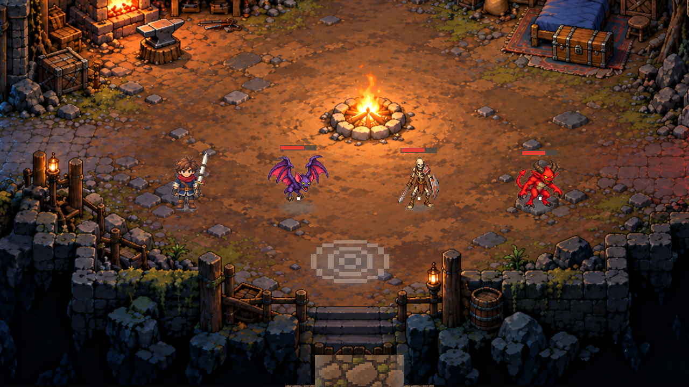
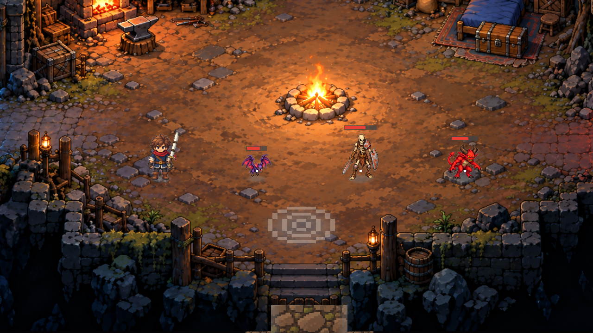

# 잡몹 종류별 체격 조정

2026-10-15 사용자 요청: 박쥐는 작게, 임프는 박쥐보다 크고 용사보다 조금 작게, 해골병사는 용사와 비슷한 크기로 만든다.

모든 잡몹에 같은 1.25 배율을 주던 `WorldRenderer`를 종류별 배율로 바꿨다. 원본 PNG를 다시 생성하거나 리사이즈하지 않고 기존 게임 렌더링 크기를 조정한다.

| 종류 | 이전 그림 영역 | 변경 후 그림 영역 | 용사 대비 높이 |
|---|---:|---:|---:|
| 용사 | 45×60 | 45×60 | 100% |
| 박쥐 | 67.5×52.5 | 37.8×29.4 | 49% |
| 임프 | 52.5×55 | 44.1×46.2 | 77% |
| 해골병사 | 45×57.5 | 46.8×59.8 | 약100% |

단위는 월드 픽셀이고 그림 영역에는 원본의 투명 여백이 포함된다. 박쥐의 부유 높이와 공격 준비 중 변형은 별도다. 실제 몸체 크기는 아래 게임 캡처로 비교한다.

## 적용

- 종류별 배율은 박쥐0.70, 임프1.05, 해골1.30이다. 그 외 이름은 기존1.25를 유지한다.
- 생존/사망 그림, 그림자, 걷기·부유의 상하 움직임, 등장/시전 빛과 몸을 둘러싼 보호막·채널링 효과를 맞췄다.
- 체력바·공격 예고·기절 표시는 변경된 그림 높이를 따라간다. 체력바 폭은 종류별로 조절하되 24 월드 픽셀보다 작아지지 않는다.
- 몬스터 이동 충돌(hw9, hh6), 피격 원(반경12), 공격 범위·대미지·속도, 바닥 공격 예고 범위, 보스 렌더링과 카메라는 변경하지 않았다. 외형에 맞춘 전투 난이도 변경은 이 PR에 포함하지 않는다.
- 변경한 게임 소스는 `core/src/main/java/com/yongsa/screen/WorldRenderer.java` 하나다. 사용자의 별도 잡몹 크기 요청에 따른 PR이며, 그림만 교체하는 A~D 작업과 구분한다.

## 실제 화면 검증

기준은 `main`의 `ab712f2`. PR #9의 흰머리 용사·마을 그림은 아직 합치지 않았으므로 아래 캡처는 현재 main의 갈색머리 용사다. 용사 그림 영역의 크기는 같다.

Java17 `:core:test :lwjgl3:dist` 성공. 84개 테스트 통과(실패0, 오류0, 건너뜀0).

외부 실행기 [MobScaleCapture.java](MobScaleCapture.java)가 같은 위치·조명·카메라(일반115%)로 전후7장씩 총14장을 만든다. 왼쪽부터 용사, 박쥐, 해골병사, 임프 순서다. 비교용 고정 배치의 실제 WorldRenderer 출력이며 플레이 녹화는 아니다.

변경 전:



변경 후:



검증 장면: 대기, 걷기, 공격 준비, 기절, 사망 시작, 등장 초반 마법진, 좌우 반전. 체력바 위치와 시체 크기가 각 종류를 따르는 것을 확인했다. 피격 원·카메라를 바꾸지 않은 상태에서 모든 전투 상황의 체감을 검증했다는 뜻은 아니다.

```text
javac -encoding UTF-8 -cp lwjgl3/build/libs/yongsa-game-0.1.0.jar -d <QA classes> design/mob-species-scale/MobScaleCapture.java
java -cp "lwjgl3/build/libs/yongsa-game-0.1.0.jar;<QA classes>" MobScaleCapture <출력 폴더>
```

마을 주민은 사용자가 추후 올릴 팀원 스토리와 인물 참고 사진을 확인한 뒤 외형·복장을 맞춘다. 이 작업에서는 주민 그림을 제작하지 않는다.
