# 방 후보 18개 · 전체 이미지

모두 **검토 전 후보**다. 채택·제외 확정이나 본 게임 자동 적용을 의미하지 않는다. 같은 던전의 잡몹방도 서로 다른 평면과 생활 흔적으로 비교한다. 각 이미지를 누르면 원본을 볼 수 있다.

[인터랙티브 비교 화면](variants.html) · [Java 경계와 연결 안내](README.md) · [내장 image_gen 프롬프트](VARIANT_PROMPTS.json)

## 무너진 갱도

| 잡몹방 A | 잡몹방 B | 잡몹방 C |
|---|---|---|
| **무너진 채굴 공동** [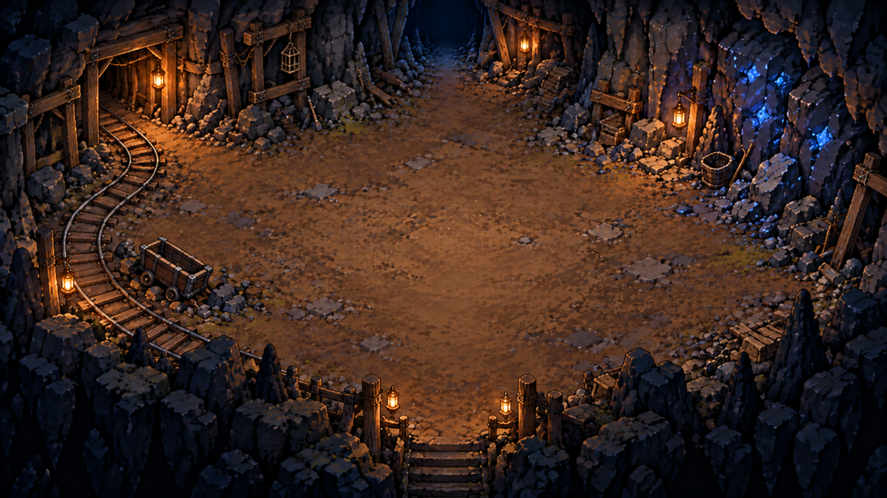](candidates/mine-mob-a.png) `mine-mob-a` 불규칙한 넓은 공동 | **갈라진 운반 갱도** [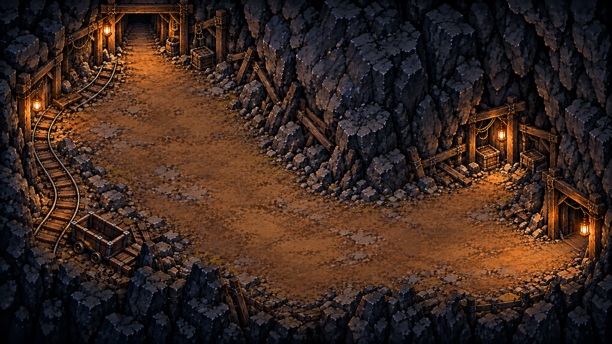](candidates/mine-mob-b.png) `mine-mob-b` 넓은 꺾임 | **버려진 적재장** [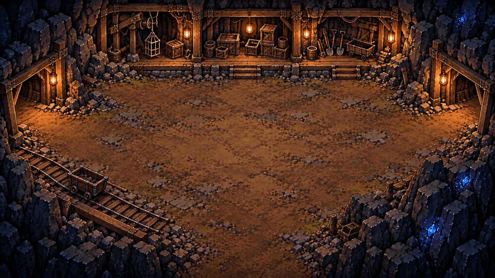](candidates/mine-mob-c.png) `mine-mob-c` 가로로 긴 공간 |

| 광물방 A | 광물방 B | 보스방 A |
|---|---|---|
| **흑철 채굴면** [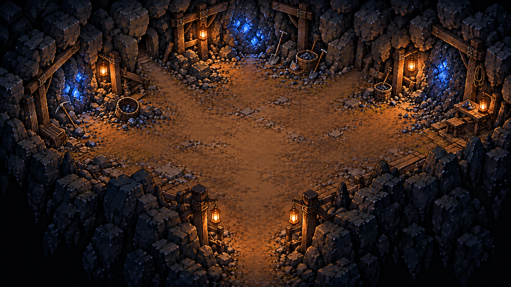](candidates/mine-ore-a.png) `mine-ore-a` 부채꼴 막다른 방 | **옛 채석 작업장** [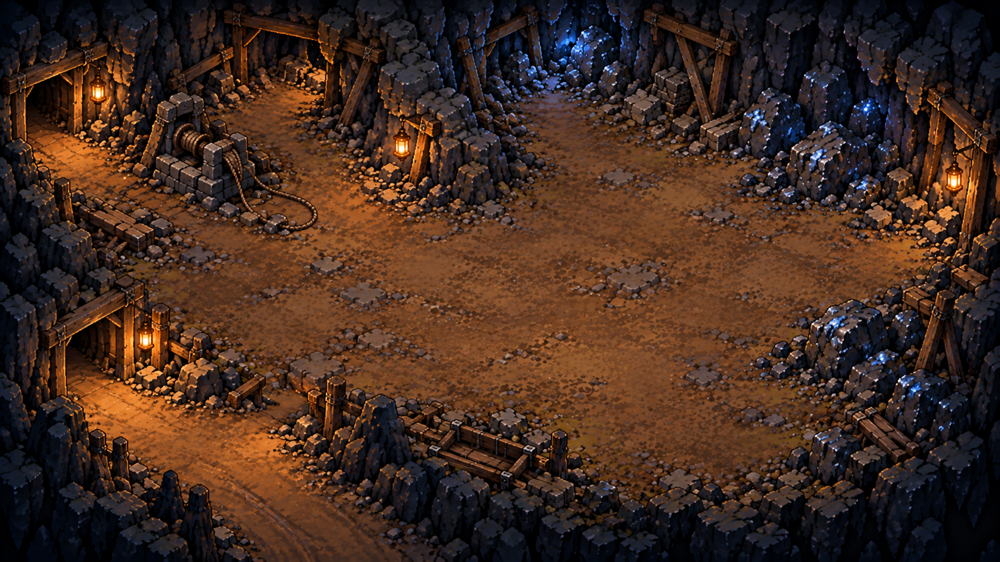](candidates/mine-ore-b.png) `mine-ore-b` 낮고 넓은 채굴 분지 | **골렘의 붕괴 공동** [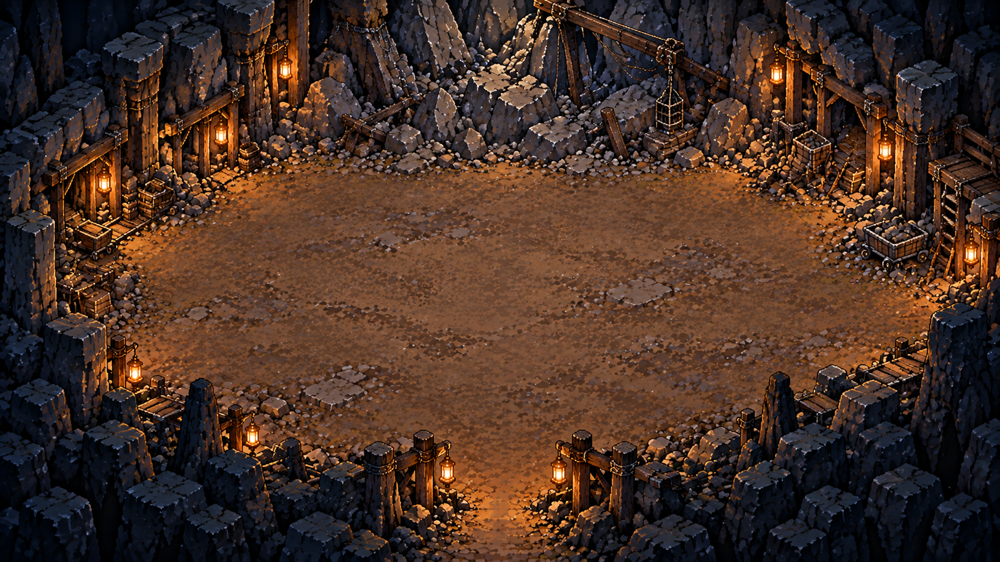](candidates/mine-boss-a.png) `mine-boss-a` 넓고 긴 돌진장 |

## 저주받은 성채

| 잡몹방 A | 잡몹방 B | 잡몹방 C |
|---|---|---|
| **폐허가 된 경비 홀** [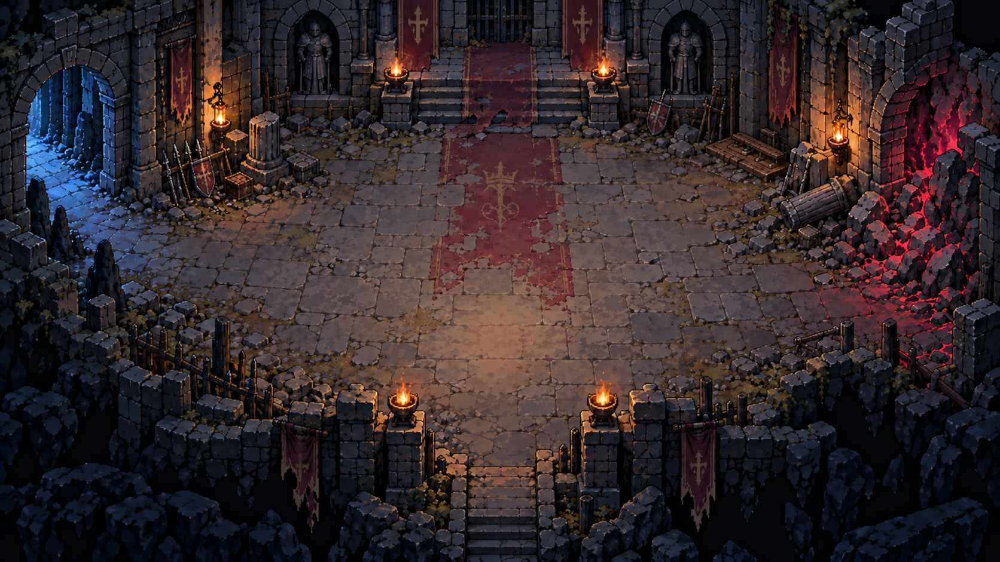](candidates/citadel-mob-a.png) `citadel-mob-a` 무너진 아치와 비대칭 홀 | **무너진 측면 회랑** [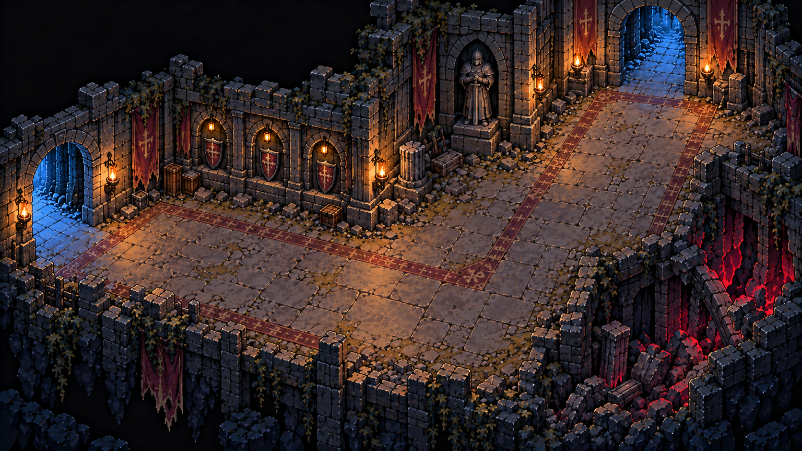](candidates/citadel-mob-b.png) `citadel-mob-b` 넓은 ㄱ자 회랑 | **버려진 병영** [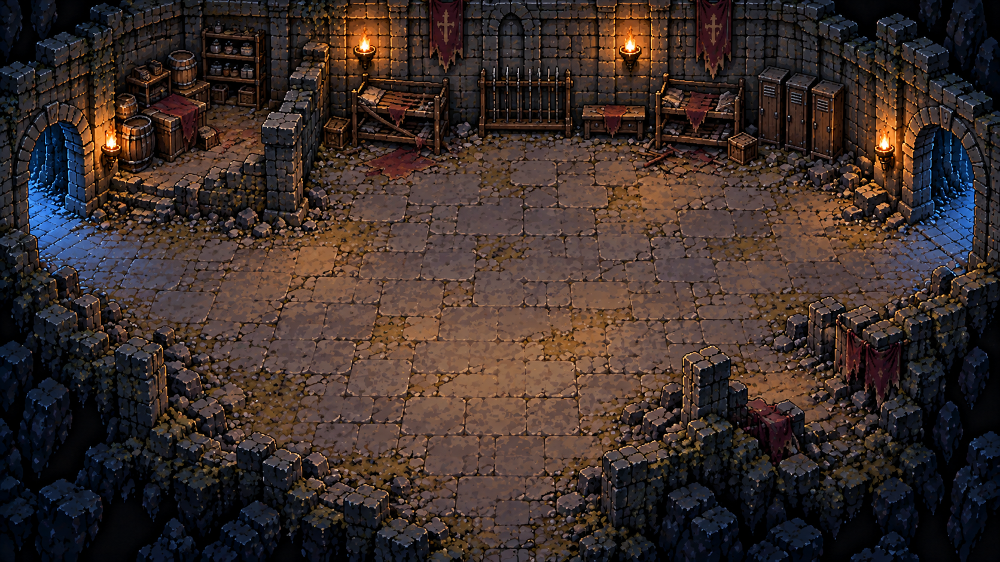](candidates/citadel-mob-c.png) `citadel-mob-c` 비대칭 생활 공간 |

| 광물방 A | 광물방 B | 보스방 A |
|---|---|---|
| **혈월석 침식 저장고** [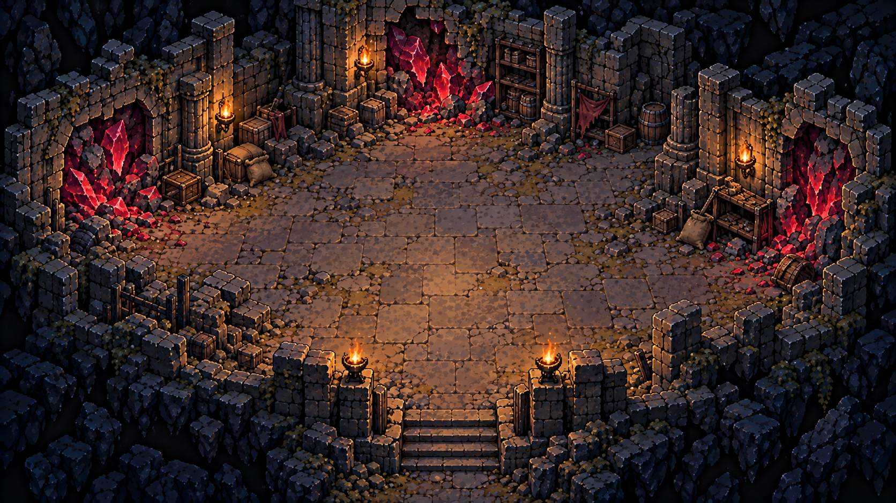](candidates/citadel-ore-a.png) `citadel-ore-a` 불규칙한 지하 저장실 | **갈라진 성벽 기초** [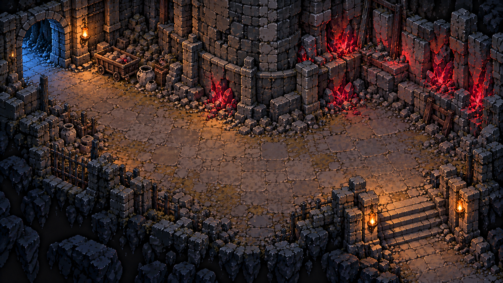](candidates/citadel-ore-b.png) `citadel-ore-b` 돌출 기초를 돌아가는 방 | **혈월 기사의 결투 홀** [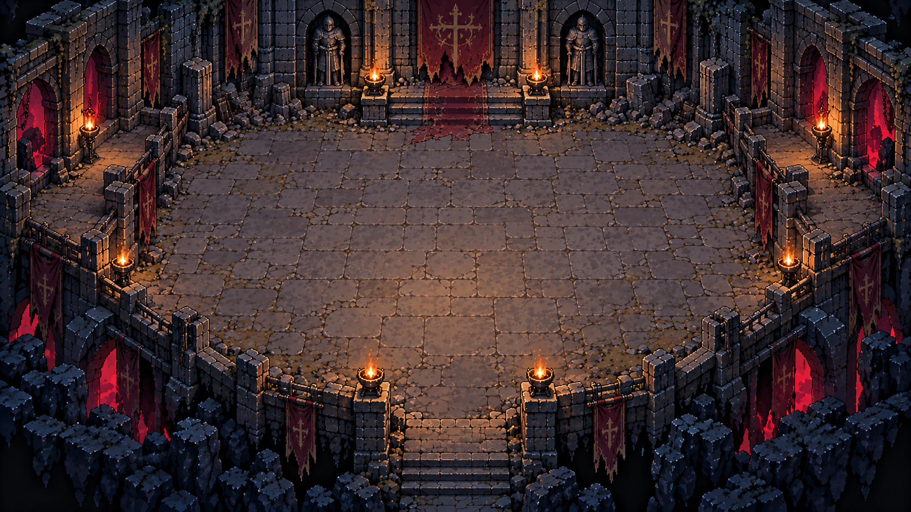](candidates/citadel-boss-a.png) `citadel-boss-a` 넓은 직사각 결투장 |

## 마왕의 탑

| 잡몹방 A | 잡몹방 B | 잡몹방 C |
|---|---|---|
| **봉인 의식장** [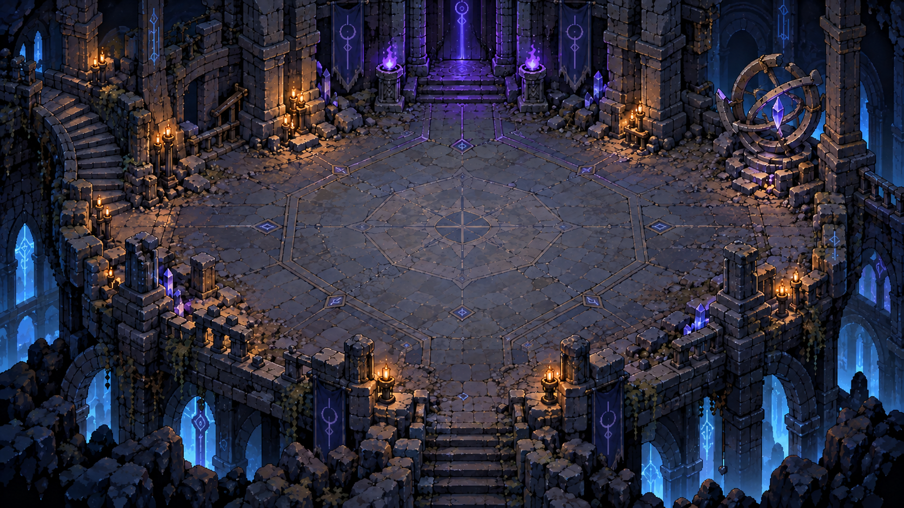](candidates/tower-mob-a.png) `tower-mob-a` 팔각형 의식장과 곁계단 | **봉인 서고** [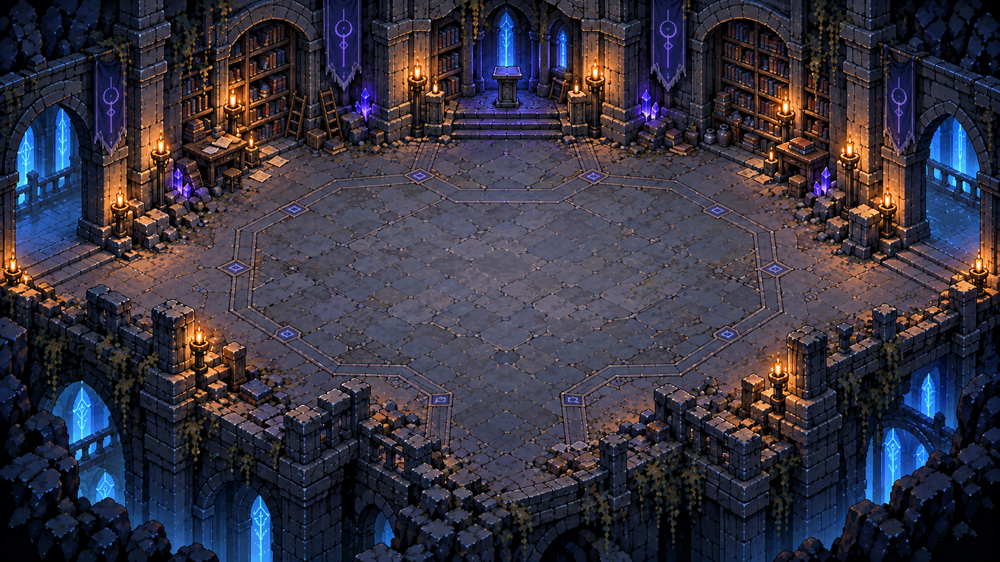](candidates/tower-mob-b.png) `tower-mob-b` 책장 벽감과 열린 중앙 | **갈라진 승강장** [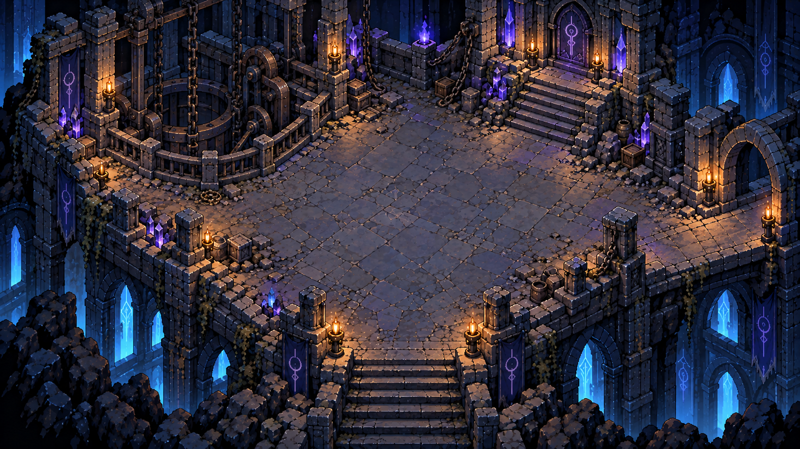](candidates/tower-mob-c.png) `tower-mob-c` 비대칭 오각형 승강실 |

| 광물방 A | 광물방 B | 보스방 A |
|---|---|---|
| **천공석 성장실** [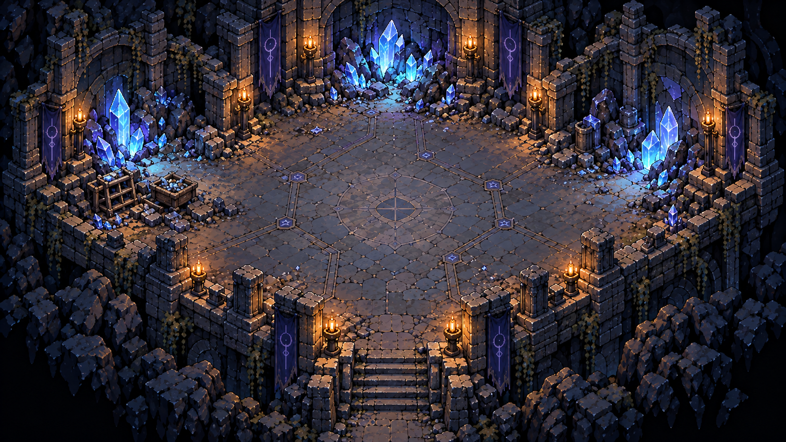](candidates/tower-ore-a.png) `tower-ore-a` 세 갈래 채굴 벽감 | **무너진 마력 저장실** [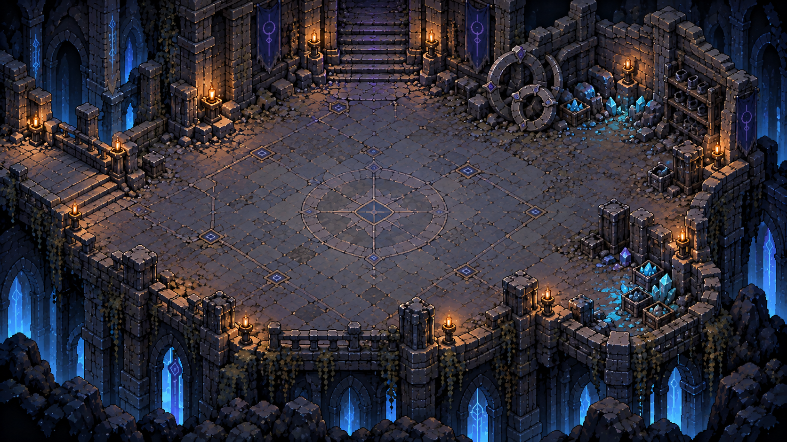](candidates/tower-ore-b.png) `tower-ore-b` 넓은 다각형 저장실 | **수문장의 마력 전당** [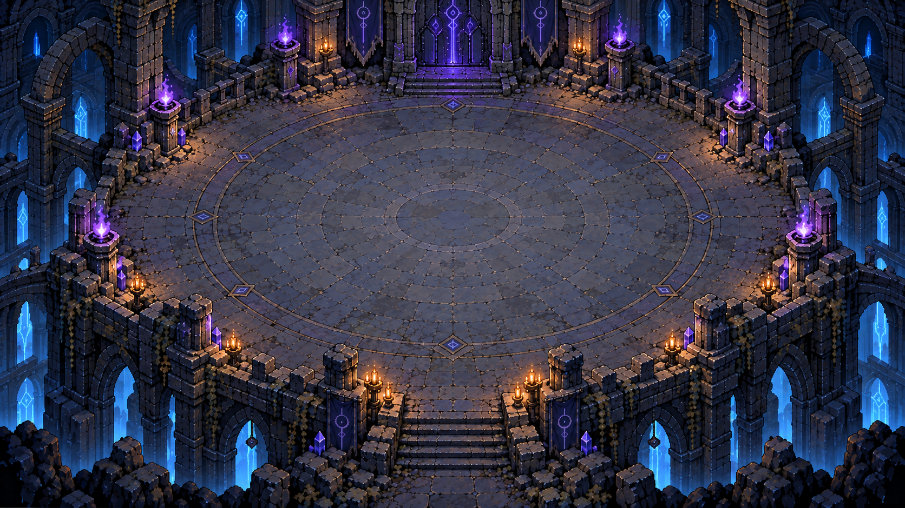](candidates/tower-boss-a.png) `tower-boss-a` 장애물 없는 큰 원형 전당 |

## 적용 기준

보이는 열린 바닥과 계단을 이동 영역으로 삼고, 실제 벽·닫힌 문·낭떠러지·장애물 바닥 면적만 막는다. 높은 물체의 몸체와 가림 효과는 발 충돌과 분리한다.

새 15개는 구도 후보이며 별도 충돌·광맥·문 상태·전경 레이어가 더 필요하다. 각 지역 A안 3개와 기존 최종 전당은 Java 이동 미리보기와 좌표 초안이 있다. 최종 전당은 캠프 아래 심연의 별도 후보로 유지한다. 자세한 제약은 README에 정리했다.

