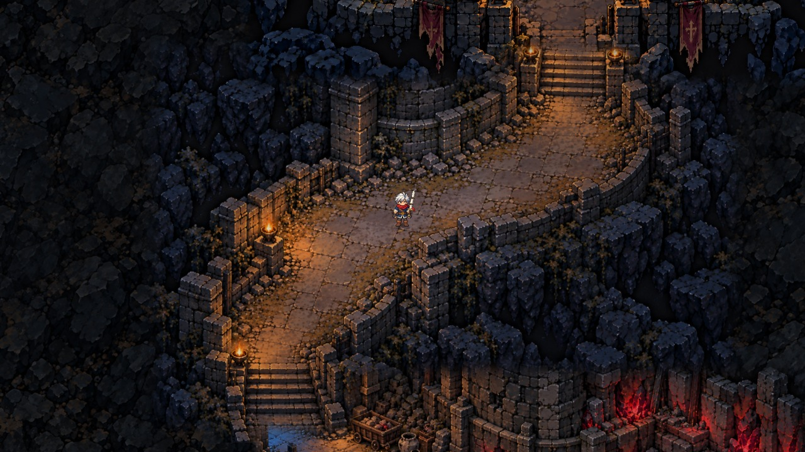
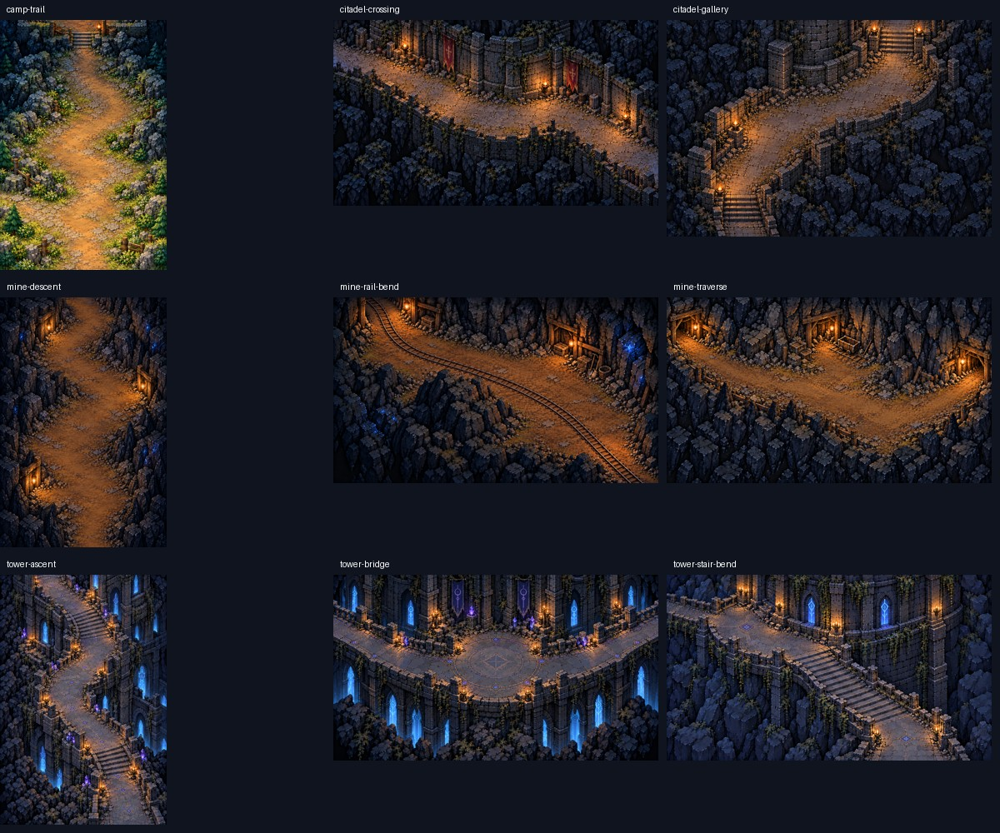

# 그림을 먼저 잇는 맵 — 2026-10-16

직각 통로에 길 무늬를 맞추던 방식을 바꿨다. **완성된 길목 그림 9종을 놓고, 그림 속 출구에 방을 연결한 다음, 실제 바닥 윤곽으로 이동 경계를 정한다.** 방 25개와 걸어서 오가는 연결 23개, 던전 진행 순서는 유지했다. 전체 맵 범위는 322×196에서 598×336타일로 넓어졌다.



## 바뀐 부분

- 성채는 둥근 성벽을 따라 굽는 회랑과 계단, 갱도는 암벽을 돌아가는 흙길과 곡선 레일, 탑은 전망대와 긴 굽은 계단을 쓴다. 캠프 아래는 마을의 녹지로 이어지는 길이다.
- `assets/scenes/links-v2/`의 PNG를 원본 비율로 한 장씩 그린다. 길목을 직선 조각으로 잘라 반복하거나 길 위에 별도 바닥 띠를 덧그리지 않는다. 일부 연결은 좌우 반전을 쓴다.
- `map.json`의 `passageScenes`에 그림에서 직접 잰 바닥 다각형과 중앙선이 있다. 각 링크의 `painted`는 배치·폭·반전·진행 방향이다. 방은 `origin` 절대 좌표로 배치된다.
- 출입구 주변만 두 장면을 섞되, 길목의 출구 바닥·계단·횃불은 불투명하게 유지한다. 나머지 암반 가장자리만 공통 바탕으로 흐려진다.
- 갱도 L3 레일, L5 옆문, 성채 R3 옆문의 기준점도 실제 바닥으로 옮겼다. 서로 다른 길목의 그림이 걸을 수 있는 바닥을 덮지 않게 배치했다.
- 탑 T3→T5의 대각선 계단은 그림 안쪽을 연결 기준으로 삼아 이음새에 직선 이미지 끝이 드러나지 않도록 했다.
- 이동은 그림 다각형을 사용한다. 미니맵·투사체용 타일 정보는 다각형에서 파생한다. 부분적으로 걸칠 수 있는 타일에서도 저장 복원·지역 이름·조명 전환이 작동한다.
- 맵 버전은 8. 이전 저장의 무기·광물·클리어 진행은 보존하고, 이전 좌표의 광맥·바닥 포션·이어하기 위치는 초기화해 캠프에서 시작한다.

## 그림과 좌표

내장 ImageGen으로 제작했다. [생성 및 레일 수정 프롬프트](generation.json)에 원본 생성 경로까지 기록했다. 최종 9장은 게임의 `assets/scenes/links-v2/`에 복사했다. 레일 길목은 마지막 수정본을 사용한다.



[전체 배치](layout.png), `trace-*.jpg`는 좌표 검수 자료다. 녹색은 이동 경계, 노란색은 검증용 중앙선이며 게임에 표시되지 않는다. 원본 그림에 이 선을 저장하지 않는다.

`python design/painted-map-links/build_layout.py`로 방 배치, 경계 데이터, 진단 그림을 재현한다. Python의 Pillow가 필요하다. 수정할 때에는 `TRACES`와 `PLACEMENTS`를 바꾸고 다시 실행한다.

## 검증

- `gradlew.bat :core:test :lwjgl3:dist --offline --no-daemon`: 96개 테스트 및 데스크톱 배포 JAR 빌드.
- 모든 23개 통로의 양방향 통행, 중앙선 전체 2px 간격의 발 여유, 전투 문 잠금, 통로 그림이 다른 통로 바닥을 덮지 않는지 검사한다.
- 방 간 겹침, 던전 해금, 광맥 배치, 이전 저장 마이그레이션을 검사한다. 곡선 가장자리의 타일 중심이 벽인 경우에도 실제 바닥 위치로 이어하는 별도 테스트가 있다.
- 실제 `WorldRenderer`로 입구·중간·출구, 주요 방과 전체 배치 **80화면**을 캡처한다. [중간](review-link.jpg) · [입구](review-entry.jpg) · [출구](review-exit.jpg).
- 캡처는 숨겨진 GL 창, 분리된 검수 저장 폴더, 해금된 문과 고정 난수를 쓴다. 사용자의 저장 파일을 읽거나 바꾸지 않는다. 전체 게임의 엔딩까지 플레이한 검증은 별도로 남아 있다.

```powershell
javac -encoding UTF-8 -cp lwjgl3/build/libs/yongsa-game-0.1.0.jar -d build/map-qa design/painted-map-links/PaintedLinksCapture.java
java -Xmx2g -cp 'build/map-qa;lwjgl3/build/libs/yongsa-game-0.1.0.jar' PaintedLinksCapture design/painted-map-links/final-captures
python design/painted-map-links/build_review.py
```

GitHub 통합 대상은 `claude/team-integration-m9u9aa`, 전달 PR은 [#14](https://github.com/choicomet/yongsa_game/pull/14)다. 기존 `map-continuity` 문서의 직선 통로 개선안은 이전 단계 기록이다.
