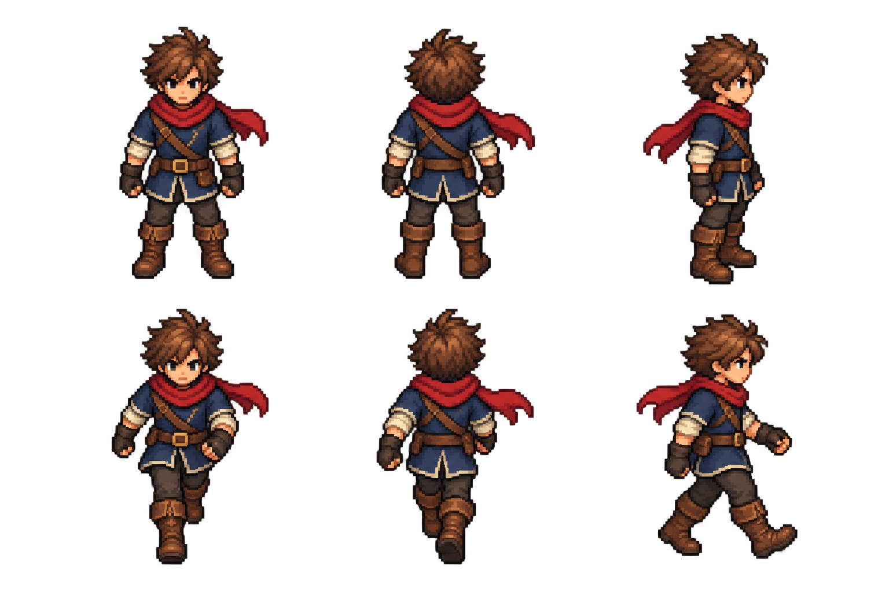
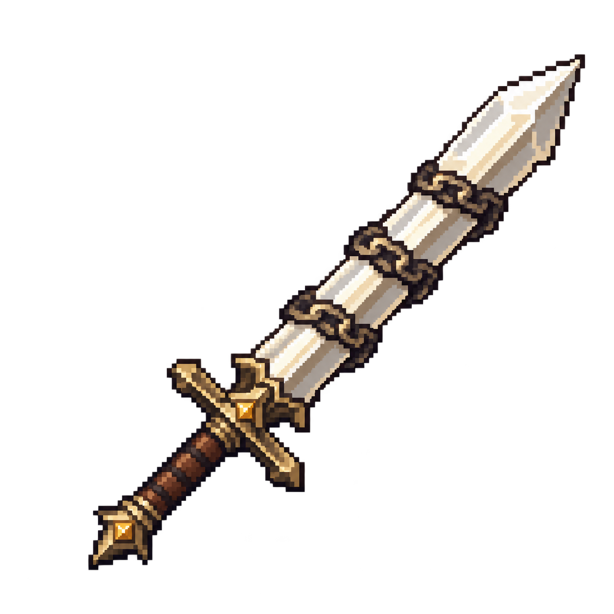
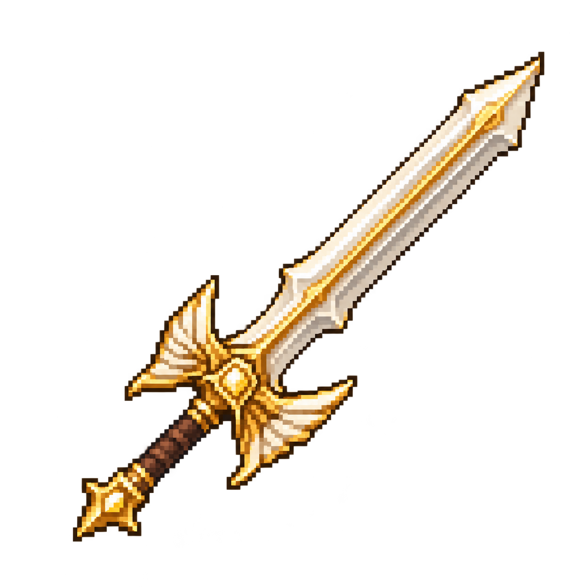
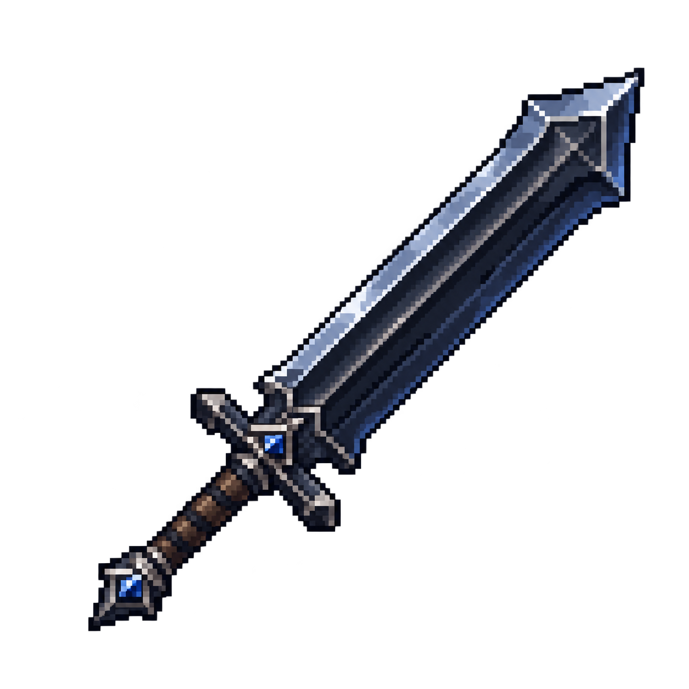
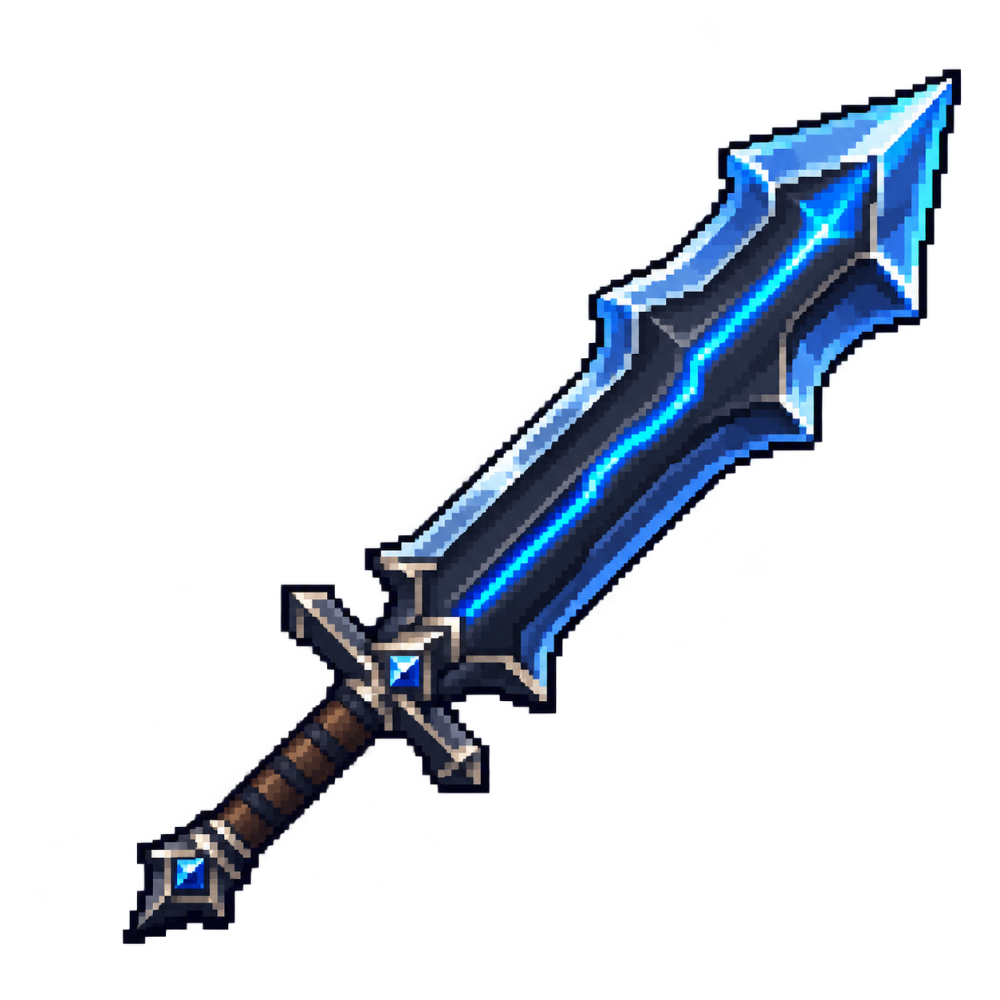
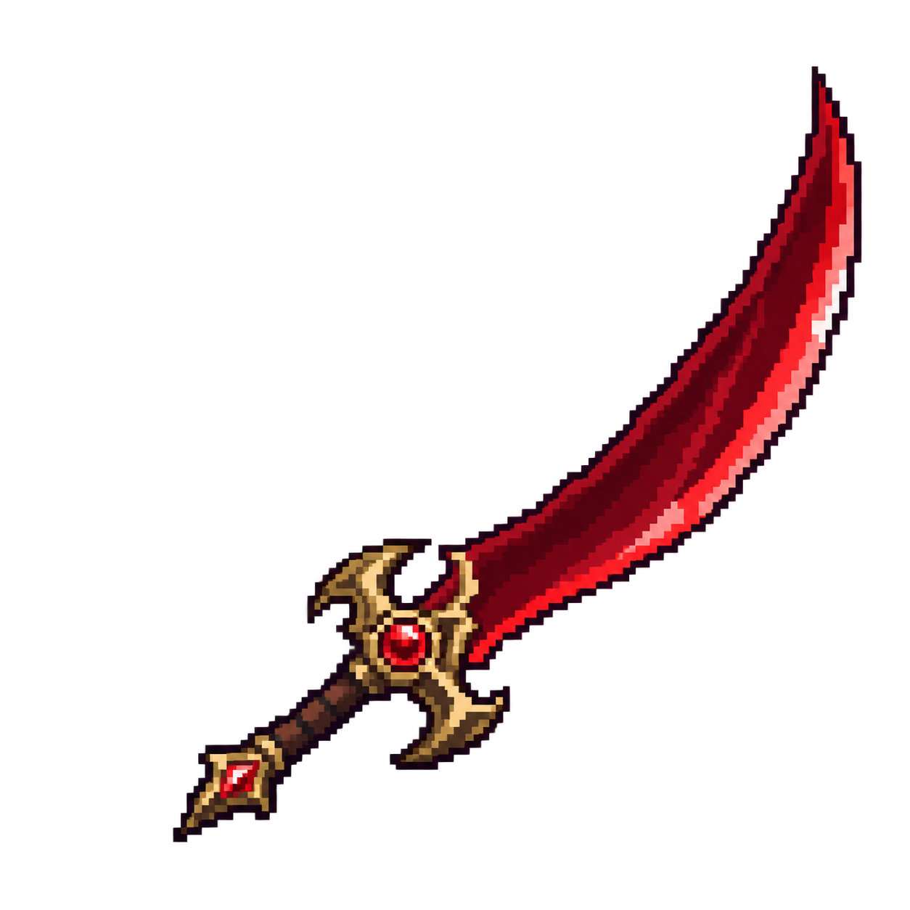
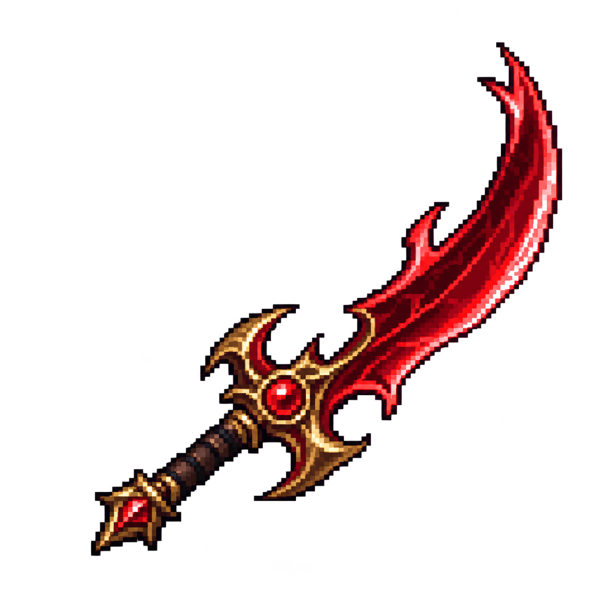
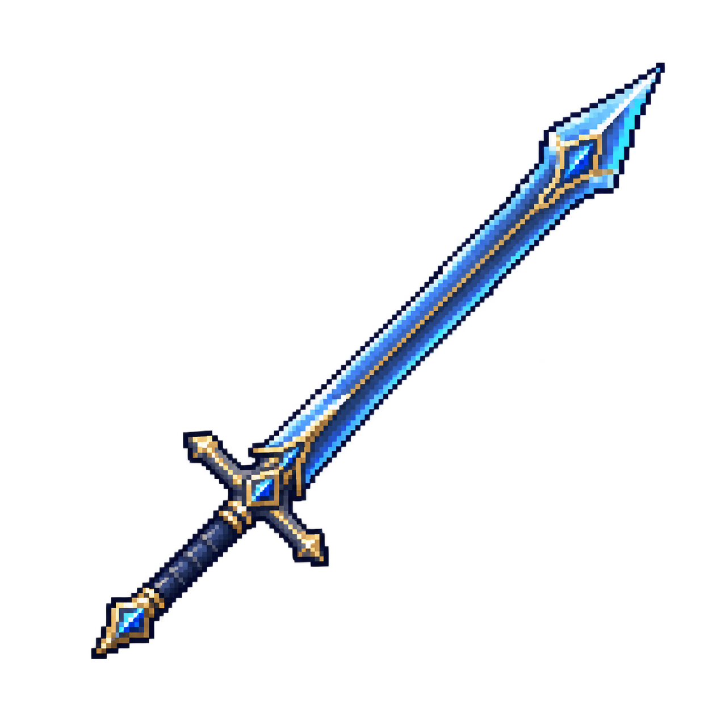
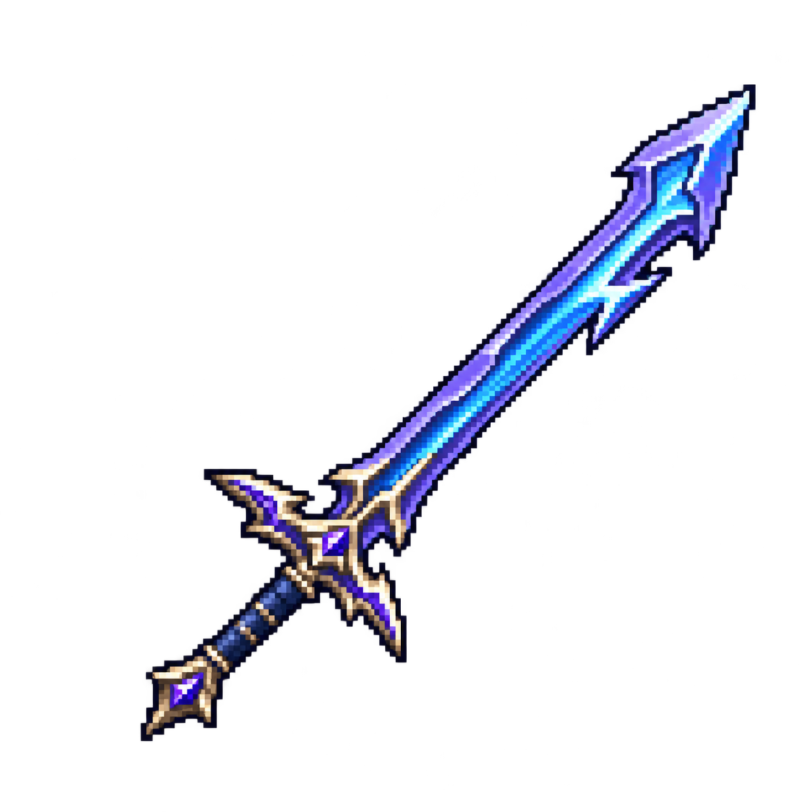

# 용사·검 도트 디자인 시안

기존 캐릭터와 검의 특징을 유지하면서 실사적인 재질과 잔장식을 덜어낸 디자인이다. **게임에 연결하기 전 검토 자료**이며, 이 PR을 반영해도 현재 플레이 그래픽이나 카메라가 자동 교체되지는 않는다.

## 용사 — 6포즈

앞/뒤/오른쪽의 대기와 걷기. 붉은 목도리, 남색 옷, 갈색 장비를 유지하고 검은 별도 레이어로 사용할 수 있도록 분리했다.

## 검 — 기본형과 각성형

| 계열 | 기본형 | 각성형 |
|---|---|---|
| 성검 |  |  |
| 흑철 |  |  |
| 혈월 |  |  |
| 천공 |  |  |

## 검토할 내용

- 작은 장착 크기에서도 캐릭터의 방향과 검 계열이 구분되는지.
- 도트 밀도와 장식량이 게임 배경에 맞는지.
- 각성형이 기본형의 특징을 유지하면서 차이를 보이는지.
- 카메라 확대를 먼저 할지, 액터 표시 크기도 조정할지. [비교 제안](DISPLAY_SCALE.md)을 참고한다.

## 확인 방법과 기록

GitHub에서는 이 README로 이미지를 확인한다. 저장소를 받은 뒤 `index.html`을 브라우저로 열면 크기 예시와 비교 갤러리를 볼 수 있다. HTML은 정적인 디자인 뷰어이며 실제 Java 실행 화면이 아니다.

- [제작 방향](BRIEF.md)
- [카메라·캐릭터 표시 크기](DISPLAY_SCALE.md)
- [검수 기록](QA.md), [PNG 검사 값](IMAGE_INSPECTION.json)
- [내장 image_gen 프롬프트](PROMPTS.json)
- [프로젝트 공통 디자인 기준](../../docs/ART_DIRECTION.md)

투명 PNG 9장: 용사 시트 1536×1024, 검 8장 각각 1254×1254. 실제 적용 전 포즈별 크롭과 장착점, 필터/배율을 맞춰야 한다. 생성 시트는 완전한 다중 프레임 전투 애니메이션 세트가 아니다.
