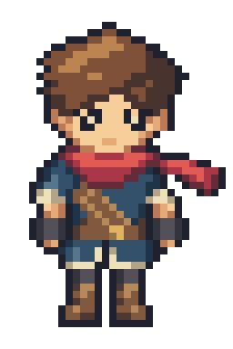
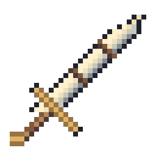
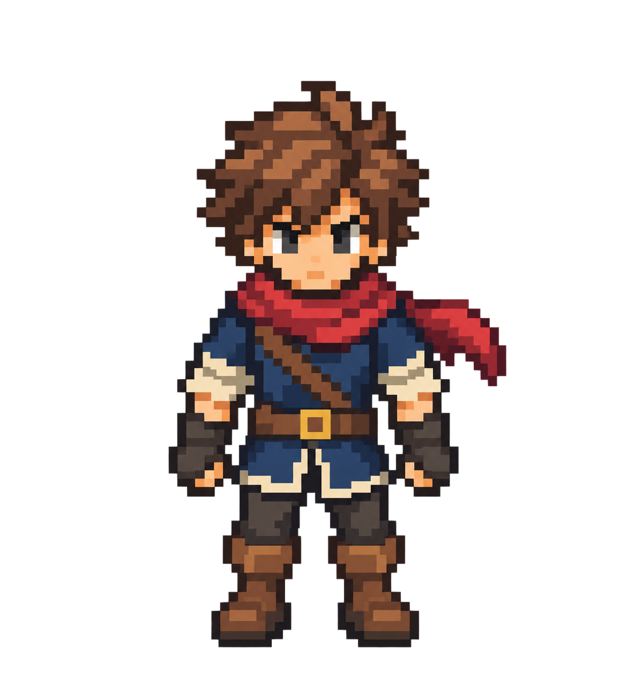
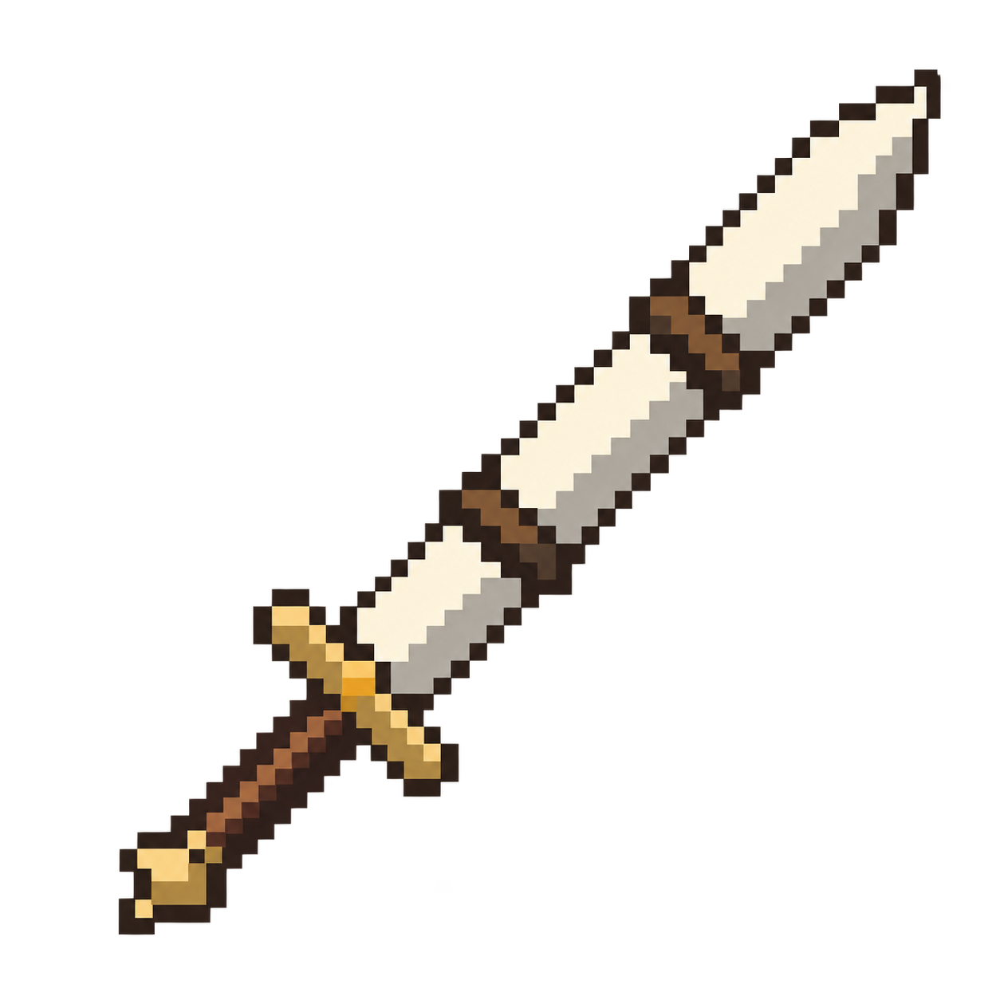

# 용사와 성검 · 잔질감을 덜어낸 도트 기준안

2026-10-10 · 최신 검토본. [이전 v3 시안](../pixel-v3/README.md) 다음 단계.

기존 그림의 갈색 머리, 붉은 목도리, 남색 옷, 갈색 장비와 검의 계열별 형태를 유지한다. 머리카락·천·가죽·금속을 큰 색 면으로 정리해 작은 화면에서 얼굴, 방향, 무기가 먼저 읽히게 한다.

이번에는 **용사 정면 대기 1프레임과 봉인 성검 1종**을 고정 격자의 원본으로 만들었다. 애니메이션 전체와 런타임 교체는 아직 진행하지 않았다. 게임성·카메라 변경과 분리된 디자인 검토다.

## 먼저 볼 것

[비교 화면 열기](index.html) — 내려받아 브라우저로 열면 기존 시안, 단순화 시안, 픽셀 원본을 비교할 수 있다. 원본은 1·2·3·4배 확대, 배경 변경, 격자·기준점 표시를 지원한다. 실제 게임 캡처가 아니다.

### 고정 격자의 원본 — 아래 이미지는 정확한 8배 확대

| 용사 정면 대기 | 봉인 성검 |
|---|---|
|  |  |
| 32×48, 22색, 실제 그림 높이 42px | 32×32, 10색, 실제 그림 높이 27px |

2배 확대하면 실제 그림 높이는 각각 **84px / 54px**다. 이미지 캔버스 높이는 각각 96px / 64px다. 이 수치는 브라우저 비교 기준이며, 게임 카메라에 그대로 적용된 값은 아니다.

캐릭터의 해상도를 32×48로 영구 제한하는 결정은 아니다. 작은 화면에서 필요한 정보량을 판단하기 위한 첫 샘플이다. 크기를 늘릴 때에는 읽히지 않는 장식을 추가하기보다 얼굴·동작·무기 실루엣의 여유를 늘린다.

### 형태 정리를 위한 생성 시안

| 용사 | 성검 |
|---|---|
|  |  |

위 생성 시안은 내장 image_gen 결과다. **고정 격자의 원본은 이 PNG를 축소·색상 변환한 결과가 아니다.** 기존 `assets/data/sprites.txt`와 같은 글자-픽셀 형식으로 별도로 작성하고 Java로 내보냈다. 생성 시안의 구체적인 디테일과 픽셀 원본 사이에는 차이가 있으며 원본은 `native/sprites.txt`다.

## 바뀐 디자인

| 요소 | 덜어낼 것 | 남길 것 |
|---|---|---|
| 머리 | 가는 머리카락, 빽빽한 하이라이트 | 갈색 머리 덩어리, 비대칭 앞머리 |
| 얼굴 | 부드러운 입체 그라데이션 | 밝은 얼굴 면, 작은 눈과 방향성 |
| 목도리 | 많은 주름·밝은 테두리 | 붉은 큰 면, 짧게 날리는 꼬리 |
| 옷·장비 | 가죽 결, 끈·버클의 잔장식 | 남색 상의, 크림색 소매, 사선 끈과 허리띠 |
| 성검 | 세밀한 사슬 고리, 보석 반사·입자 | 상아색 직선 날, 봉인 띠 두 개, 짧은 금색 가드 |
| 명암 | 재질마다 많은 중간색 | 큰 그림자 면, 절제된 밝은 면 |

## 파일과 재현

- [픽셀 원본](native/sprites.txt): 팔레트와 픽셀 행. 런타임의 같은 이름 자산을 아직 대체하지 않는다.
- [구조화 데이터](native/sprites.json): 프레임, 픽셀 행, 발·손잡이 기준점.
- [작성 소스](source/build-sprites.mjs): 픽셀을 직접 정의한 편집 가능한 원본.
- [Java 내보내기](source/ExportSprites.java): PNG와 2·4·8배 미리보기, 검증 결과 생성.
- [검증 결과](native/VALIDATION.json), [검수 기록](QA.md), [게임 연결 시 확인 사항](INTEGRATION.md), [생성 프롬프트](PROMPTS.json).

`design/pixel-v4/`에서 Node.js와 JDK 17로 실행:

```powershell
node source/build-sprites.mjs
java '-Djava.awt.headless=true' source/ExportSprites.java native/sprites.txt
```

## 다음 제작 순서

1. 이 용사와 성검을 실제 표시 크기로 비교해 디테일 밀도와 크기를 판단한다.
2. 같은 발 기준점을 쓰는 뒤·옆 대기와 걷기 프레임을 만든다. 현재 1프레임만으로 애니메이션 안정성을 검증했다고 볼 수 없다.
3. 흑철의 넓은 날, 혈월의 곡선, 천공의 가는 날을 같은 밀도로 정리하고 각성형으로 확장한다. 계열 구분은 실루엣으로, 각성 구분은 핵심 형태 변화와 제한된 포인트 색으로 한다.
4. 런타임에서는 필터·표시 크기·피벗을 연결하고 걷기, 공격, 구르기, 문 통과, 적과 보스의 예고 가독성을 확인한다.
5. 이후 중앙 캠프의 바닥 대비와 소품 밀도를 낮추고 타이틀처럼 자연스러운 외곽을 검토한다. 중앙방 변경은 이번 산출물에 포함되지 않는다.
