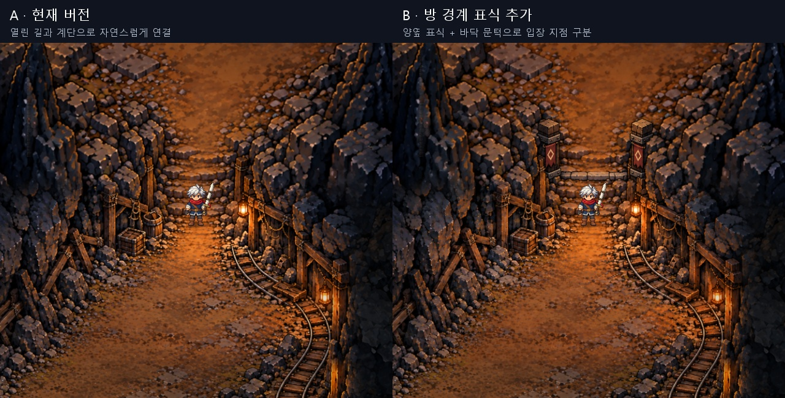
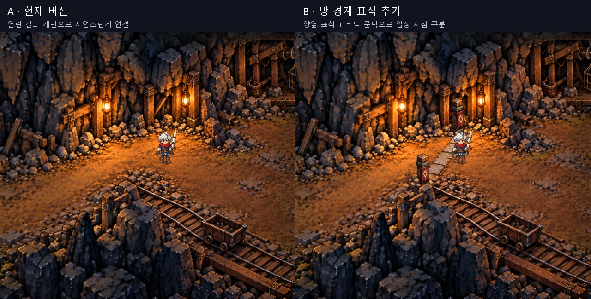

# 방 경계 A/B 비교 — 선택 대기

게임에 적용된 A의 자연스러운 연결을 보존한 상태에서, 방 입장 지점을 읽기 쉬운 B 후보를 따로 만들었다. **B는 비교용 후보이며 기본 게임에 적용하지 않았다.** 검토 자료는 같은 `haeseong/game` 브랜치와 PR #16에 보관한다.

- **A 현재 버전**: 열린 흙길과 돌계단, 연속된 바위 벽. `1b516b3`의 그림 원본을 A 폴더에 그대로 보관했다.
- **B 경계 표식**: 길 양옆에 철띠를 두른 목재 표식과 짧은 붉은 깃발, 바닥 높이에 맞는 돌 문턱을 추가했다. 머리 위 들보나 닫힌 아치는 추가하지 않았다.

둘 다 같은 `WorldRenderer`, 카메라, 용사 위치, 조명과 축척으로 렌더링했다. B를 선택하면 새 표식의 발 위치와 앞뒤 가림까지 최종 반영해야 한다. 현재 비교는 확정된 플레이 버전이 아니다.

## 보관 파일

- [A 북쪽](A/mine-north.png), [A 옆길](A/mine-side.png)
- [B 북쪽](B/mine-north.png), [B 옆길](B/mine-side.png)
- [내장 image_gen 생성 프롬프트와 원본 기록](generation.json)
- `BoundaryCompareCapture.java`: 저장소의 실행 JAR을 사용하며 메모리 안에서만 후보 그림을 교체한다. 사용자 저장 파일과 기본 게임 에셋은 변경하지 않는다.

## 10월 20일 추가로 보고된 곳

새로 받은 두 스크린샷은 **CAMP→L1의 양쪽 연결부**다. 이곳은 아직 다시 그리지 않았다. 기존에 실제로 수정·업로드한 곳은 **L1→L2의 L1 쪽**과 **L3→L5의 L5 쪽** 두 곳이다. GitHub와 PC 체크아웃 모두 `1b516b3`을 포함하며, 현재 `4498574`까지 올라와 있다. 새 두 스크린샷의 문제는 업로드 누락이나 B 후보의 적용 대기와 별개로 남아 있는 원화 연결 문제다.

이어 진행한 [전체 맵 점검](../full-map-audit/README.md)에 46개 연결부의 미수정 위치와 화면을 정리했다. A/B 선택과 별개로 원화 연결 수정이 필요하다.
