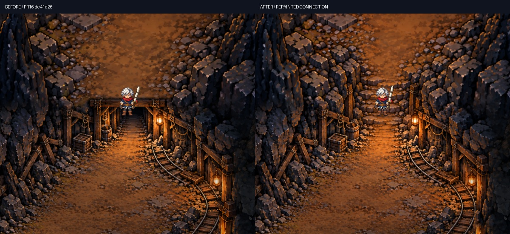
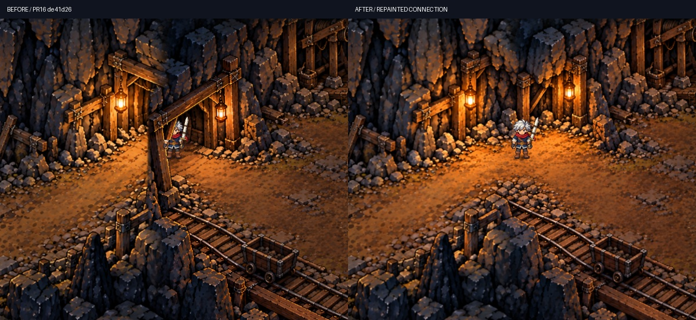

# 출입구 그림 연결 수정 — 2026-10-18

## 최신: 연결 구간 자체를 다시 그리기

`de41d26`의 투명도 보정만으로는 위쪽 바닥이 아래 갱도 지붕에 붙어 보이는 문제가 남았다. 사용자가 지적한 광산 두 곳은 **방과 통로를 함께 포함한 실제 화면을 편집 원본으로 삼아 연결 구간을 새 그림으로 교체**했다.

- **L3→L5 북쪽 연결**: 위쪽 흙길, 열린 돌계단, 아래쪽 갱도가 한 바닥으로 이어진다. 길을 가로막던 지붕·문틀과 어두운 막다른 입구를 없애고 양쪽 암벽을 계단 옆으로 연결했다.
- **L1→L2 옆 연결**: 서로 교차하던 문틀 두 개와 통행 중간의 기둥을 없애고, 하나의 뒷벽과 열린 흙길로 다시 그렸다. 기존 레일·광차와 주변 방은 유지한다.
- 게임은 새 그림을 원래 좌표의 512×512 월드 영역에 그린다. 화면 전체를 바꾸거나 생성 이미지를 잘라 늘이지 않는다. 가장 바깥 32월드픽셀만 기존 풍경으로 넘기며, 연결부 중앙은 새 그림이다.
- 예전 문틀의 앞쪽 가림 픽셀은 해당 영역에서 제거한다. 새 그림 속 상자·통과 암벽은 새 그림의 픽셀로 가린다.
- 새 그림에서 바닥 다각형과 장애물 발 위치를 다시 짚어 `map.json`의 `joints`에 기록했다. 이동·투사체/미니맵용 타일·통로 위치 판정이 같은 데이터를 쓰며, 문 잠금 규칙은 유지한다. 맵 배치·진행 순서·저장 버전은 그대로다.

### 실제 게임 전후 비교




[연결부 양쪽 발 위치 8곳과 잠금문 2곳](joint-walk.jpg). 방 전체·길목 등을 포함한 실제 게임 화면 15장과 이동 경계 진단 2장을 확인했다. 새로운 바닥과 벽의 통행, 문 중앙과 옆쪽 우회 차단, 현재 맵 좌표·이미지 비율을 검사하는 테스트 3개를 추가했다. **전체 107개 테스트 통과, 배포 JAR 빌드 성공.** 전체 수동 플레이를 했다는 의미는 아니다.

### 새 그림 파일과 제작 기록

내장 **image_gen**으로 편집했다. [최종 프롬프트와 생성 원본 기록](joint-generation.json).

- [북쪽 연결 그림](../../assets/scenes/joints-v1/mine-north.png)
- [옆 연결 그림](../../assets/scenes/joints-v1/mine-side.png)
- [배치·바닥 경계·가림 좌표](../../assets/data/map.json)의 `joints`

`JointArtCapture.java`는 조명·배우가 없는 원래 장면을 정확한 월드 좌표로 내보낸다. `-Dyongsa.jointFootprint=true`는 새 그림 위에 실제 통행 가능한 발 위치만 진단 점으로 표시한다. `JointWalkCapture.java`는 새 바닥 8곳의 통행과 잠금문 2곳의 차단을 확인하며 캡처한다. 두 도구 모두 별도 검수 저장 폴더를 쓴다. `install_joint_layout.py`는 바닥 다각형만 갱신하며 PNG를 편집하지 않는다. 방 배치를 변경하면 연결 그림과 기준 문 좌표를 함께 다시 검수해야 한다.

## 이전 단계: 구조물 잘림 보정

사용자가 PC에서 확인한 커밋은 PR #14의 `5372e64`였다. 이후 GitHub에서는 이 작업이 `haeseong/game` / [PR #16](https://github.com/choicomet/yongsa_game/pull/16)으로 통합됐다. 이번 수정은 최신 통합 `a0435d4` 위에 누적한다.

## 문제와 수정

갱도 북쪽 입구의 들보가 바닥에 덮이고, 옆문은 기둥이 잘린 채 두 그림이 붙어 보였다. 방 테두리 전체에 적용하던 넓은 투명 처리가 출입구 목재까지 지웠고, 문턱 바로 앞에서 방 그림을 지워 계단과 문틀도 함께 끊겼다. 길목 이미지 가장자리의 급격한 혼합을 막는 처리는 대각선 문에만 적용되어 있었다.

- 실제 연결된 문 주변은 테두리 혼합 폭을 줄여 들보·기둥·계단을 보존한다. 그림 바깥 경계는 계속 투명하게 이어진다.
- 방 그림을 길목 그림으로 넘기는 위치를 문턱보다 바깥으로 옮겨 문틀이 반으로 지워지지 않게 한다.
- 모든 출구 방향에 연속적인 혼합을 적용해 길목 이미지의 사각형 끝이 드러나지 않게 한다.
- `RoomJoinMask` 하나를 배경, 기존 앞쪽 PNG, 원본 픽셀 앞뒤 가림 처리에서 함께 사용한다.

원본 PNG, 맵 크기·배치, 이동 경계, 보상·전투·저장 규칙은 변경하지 않는다. 그림의 서로 다른 원근이나 조명까지 다시 그리는 작업은 포함하지 않는다.

## 검증

- Java 17 `:core:test :lwjgl3:dist --offline --no-daemon`: **104개 테스트 통과**, 실패·오류 0, 배포 JAR 생성.
- 회귀 테스트 3개: 보고된 북쪽 들보와 옆 기둥의 보존, 방 테두리의 연속 투명도, 23개 연결의 모든 문 방향에서 이미지 경계에 갑작스러운 잘림이 없는지 검사.
- 기존 23개 통로 양방향 통행·문 잠금·저장/재개·캠페인 자동 테스트 포함.
- 실제 `WorldRenderer`로 23개 길목의 입구·중간·출구 및 주요 방 등 80화면, 물체 앞뒤 가림 30화면을 검수했다. 별도 검수 저장 폴더를 사용했다.

실제 화면: [전체 입구](review/entry.jpg) · [전체 출구](review/exit.jpg) · [길목](review/link.jpg) · [가림 회귀 확인](review/foreground.jpg).

확대 비교: [북쪽 입구](north-comparison.jpg) · [옆문](side-comparison.jpg). BEFORE는 사용자가 실행한 PR #14, AFTER는 최신 통합본과 이번 보정이다.

## 재현

저장소 루트에서 배포 JAR을 만든 뒤 실행한다. 캡처 원본은 Git에 넣지 않고 비교 화면만 보관한다.

```powershell
javac -encoding UTF-8 -cp lwjgl3/build/libs/yongsa-game-0.1.0.jar -d build/seam-qa design/painted-map-links/PaintedLinksCapture.java design/combat-rewards/ForegroundCapture.java
java -Xmx2g -cp 'build/seam-qa;lwjgl3/build/libs/yongsa-game-0.1.0.jar' PaintedLinksCapture build/seam-captures
java -Xmx2g -cp 'build/seam-qa;lwjgl3/build/libs/yongsa-game-0.1.0.jar' ForegroundCapture build/seam-foreground
python design/seam-fix/build_review.py build/seam-captures design/seam-fix/review
python design/seam-fix/build_review.py build/seam-foreground design/seam-fix/review --foreground
```

전체 엔딩까지 직접 조작하며 이동·전투한 수동 플레이 검증을 의미하지 않는다.
