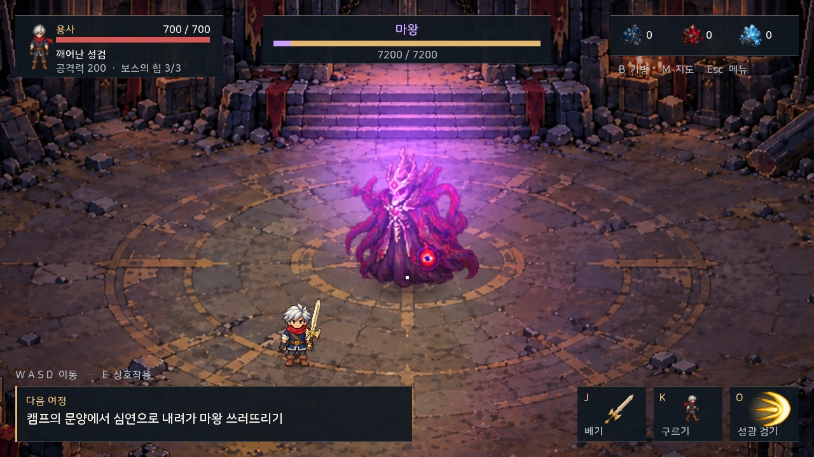
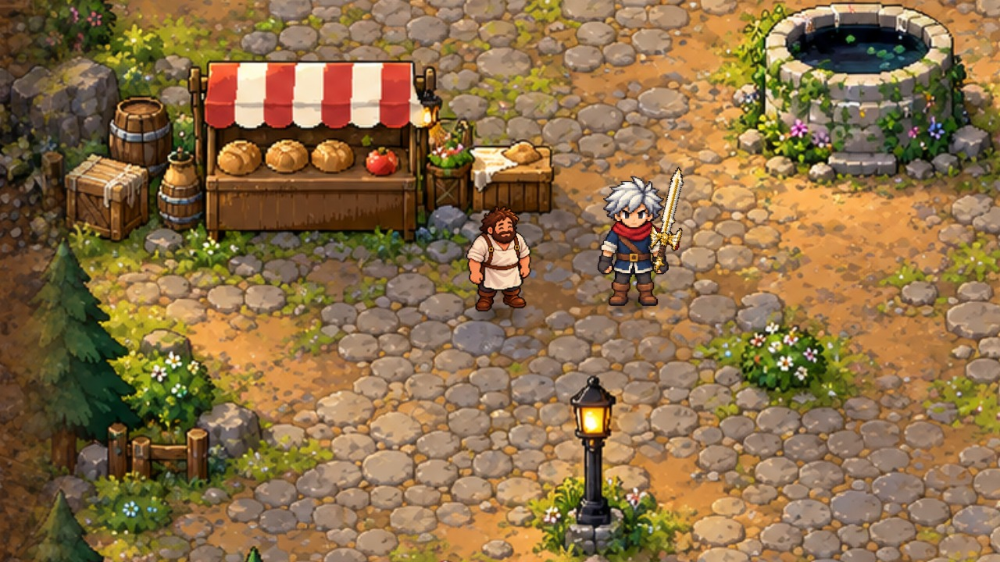
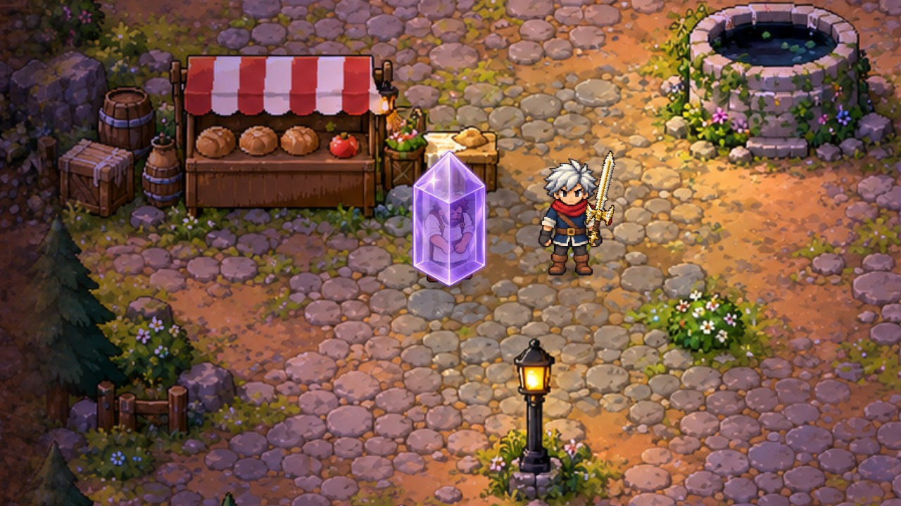
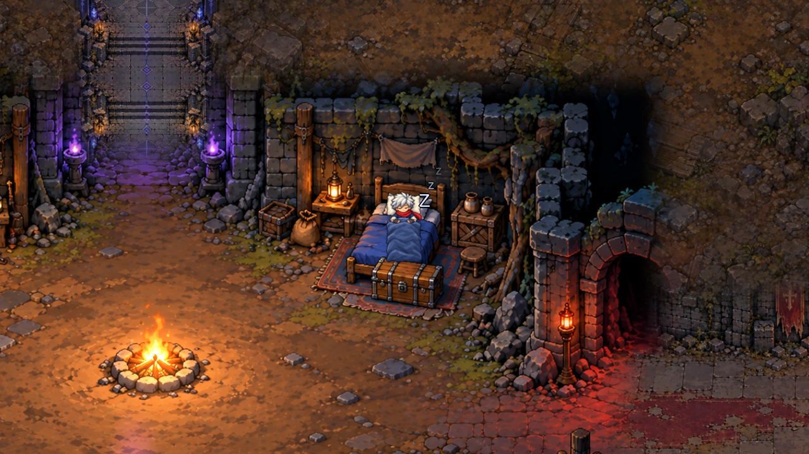

# 이야기 스프라이트 B — 2026-10-16

> 2026-10-19: 주민 비율과 기쁨 동작은 [캐릭터 모션 보강](../character-motion/README.md)에서 다시 조정했다. 현재 성인 주민은 용사와 비슷한 몸높이로 표시한다. 아래의 1.35배 설명과 캡처는 당시 제작 이력이다.

마왕의 본모습, 주민 6명, 수정 감옥, 잠든 흰머리 용사를 게임에 연결했다. 기존 `codex/story-sprites`의 `9aafafa` 초안을 최신 통합 브랜치 `95ce69a` 위에서 검수·완성한 작업이다. 작업 브랜치는 `codex/story-sprites-ready`, PR 대상은 `claude/team-integration-m9u9aa`다. 맵 PR #14의 병합 여부와 관계없이 적용할 수 있다.



## 게임 반영

- 마왕 2페이즈부터 `assets/team/jiyong/boss_lich2.png`를 사용한다. 공격·특수 공격·피격·이동·사망을 기존 8열×5행 규격으로 읽는다. 새 시트가 없으면 1페이즈 시트로 돌아가는 호환 처리도 유지했다.
- 사망 이벤트에 페이즈와 방향을 전달한다. 쓰러질 때 1페이즈 그림으로 돌아가거나 작아지지 않으며, 좌우 방향도 유지한다. 새 시트에 임시 보라색 틴트를 중복 적용하지 않는다.
- 주민 6명은 구출 전 세 번째 자세와 반투명 수정, 구출 후 두 서 있는 자세와 기존 기쁨 동작을 사용한다.
- 실제 화면에서 작은 주민 그림의 세부가 뭉개지고 용사보다 지나치게 작아 보였다. **원본에서 직접 4배 규격 표시용 시트를 만들고, 월드 크기는 기존의 1.35배**로 맞췄다. 성인 몸높이 약 47px, 아이 약 39px이며 용사보다 작다.
- `assets/sprites/story/`의 표시용 그림은 밉맵으로 축소한다. 기존 32×40 주민, 44×60 수정, 48×56 수면 그림도 그대로 제공하며, 표시용 그림이 없으면 기존 파일을 사용한다.
- 침대에는 같은 크기의 흰머리 용사 수면 그림을 사용한다. 베개·이불 위치는 실제 캠프 화면에서 확인했다.





## 제작과 파일

내장 ImageGen으로 만들었던 9개 원본은 `sources/`, 참고 그림은 `reference/`, 실제 생성 프롬프트와 생성 경로는 [generation.json](generation.json)에 있다. 이번 완성 단계는 기존 생성 결과를 사용하며 새 이미지 생성은 하지 않았다.

사용자가 2026-10-15 고정 칸 스프라이트의 크기 조정을 허용한 범위에서 원본을 보존하고 칸에 맞게 크기·위치를 정리했다. `repack_boss.py`와 `repack_small.py`가 과정을 재현한다. 작은 시트를 다시 늘려 표시용 시트를 만든 것이 아니라 원본에서 각각 만든다. 보고서는 `inspection.json`, `inspection-small.json`, `display-inspection.json`이다.

| 파일 | 규격 |
|---|---|
| `assets/team/jiyong/boss_lich2.png` | 2048×1280, 256px 칸 40장, 발 기준 (128,224) |
| `assets/team/sunwoo/villager_*.png` | 96×40, 32×40 칸 3장씩 6종 |
| `assets/team/sunwoo/crystal_prison.png` | 88×60, 44×60 칸 2장 |
| `assets/sprites/hero_sleep.png` | 48×56, 1장 |
| `assets/sprites/story/villager_*.png` | 384×160, 128×160 칸 3장씩 6종 |
| `assets/sprites/story/crystal_prison.png` | 352×240, 176×240 칸 2장 |
| `assets/sprites/story/hero_sleep.png` | 192×224, 1장 |

## 검증

- Java 17 `gradlew.bat :core:test :lwjgl3:dist --offline --no-daemon`: **91개 테스트 통과**, 배포 JAR 빌드 성공. PR #14와 별도 기준 브랜치이므로 맵 PR의 추가 테스트는 이 숫자에 포함되지 않는다.
- 기존 실제 전투 테스트에 사망 이벤트의 2페이즈·방향 유지 검증을 추가했다.
- 보스 40프레임 모두 내용·투명 여백·발 기준을 검사했다. 주민/수정/수면 기본 시트와 4배 표시용 시트도 칸 크기·잘림·수정 내부 알파를 검사했다.
- [실제 렌더링 22화면](review-all.jpg): 마왕 1/2페이즈, 좌우 방향, 특수 공격과 쓰러짐, 마을 전경 2개와 주민별 구출 전후 12개, 수면, 전체 보스 시트. 렌더러가 선택한 2페이즈 시트와 시체 크기도 확인했다.
- 캡처는 숨겨진 GL 창과 분리된 `build/story-qa-save`를 사용한다. 연출 확인을 위해 상태를 배치한 화면이며, 처음부터 엔딩까지 수동으로 플레이했다는 뜻은 아니다.

```powershell
python design/story-sprites/repack_boss.py
python design/story-sprites/repack_small.py
.\gradlew.bat :core:test :lwjgl3:dist --offline --no-daemon
javac -encoding UTF-8 -cp lwjgl3/build/libs/yongsa-game-0.1.0.jar -d build/story-qa design/story-sprites/StorySpriteCapture.java
java -Xmx2g -cp 'build/story-qa;lwjgl3/build/libs/yongsa-game-0.1.0.jar' StorySpriteCapture design/story-sprites/captures
python design/story-sprites/build_review.py
```

다음 작업은 C(눈알 효과·상자 3종), D(앞쪽 가림 보강), 전체 플레이와 밸런스 검수다. 맵은 별도 PR #14에서 사용자가 먼저 확인 중이다.
