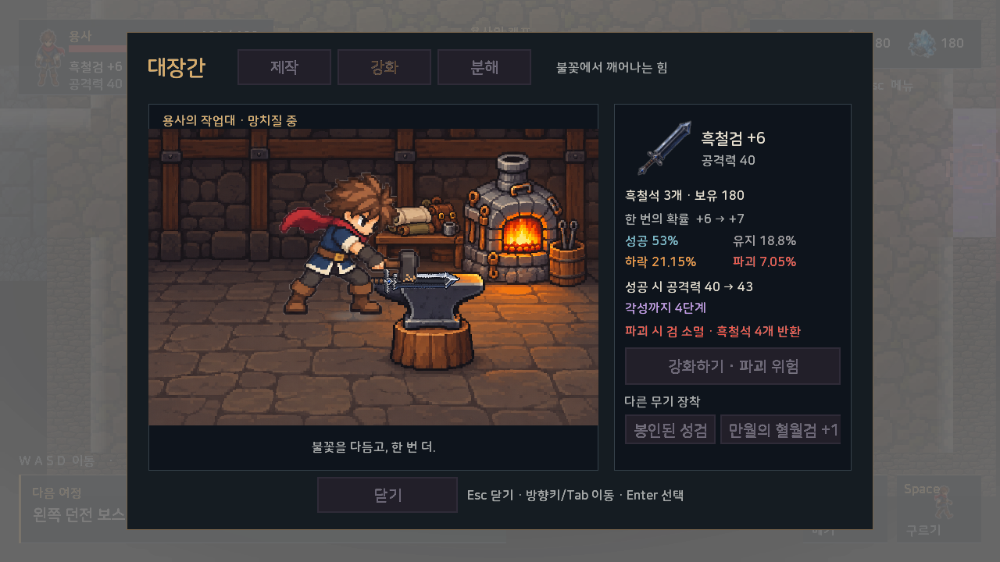

# 2번 스타일 인게임 적용 · 용사의 대장간

2026-10-11 · Java 17 + libGDX 런타임에 연결한 변경안. [실제 게임 화면 보기](index.html)

사용자가 선택한 **2번 시안은 플레이 장면**, **1번의 상세 그림은 큰 미리보기·삽화**로 나눴다. 32×48 고정 격자 실험안은 비교 기록으로 남기고 이번 런타임에는 적용하지 않았다.

## 적용 범위

| 요소 | 게임 안 | 상세 미리보기 |
|---|---|---|
| 용사 | 앞·뒤·옆 대기/걷기 6프레임 | 기존 HUD 초상 유지 |
| 검 | 성검·흑철·혈월·천공 기본/각성 8종 | 가방·제작 카드·강화 정보의 기존 상세 그림 |
| 적 | 박쥐·해골·마족병·골렘·기사·수문장·마왕 | 기존 상세 원본 보존 |
| 소품 | 화로·침대·모닥불·광맥 3종 | HUD 광물 그림 보존 |
| 지형 | 캠프·갱도·성채·탑 바닥과 벽 | 타이틀 삽화 유지 |
| 대장간 | 용사 망치질 6포즈 + 작업 공간 | 오른쪽 작은 검 미리보기 |

새 PNG 14개는 [assets/world](../../assets/world/), UV와 표시 크기는 [hd-art.json](../../assets/data/hd-art.json)에 있다. 총 110개 world 영역이며 기존 103개 게임 그래픽에 대응하는 버전과 대장간 7개 영역이다. 기존 assets/hd 이미지는 그대로 남는다.

## 대장간

작업 장면 576×380을 왼쪽 큰 패널에 배치했다. 오른쪽 폭 304에는 검·재료·공격력·확률 네 개·강화 버튼을 모았다. 확률 막대를 제거하되 성공/유지/하락/파괴의 정확한 숫자와 파괴 확인창은 유지한다. 이전 세 줄 기록은 최근 한 줄로 줄였다.

- 3회 망치질: 준비 → 들어올리기 → 내려치기 → 반동.
- 성공: 웃으며 주먹을 들어 올림. 각성 시 모루 위 검도 각성형으로 바뀜.
- 유지: 잠시 멈칫한 뒤 대기 자세.
- 하락: 고개와 어깨를 낮춤.
- 파괴: 짧은 반동 뒤 낙담, 모루의 검이 사라짐. 실제 무기는 성검으로 자동 장착되는 기존 규칙.
- 제작에도 같은 작업 연출을 사용.

기본 망치질은 1.35초(기존 balance의 hammerSeconds가 더 길면 그 값), 결과는 1.05초, 각성은 기존 설정 1.5초를 사용한다. 모두 설정의 연출 속도를 따른다. 마지막 타격에서 실제 판정·재료 소모·저장을 한 번 수행하며, 연출 중 키보드·마우스·F1의 다른 작업 진입을 막는다. 확률이나 공격력 수치는 변경하지 않았다.

## 연결 구조

Art.world / worldSword는 플레이용 이미지를, 기존 get / sword는 상세 그림을 반환한다. WorldRenderer가 전자를 사용한다. world PNG는 Nearest 필터, 상세 그림은 기존 Linear/mipmap이다. 캐릭터·무기·적의 논리적 표시 크기, 충돌, 전투 범위, 카메라(일반 115% / 보스 100%)와 사거리는 유지했다.

생성 PNG는 **도트 느낌의 큰 색 덩어리**를 사용하는 이미지다. 균일한 고정 격자·제한 팔레트의 네이티브 픽셀 원본이라고 주장하지 않는다. 비정수 카메라 배율도 유지했으므로 모든 표시 픽셀의 폭이 같다는 보장은 없다. 사용자가 선택한 2번의 디테일을 우선했다.

캠프의 불규칙한 외곽·구역 배치, 몬스터의 추가 방향별 애니메이션은 후속 작업이다. 이번에는 기존 방 지형과 전투 시스템에 그림을 연결했다.

[검수 기록](QA.md) · [생성 프롬프트 전체](PROMPTS.json) · [사용자 방향](../../docs/ART_DIRECTION.md)
