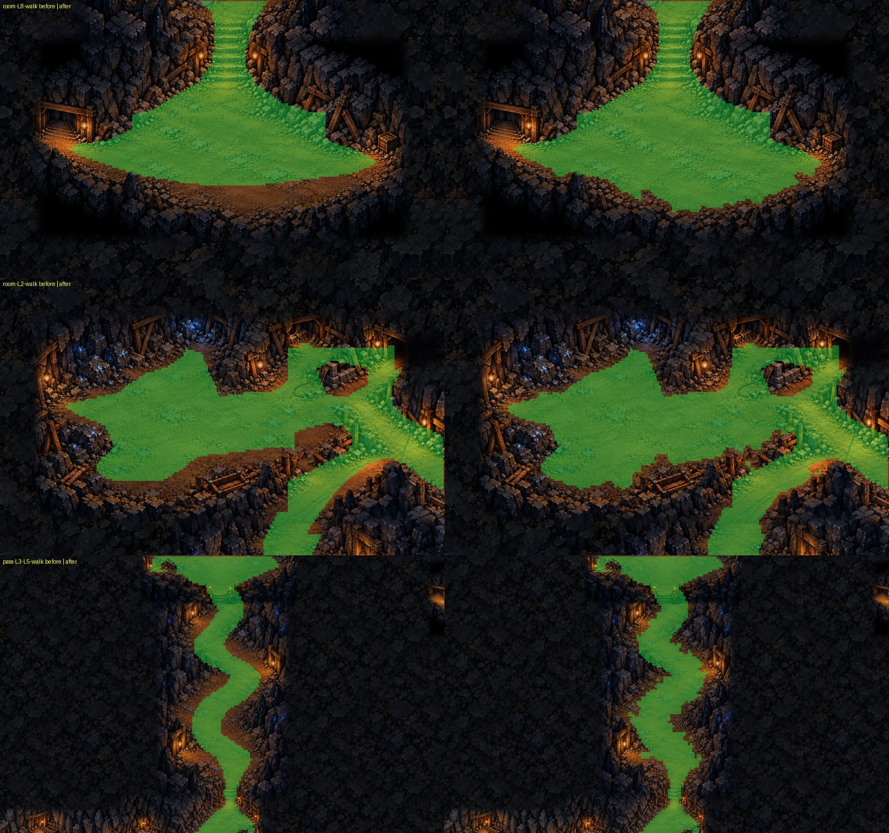
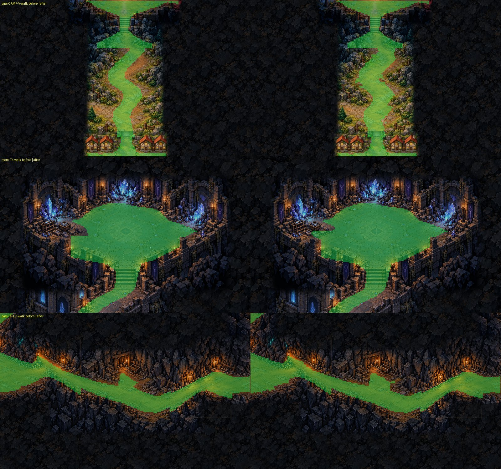

# 보이는 길인데 막힌 곳 열기 — 2026-10-26

그림은 바꾸지 않았다. 그림에서 바닥으로 보이는데 이동 경계(바닥 다각형) 밖이라 못 들어가던 곳을 경계 안으로 넣었다.

## 무엇이 막혀 있었나

맵 전체(방 29개, 연결부 그림 35장, 길목 그림 9장)를 실제 게임 렌더러로 찍고, 발이 설 수 있는 자리를 초록으로 겹쳐 봤다. 막힌 곳은 대부분 **길 가장자리의 흙바닥·포장 띠**였다. 바닥 다각형이 길 한가운데만 감싸고 있어서, 그림상 같은 바닥인데 가장자리 한두 칸에서 보이지 않는 벽에 걸렸다.

| 종류 | 고친 곳 |
|---|---|
| 방 (`natural-room-scenes.json`) | 광산 L1·L2·L5·L6·L7·L8, 성채 R4, 탑 T4, 동굴 2곳 (그림 10장) |
| 연결부 (`map.json` joints) | 광산 쪽 8장, 성채 쪽 4장 |
| 길목 (`map.json` passageScenes) | 광산 3장, 성채 2장, 캠프↔마을 길 |

가장 크게 바뀐 곳은 L8(광산 교차로) 아래쪽 흙길, L2 아래 흙바닥, L3↔L5 내리막 길 양옆, 광산 레일 굽은 길, 탑 T4 왼쪽 광석 수레 앞 흙바닥이다. 성채·탑은 대부분 원래 경계가 그림과 맞았다.

## 원칙

- **넓히기만 했다.** 원래 바닥은 하나도 줄이지 않았다 (T4만 꼭짓점 정리로 0.02% 차이).
- 바위·벽·소품 위는 열지 않았다. 바닥 다각형과 이어진 흙·포장 영역 가운데 발(반지름 약 10px)이 들어갈 만큼 넓은 곳만 넣었다. 막힌 소품 다각형(`blocked`)은 그대로다.
- 문 잠금, 던전 봉인, 전투 잠금, 광맥·시설 판정 코드는 건드리지 않았다.

## 지용 브랜치(`map/replenishment`)와의 관계

`map/replenishment`는 **코드** 쪽 수정이다. 방 그림과 연결 그림이 맞닿는 선에서 양쪽 다 바닥인데 막히던 문제를 충돌 격자 하나로 합쳐 해결한다. 이번 수정은 **데이터** 쪽이다. 그림 하나 안에서 바닥 다각형이 그림보다 좁았던 곳을 넓혔다. 두 수정은 서로 다른 원인을 고치므로 겹치지 않고, 나중에 함께 합쳐도 충돌하지 않는다 (그 브랜치는 `WorldMap.java`만, 이번은 JSON만 바꾼다). 그 README가 고칠 후보로 적은 `exit-R5-R6` 포장 바닥도 이번에 넓혔다.

## 검증

- `gradlew :core:test :lwjgl3:dist`: 121개 테스트 통과 (잠긴 문 옆 우회 차단, 길목 20개 통과 검사 포함).
- `WalkCap.java`로 방·길목 96장을 수정 전후 같은 위치에서 다시 찍어 비교했다.
- 수동 플레이는 하지 않았다. 게임에서 벽에 붙어 걸어 보며 확인해 주면 좋다.

## 다시 만들기

`find_edges.py`가 그림의 흙·포장 색과 질감으로 넓힐 후보를 찾고 `c_<id>.jpg` 확인 그림과 `cands.json`을 만든다. `apply_edges.py`가 그 결과를 JSON의 `walkable` 줄에만 넣는다. 저장소 루트에서 실행한다 (Pillow, OpenCV, Shapely 필요).
