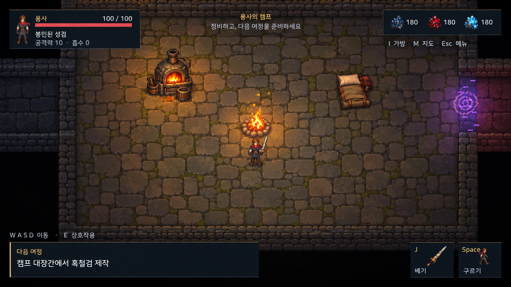

# 현재 디자인 방향

2026-10-10 · 사용자 피드백과 현재 적용 상태를 구분한 공통 기준.

## 사용자가 정한 방향

- UI/UX 수업 프로젝트이며 실제 Java 게임에서 쓸 수 있는 완성도를 원한다.
- 현재 만든 디자인의 기본 틀·분위기·캐릭터 정체성을 유지하면서 게임에 맞게 과한 부분을 덜어낸다.
- 참고 게임: **던그리드, 코어 키퍼, 테라리아**. 특히 도트이면서 퀄리티가 높은 느낌을 원하며, 캠프 도트 시안의 방향을 긍정적으로 평가했다.
- 이전 HD 결과는 좋지만 너무 3D 게임 같은 그래픽이라 어색하다는 평가다. 복잡한 재질·반사·장식의 밀도를 조정한다.
- **16×20 제한은 해제**했다. Java에서 실행 가능한 범위에서 원본 해상도를 높여도 된다. 도트 스타일이 저해상도 강제 복귀를 뜻하지 않는다.
- 검은 별도 자산으로 디자인하고 캐릭터와 분리해서 사용한다.
- 현재 요청은 캐릭터와 무기 디자인을 먼저 진행하는 것이다. 게임성 개선도 이어간다.
- 이후 중앙방은 타이틀 화면 같은 느낌으로 정리하고 싶다. 현재의 고정된 사각형 방 인상을 완화하는 것이 목표다.
- 실제 게임에서는 디자인 체감이 약하다고 느끼며 카메라 확대와 캐릭터 크기 증가를 검토하고 싶어 한다.
- 자료 공유는 개별 ZIP보다 **같은 저장소의 별도 브랜치·PR** 방식으로 진행한다.

테라리아 언급은 표현과 품질의 참고다. 횡스크롤 전환이나 건설·농사 기능 추가를 확정한 요청으로 해석하지 않는다. 이전에 “최대 품질로 진행하고 과하면 줄이자”라고 했지만, 이후 실제로 과하다는 피드백이 왔으므로 최신 의견을 따른다.

## 현재 무엇이 적용되어 있나

| 구분 | 상태 |
|---|---|
| 기존 HD 아트·Scene2D UI | `1fc7a2c`에 커밋되어 현재 게임에 적용됨 |
| 몬스터 행동·보스 패턴/분노·투사체 | 이후 Claude의 `da87414` 작업에 포함. 본 디자인 PR에서 수정하지 않음 |
| F1 개발 메뉴 | `f9e022d`에 포함 |
| 캠프 도트 시안 | 방향 참고 이미지. 실제 맵 교체 상태 아님 |
| 용사 6포즈·검 8종 도트 PNG | `design/pixel-v3/`의 디자인 검토 자료. 현재 `assets/hd/`를 대체하지 않음 |
| 카메라 확대/액터 크기 변경 | 제안 단계. 실제 카메라 값은 이번 PR에서 변경하지 않음 |
| 타이틀 느낌의 자연스러운 중앙방 | 후속 구상. 맵·충돌 데이터 변경 전 |

## 아트 제작 기준

영웅은 갈색 머리·붉은 목도리·남색 옷·갈색 장비를 유지하고 얼굴·방향·손·발이 읽히도록 정리한다. 무기는 성검의 봉인, 흑철의 넓은 날, 혈월의 곡선, 천공의 길고 가는 형태로 구분한다. 각성형도 기본형의 계열이 유지되어야 한다.

작은 균열, 가죽/금속 미세 질감, 과한 입자와 발광을 줄이고 도트 덩어리·명암 단계·외곽선의 일관성을 높인다. 배경은 캐릭터와 공격 예고보다 약한 대비로 정리한다. 한글의 가독성은 유지하며 무조건 도트 글꼴로 바꾸지 않는다.

생성 PNG는 도트 스타일 시안이다. 실제 적용 전에 그리드, 크롭, 발/손잡이 기준점, 카메라 배율과 텍스처 필터를 정렬해야 한다. 이미지 크기가 공격 범위나 충돌 크기를 자동으로 바꾸지 않도록 한다.

## 카메라와 표시 크기 — 제안, 확정 수치 아님

우선 게임 월드만 현재보다 **15~20% 확대**한 비교본을 권장한다. HUD/글자 크기는 유지한다. 더 필요할 때 용사·일반 적의 시각 크기를 5~10% 조정한다. 큰 보스는 별도로 본다. 타일·소품·충돌까지 일괄 확대하지 않는다.

보스 예고와 적이 화면 밖으로 잘리는지, 좁은 문 통과와 무기 판정이 자연스러운지 실제 플레이로 확인한다. 세부 수치는 [표시 크기 제안](../design/pixel-v3/DISPLAY_SCALE.md)에 있으며 아직 검증 완료된 설정은 아니다.

## 중앙 캠프 — 후속 방향

모닥불 주변으로 대장간·침대·던전 입구가 작은 구역을 이루고, 무너진 벽과 암벽이 불규칙한 외곽을 만드는 구상을 제안한다. 타이틀의 구도와 분위기를 참고하되 모든 배치를 그대로 고정한 승인은 아니다. 그림뿐 아니라 실제 이동 공간, 문 위치와 충돌도 함께 검토한다. 지금 모든 던전 방을 전면 재설계하라는 요청으로 확대하지 않는다.

### 사용자 타이틀 참고

### 긍정적으로 평가한 도트 방향 시안

