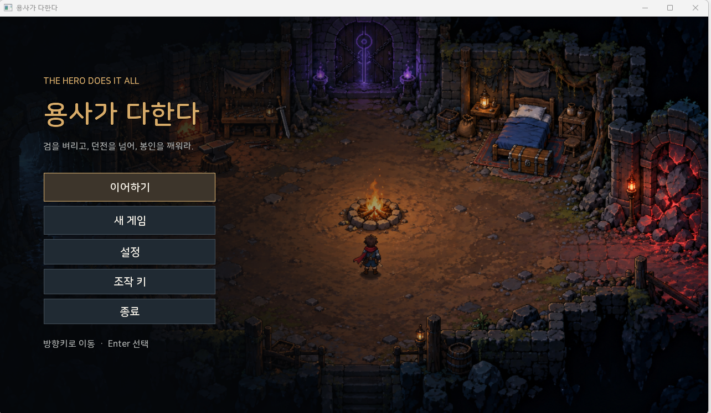

# 현재 디자인 방향

2026-10-11 · 최신 사용자 의견과 적용 상태.

## 사용자가 정한 방향

UI/UX 수업의 실제 Java 게임이다. 처음에는 최대한 높은 품질을 원했으나 이후 3D처럼 과한 재질·반사·장식을 덜어내기를 요청했다. 던그리드·코어 키퍼·테라리아처럼 도트이면서 완성도 있는 표현이 참고 방향이다. 횡스크롤·건설·농사 기능 추가를 뜻하지 않는다.

기존 갈색 머리, 붉은 목도리, 남색 옷, 갈색 장비와 검 계열의 실루엣을 유지한다. 16×20 제한은 해제됐으며 32×48도 영구 상한이 아니다. 검은 캐릭터와 분리된 자산으로 사용한다.

**최신 결정은 v4 비교 화면의 2번을 인게임 수준으로, 1번을 큰 그림이 필요한 곳에 사용하는 것이다.** 사용자는 3번 고정 격자 실험안보다 2번의 디테일을 선호했고 기존 주요 그래픽 전체로 이 구분을 확장하도록 요청했다.

대장간에서는 용사가 직접 망치질하고 성공·실패에 따라 동작이 바뀌어야 한다. 확률·비용 패널을 작게 줄이고 동작 장면이 더 크게 보여야 한다. 작업 공유는 ZIP보다 **별도 브랜치와 GitHub PR**을 사용한다.

## 이번 브랜치의 적용 상태

[2번 스타일 런타임 변경안과 실제 캡처](../design/style2-runtime/README.md)가 최신이다.

- 플레이용: 용사 앞·뒤·옆 대기/걷기 6프레임, 검 8종, 적 7종, 대장간·침대·모닥불·광맥, 4개 지역 바닥·벽.
- 상세 그림: assets/hd 원본, 타이틀 삽화, HUD 초상, 가방·제작 카드·강화 정보의 무기 그림.
- 대장간: 6포즈 작업 애니메이션, 성공/유지/하락/파괴/각성 반응. 왼쪽 큰 작업 장면과 오른쪽 작은 확률·재료 카드.
- 기존 전투·맵·강화 확률·비용·충돌 유지. GameScreen 변경은 작업 중 F1 차단 한 곳.
- 일반 115%·보스/최종방 100% 카메라와 휠/+/- 비교 기능은 Claude의 기존 구현 유지. 추가 15% 확대가 아님.
- 마족병 사거리 7칸 유지. 제안됐던 5.5칸은 확정 요청이 아님.
- 기존 방 형태 유지. 중앙 캠프의 자연스러운 외곽은 후속 작업.

이 상태는 codex/pixel-art-review 브랜치의 적용본이며 원본 구현 브랜치에 자동 병합됐다는 의미는 아니다.

## 제작 기준

얼굴·동작·목도리·손발과 무기 형태가 먼저 읽혀야 한다. 성검은 봉인 띠, 흑철은 넓은 직선 날, 혈월은 곡선, 천공은 길고 가는 날이 핵심이다. 각성형에도 계열 정체성이 남아야 한다. 작은 균열·가죽 결·보석 반사는 줄이고 큰 명암 면을 사용한다. 한글은 읽기 쉬운 기존 글꼴을 유지한다.

생성 PNG는 고정 격자·제한 팔레트의 네이티브 픽셀 원본과 다르다. 이번 사용자의 선택은 전자이며 Java에서 투명 텍스처로 사용한다. Nearest 필터를 적용하더라도 비정수 카메라 배율에서 모든 픽셀 폭이 일정해지는 것은 아니다. 원본 해상도와 월드 표시 크기·물리 판정은 분리한다.

v3 상세 원본과 v4 고정 격자 실험은 방향 변화의 기록으로 보존한다. [v4 비교](../design/pixel-v4/README.md)는 최신 런타임 상태 설명이 아니다.

## 중앙 캠프 후속 방향

타이틀처럼 모닥불을 중심으로 대장간·침대·던전 입구가 작은 구역을 이루고 무너진 벽과 암벽이 불규칙한 외곽을 만드는 방향이다. 구체적 배치와 이동 공간·문·충돌은 게임성 작업과 함께 검토한다.

## 자연스러운 던전으로 확장 · 2026-10-11 후속 요청

사용자는 캠프와 같은 자연스러운 구성을 갱도·성채·탑·최종방에도 적용하고, 승인한 구상안의 모습을 실제 게임에 가깝게 유지하도록 요청했다. 방 구조는 Claude가 작업할 예정이므로 [자연스러운 던전 배경과 연결 준비](../design/natural-dungeons/README.md)에 배경 4장, 출입구·이동 경계 초안, 별도 Java 미리보기를 준비했다. 본 게임 맵에 자동 연결된 상태는 아니다.

방 전체 배경과 별도 캐릭터를 조합해 구도를 보존한다. 광원·문·광석 중 그림에 남아 있는 정적 부분과 게임 상태에 따라 바뀔 부분을 구분하고, 문 개폐·채굴·전투·방 연결을 구현하면서 맞춘다. 기존 2번 캐릭터/무기와 1번 상세 그림 구분은 유지한다.

