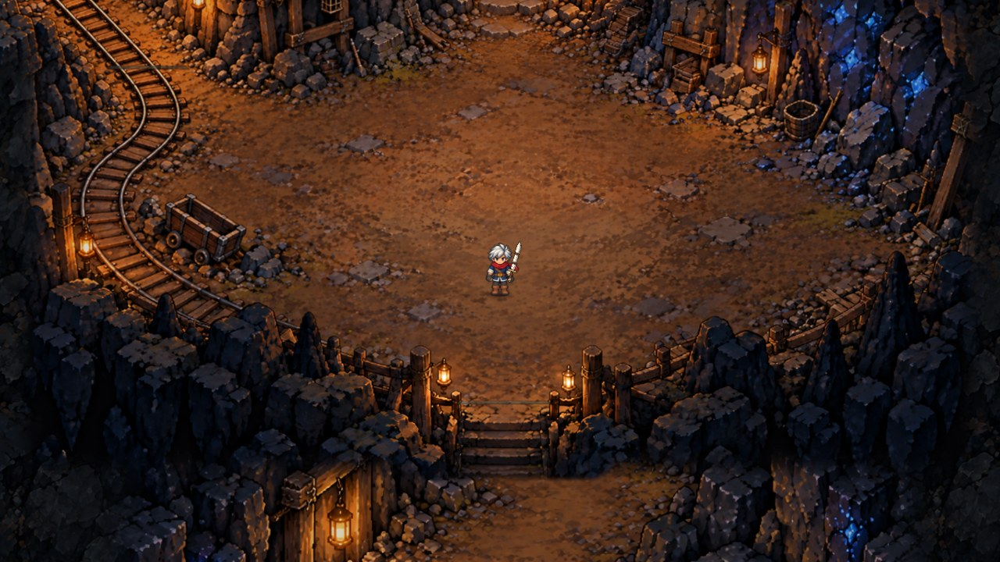
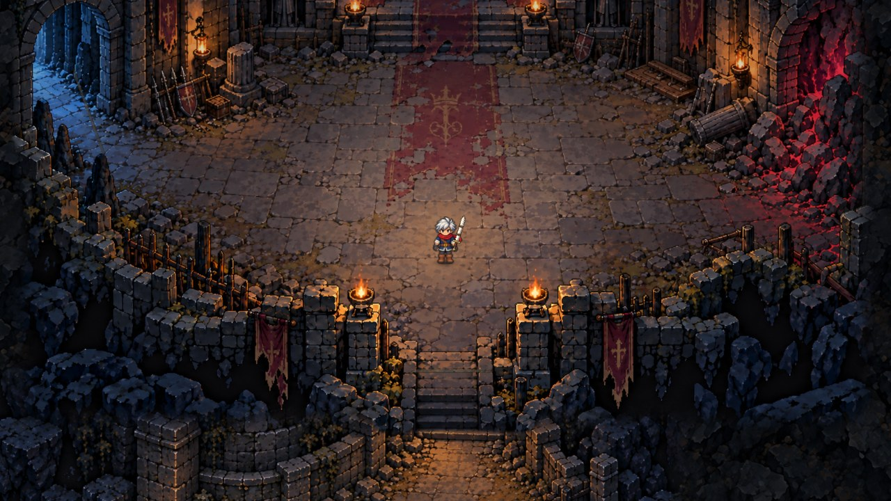
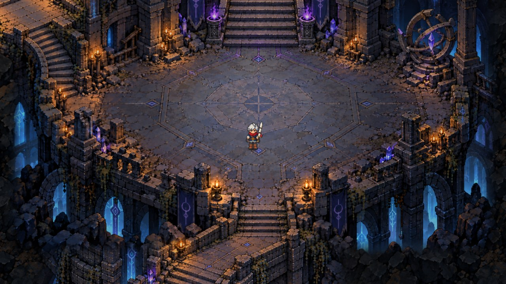
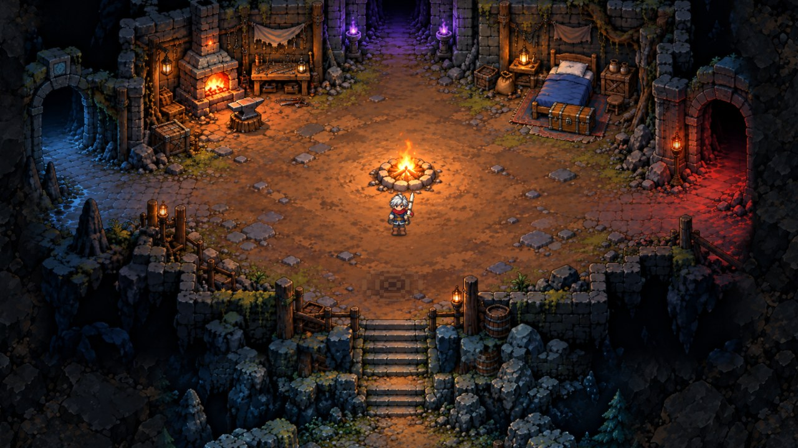
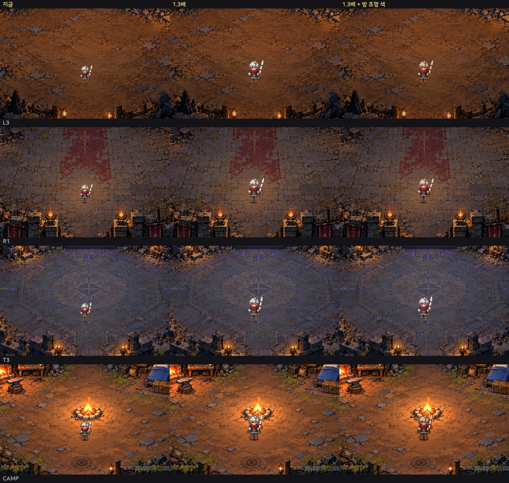

# 용사와 맵의 이질감 줄이기 — GPT 작업 지시 (2026-10-26, 묶음 H)

용사가 방 그림 위에 따로 붙인 스티커처럼 보인다는 의견에 대한 작업 지시다. 아래 **진단**을 보고 **H1~H3 그림 작업**을 해 준다. 코드 쪽 조정(C1~C4)은 Claude가 사용자 확인 뒤에 한다. 그림 작업 순서는 H1 → H2 → H3.

## 지금 화면

같은 위치·카메라 115%에서 찍은 실제 게임 화면이다.

| 광산 L3 | 성채 R1 |
|---|---|
|  |  |
| **탑 T3** | **캠프** |
|  |  |

## 진단: 왜 겉도는가

1. **크기가 작다.** 용사 몸은 약 58월드px인데 문 아치는 110~130px, 광차는 80px 정도다. 사람이 문 높이의 절반이 안 돼서 장난감처럼 보인다.
2. **비율이 다르다.** 용사는 머리가 몸의 40%쯤 되는 2.5등신 SD인데, 배경의 통·광차·횃불대·계단은 실제 비율에 가깝게 그려져 있다.
3. **시점이 다르다.** 방 그림은 위에서 약 40° 내려다본 3/4 시점이라 바닥 윗면과 물체의 윗면이 보인다. 용사는 정면·뒷면·옆면을 수평으로 본 그림이라 머리·어깨 윗면이 안 보이고, 바닥에 세워 붙인 판처럼 보인다.
4. **색과 조명이 따로 논다.** 배경은 횃불의 따뜻한 빛과 차가운 그림자, 채도가 낮은 흙·돌이다. 용사는 흰 머리·선명한 빨간 목도리가 고르게 밝아서 혼자 튄다. 탑(청보라 빛)과 성채(회색 돌)에서 특히 심하다.
5. **외곽선.** 배경 물체는 검은 선 없이 명암으로 형태를 잡는데, 용사만 진한 외곽선이 있다.
6. **대각선.** 8방향 걷기 브랜치(`hero/8-direction`)는 대각선에 옆모습을 그대로 쓴다. 대각선 전용 자세가 없어 방향을 틀 때 어색하다.

크기와 조명 색만 코드로 바꿔 본 시안: 
(왼쪽부터 지금 / 1.3배 / 1.3배 + 방 조명 색. 기존 그림을 늘리고 색을 곱한 합성 시안이며 게임 화면이 아니다. 크기와 색만으로도 덜 튀지만, 시점과 비율은 그림을 다시 그려야 해결된다.)

## H1. 걷기·서기 시트 다시 그리기 (가장 중요)

파일: `assets/sprites/hero-motion/walk.png` 을 **같은 이름·같은 규격으로 교체**한다. 그러면 코드 수정 없이 바로 바뀐다.

| 항목 | 지금과 똑같이 지킬 것 |
|---|---|
| 크기 | 1536×864, 투명 배경 |
| 칸 | 6열×3행, 칸 하나 256×288 |
| 행 순서 | 1행 아래(정면), 2행 위(뒷면), 3행 오른쪽. 왼쪽은 게임이 3행을 뒤집어 쓴다 |
| 열 | 걷기 6프레임. 1열이 서 있는 자세 겸 걷기 첫 프레임 |
| 발 위치 | 발바닥이 칸 위에서 271px 줄에 닿게, 가로는 칸 가운데 (지금과 같음) |
| 캐릭터 높이 | 칸 안에서 지금처럼 약 235px (머리 끝 36px 줄 ~ 발 271px 줄). 게임 속 크기는 코드(C1)에서 정하므로 그림은 칸을 같은 비율로 채운다 |

바꿀 것:

- **시점**: 방 그림과 같은 위에서 약 40° 내려다보는 3/4 시점. 정수리·어깨·발등 윗면이 조금 보이고, 몸 앞면은 살짝 짧게. 정면 자세도 고개가 약간 숙여 보이는 정도.
- **비율**: 2.5등신 → **3.5~4등신**. 머리를 줄이고 몸·다리를 늘린다. 얼굴 표정은 작아져도 된다.
- **정체성은 유지**: 흰 머리, 빨간 목도리, 남색 윗옷, 갈색 허리띠·장갑·부츠, 한 손 검 든 모험가.
- **색**: 흰 머리는 따뜻한 회백색(순백 금지)에 그림자는 푸른 회색. 목도리 빨강은 채도를 한 단계 낮춘 짙은 진홍. 전체 명도를 배경 바닥보다 아주 조금 밝은 정도로.
- **빛**: 방 그림처럼 위쪽(횃불 쪽)에서 오는 따뜻한 빛, 아래·뒤는 차가운 그림자. 몸 윤곽 한쪽에 아주 얇은 밝은 테두리(림 라이트).
- **외곽선**: 검은 선 대신 짙은 갈색·남색의 얇은 선. 빛을 받는 쪽은 선을 생략해도 된다.
- **질감**: 지금 방 그림과 같은 도트 크기·밀도. 매끈한 일러스트나 굵은 도트 금지.
- 칸 안에 그림자·바닥을 그리지 않는다 (그림자는 게임이 그린다).

## H2. 구르기 시트 같은 화풍으로

파일: `assets/sprites/hero-motion/roll.png`. H1과 똑같은 규격(1536×864, 6×3, 256×288, 행 순서·발 위치 동일). 동작 순서는 지금 시트를 따른다: 웅크리기 → 몸 말기 → 회전 → 착지. H1과 같은 시점·비율·색·외곽선으로 다시 그린다.

## H3. 대각선 자세 (코드 연결 필요)

8방향 걷기를 쓸 때 필요하다. 새 파일 두 장:

- `assets/sprites/hero-motion/walk-diag.png`: 1536×576, 6열×2행, 칸 256×288. 1행 **오른쪽 아래**, 2행 **오른쪽 위**. 왼쪽 대각선은 게임이 뒤집어 쓴다.
- `assets/sprites/hero-motion/roll-diag.png`: 같은 규격의 구르기.

발 위치·높이·화풍은 H1과 같다. 이 두 장은 그림만 넣어 두면 Claude가 `hero/8-direction` 작업과 함께 코드에 붙인다.

## 하지 말 것

- 배경 방 그림, 바닥 다각형, 문·연결부 그림은 이번 작업에서 건드리지 않는다.
- 칸 크기·칸 수·발 위치를 바꾸지 않는다 (바꾸면 코드가 틀어진다).
- 다른 프로그램으로 늘리거나 재양자화하지 않는다. 생성한 PNG를 그대로 넣는다.

## 확인 방법

1. 게임에서 광산 L3, 성채 R1, 탑 T3, 캠프에 서 있는 화면과 걷는 화면을 찍어, 위의 "지금 화면"과 나란히 PR에 올린다.
2. 서 있다가 걷기·구르기로 넘어갈 때 발이 뜨거나 미끄러지지 않는지 본다 (발바닥 271px 줄).
3. 잡몹(해골병·박쥐·마족병) 옆에 섰을 때 용사만 튀지 않는지 본다. 잡몹이 오히려 겉돌면 다음 묶음에서 같은 기준으로 맞춘다.

## Claude가 코드로 할 수 있는 것 (제안, 아직 적용 안 함)

그림이 오기 전에도 할 수 있고, 새 그림과 함께 해도 된다. 사용자가 고르면 적용한다.

| | 내용 | 바뀌는 곳 | 영향 |
|---|---|---|---|
| C1 | 용사 표시 크기 1.3배 (58 → 약 75월드px). 잡몹도 1.2배 정도 함께 키울지 결정 필요 | `HeroMotion.WIDTH/HEIGHT`, `WorldRenderer.HERO_SCALE` | 충돌·공격 판정은 그대로. 보이는 크기만 |
| C2 | 방 조명 색 입히기: 방마다 이미 계산하는 조명 색(`ambientFor`)을 용사·잡몹에 30~45% 곱하고 채도를 10~15% 낮춤 | `WorldRenderer` 배우 그리기 | 탑·성채에서 효과 큼. 피격 빨간색은 그대로 |
| C3 | 외곽선 색을 검정 → 방 그림자색(짙은 갈색·남색)으로 | `WorldRenderer` 윤곽 처리 | H1 새 그림이 오면 필요 없을 수 있음 |
| C4 | 발밑 그림자를 조금 진하고 넓게, 가까운 횃불 반대쪽으로 살짝 늘이기 | `drawActorShadow` | 서 있는 느낌이 강해짐 |

추천: **C1 + C2를 먼저** 적용해 보고 H1 그림이 오면 C3는 빼는 순서. 위 시안 가운데·오른쪽 열이 C1, C1+C2에 해당한다.

## GPT에게 붙여 넣을 요청문

```text
choicomet/yongsa_game 저장소의 docs/GPT_HERO_HARMONY.md 를 읽고 묶음 H 를 작업해 줘. 기준 브랜치는 main.
H1(walk.png) → H2(roll.png) → H3(walk-diag.png, roll-diag.png) 순서.
파일 이름·칸 크기(256×288, 6×3)·발 위치(칸 위에서 271px)는 지금과 똑같이 지키고,
방 그림과 같은 위에서 40° 내려다보는 3/4 시점, 3.5~4등신, 방 조명에 맞춘 색으로 다시 그려 줘.
흰 머리·빨간 목도리·남색 옷·갈색 장비는 유지해 줘.
main 에 바로 올리지 말고 새 브랜치에서 PR 을 열고, 광산 L3·성채 R1·탑 T3·캠프의 전후 게임 화면을 PR 에 넣어 줘.
```
