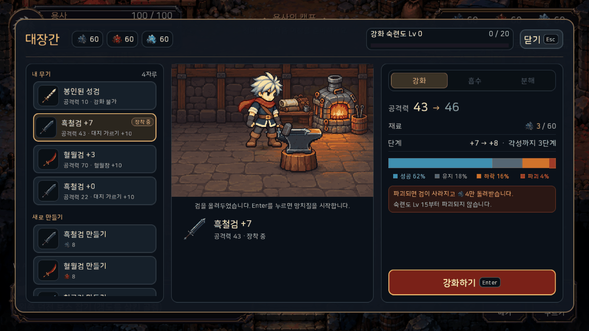
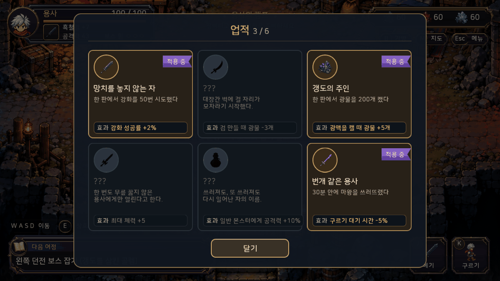
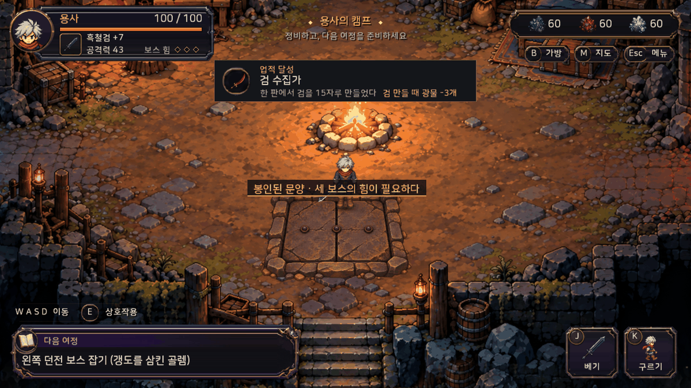
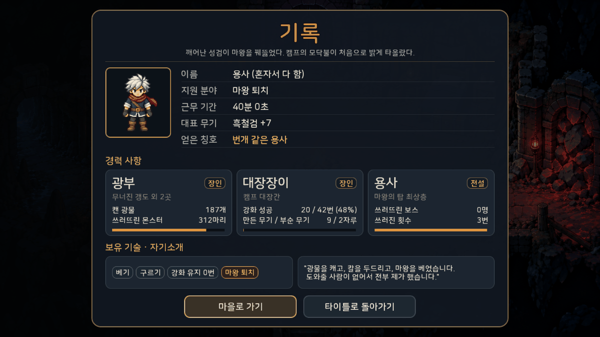

# GPT 작업지시서: 대장간 화면·업적·기록 화면 디자인 (2026-11-27)

지용이 새로 만든 화면 세 가지(대장간 개편 PR #61, 업적·엔딩 기록 PR #60)는 기능은 다 되어 있고,
겉모습은 코드로 그린 둥근 사각형(단색 + 테두리)뿐이다. 이 겉모습을 게임 그림체에 맞는 그림으로 바꾼다.
화면 배치(무엇이 어디 있는지)와 글자는 그대로 두고, **판·카드·버튼·배지·아이콘 그림만** 새로 만든다.

## GPT 에게 붙여 넣을 요청문

```text
choicomet/yongsa_game 저장소의 docs/GPT_UI_WORK_ORDER_2026-11-27.md 를 읽고 그대로 작업해 줘.
기준 브랜치는 main (PR #61 대장간 개편, #60 업적·기록이 병합된 상태).
아직 병합 전이면 jiyong/forge_redesign 에 jiyong/achievements 를 합쳐서 기준으로 써 줘.
화면 배치와 글자는 바꾸지 말고, 문서에 적힌 파일 이름·크기 그대로 그림만 만들어 줘.
그림을 넣은 뒤 화면 캡처를 PR 설명에 붙여 줘. PR 대상은 main.
```

## 지금 화면 (캡처, 1600×900 창)

| 화면 | 캡처 |
|---|---|
| 대장간 · 강화 |  |
| 대장간 · 흡수 |  |
| 대장간 · 분해 |  |
| 업적 창 (타이틀 메뉴 → 업적) |  |
| 업적 달성 알림 (게임 중 화면 위) |  |
| 엔딩 "기록" (용사 이력서) |  |

## 공통 규칙

- **그림체**: 지금 HUD 그림(`assets/ui/hud/*.png`: 초상화 테두리, 퀘스트 판, 스킬 칸, 토스트)과 같은 계열.
  어두운 남색·검은 철판 바탕 + 낡은 금색 테두리, 픽셀 느낌. 대장간은 쇠·가죽·불빛, 업적은 훈장·메달, 기록은 낡은 양피지 이력서 느낌을 살짝 섞는다.
- **늘어나는 판(9칸 판)**: 판·카드·버튼은 크기가 바뀌므로, 가운데가 늘어나도 깨지지 않게 그린다.
  각 그림마다 아래 표의 **모서리 여백(px)** 안에만 장식을 넣고, 가운데와 변은 단순한 무늬로 둔다.
- **파일 형식**: 투명 배경 PNG. 크기는 표의 "그릴 크기"(1배) 그대로. 2배로 그렸다면 파일 이름 끝에 `@2x` 를 붙인다.
- **글자는 그림에 넣지 않는다.** (버튼의 "강화하기", 배지의 "장착 중" 같은 글자는 게임이 그린다.)
- **위치**: `assets/ui/forge/`, `assets/ui/achievement/`, `assets/ui/record/`.
- **코드 연결**: 파일 이름이 지금 코드의 그림 이름과 같다. 그림만 넣어 두면 Claude 가 "PNG 가 있으면 그걸 쓰고, 없으면 지금 코드 그림"으로 연결한다.
  GPT 가 직접 연결해도 된다: `core/src/main/java/com/yongsa/ui/Ui.java` 의 `skin.add("이름", rounded(...))` 를 PNG 9칸 판으로 바꾸면 된다.

## A. 대장간 화면 (`assets/ui/forge/`, PR #61)

화면 구성: 위쪽 머리줄(대장간 제목, 광물 3개, 강화 숙련도 막대, 닫기) / 왼쪽 "내 무기·새로 만들기" 목록 / 가운데 대장간 무대 그림 + 고른 검 / 오른쪽 강화·흡수·분해 탭과 수치, 큰 버튼.

| 파일 | 지금 코드 이름 | 어디 | 그릴 크기 | 모서리 여백 | 메모 |
|---|---|---|---|---|---|
| `window.png` | `panelRound` | 대장간 창 전체 바탕 (업적·기록 창도 같이 씀) | 160×160 | 40 | 가장 바깥 판. 네 모서리에 쇠 장식, 테두리 금색 |
| `column.png` | `forgeCol` | 왼쪽·가운데·오른쪽 세 칸 바탕 | 96×96 | 24 | 창 바탕보다 한 단계 어둡게, 안으로 들어간 느낌 |
| `chip.png` | `forgeChip` | 머리줄 광물 개수 칸, 숙련도 칸 | 64×40 | 14 | 작은 철판 |
| `card.png` | `forgeCard` | 목록의 검 한 칸 (평소) | 96×72 | 18 | 무기 걸이·나무판 느낌도 좋음 |
| `card_selected.png` | `forgeCardSel` | 목록에서 고른 칸 | 96×72 | 18 | 금색 테두리가 빛남 |
| `card_awakened.png` | `forgeCardAwake` | 각성한 검 칸 | 96×72 | 18 | 보라빛 테두리 |
| `icon_slot.png` | `forgeIcon` | 목록 칸 왼쪽 검 그림 자리 | 56×56 | 12 | 작은 진열 받침 |
| `badge_equipped.png` | `forgeBadgeEq` | "장착 중" 배지 | 56×24 | 10 | 글자 없이 바탕만 |
| `badge_skill.png` | `forgeBadgeSkill` | 스킬 이름 배지 | 56×24 | 10 | 보라 |
| `tabs.png` | `forgeSeg` | 강화·흡수·분해 탭 묶음 바탕 | 96×48 | 16 | |
| `tab_on.png` | `forgeSegOn` | 고른 탭 | 80×40 | 14 | 금색 |
| `warn.png` | `forgeWarn` | "파괴되면 검이 사라지고…" 경고 상자 | 96×64 | 18 | 붉은 철판, 모서리에 금 간 자국 |
| `skill_box.png` | `forgeSkill` | 흡수 탭의 스킬 설명 상자 | 96×64 | 18 | 보라 |
| `key.png` | `forgeKey` | Enter·Esc·Space 키 표시 | 40×28 | 10 | HUD `pill_key.png` 와 맞춤 |
| `line.png` | `forgeLine` | 칸 안의 가는 구분선 | 64×2 | 가로 8 | |
| `button_primary.png` / `_over` / `_down` / `_disabled` | 큰 버튼("강화하기") | 오른쪽 아래 | 160×64 | 24 | 붉은 쇠판 + 불빛. 꺼진 상태는 회색 |

- **확률 막대**(성공·유지·하락·파괴 색 막대)는 코드로 그린다. 색만 그림체에 맞게 제안해 주면 된다.
- **가운데 대장간 무대**(용사가 모루 앞에 선 그림)는 이미 그림이 있으니 그대로 둔다.

## B. 업적 창 (`assets/ui/achievement/`, PR #60)

3×2 카드. 달성한 카드는 금빛, 못 한 카드는 어둡고 그림은 검은 실루엣.

| 파일 | 지금 코드 그림 | 그릴 크기 | 모서리 여백 | 메모 |
|---|---|---|---|---|
| `card_on.png` | 달성 카드 (갈색 바탕 + 금 테두리) | 96×96 | 24 | 훈장 상자 느낌 |
| `card_off.png` | 미달성 카드 (남색 바탕 + 회색 테두리) | 96×96 | 24 | 먼지 낀 빈 상자 |
| `ring_on.png` / `ring_off.png` | 그림 둘레 동그라미 | 64×64 | 늘이지 않음 | 메달 테두리. 가운데 40×40 은 비워 둠 |
| `ribbon.png` | "적용 중" 띠 (보라) | 96×36 | 왼쪽 16 | 오른쪽 끝이 제비꼬리로 갈라진 띠. 글자 없음 |
| `effect_on.png` / `effect_off.png` | 아래 "효과 …" 칸 | 64×30 | 10 | |
| `icon_hammer.png` | 망치를 놓지 않는 자 (강화 50번) | 64×64 | | 지금은 흑철검 그림을 빌려 씀 → **업적 전용 그림** 6개 |
| `icon_collector.png` | 검 수집가 (검 15자루) | 64×64 | | 벽에 여러 검이 걸린 모습 |
| `icon_miner.png` | 갱도의 주인 (광물 200개) | 64×64 | | 곡괭이 + 광석 |
| `icon_flawless.png` | 쓰러진 적 없는 자 | 64×64 | | 금 방패·월계관 |
| `icon_unyielding.png` | 불굴의 용사 (10번 넘게 쓰러짐) | 64×64 | | 금 간 투구에서 다시 솟는 불꽃 |
| `icon_swift.png` | 번개 같은 용사 (30분 안에) | 64×64 | | 번개 + 모래시계 |

- 업적 아이콘은 못 한 업적에서 검은 실루엣으로도 쓰이니, **윤곽만 봐도 무엇인지 알 수 있게** 그린다.

## C. 업적 달성 알림 (게임 중 화면 위 가운데, PR #60)

| 파일 | 그릴 크기 | 모서리 여백 | 메모 |
|---|---|---|---|
| `assets/ui/achievement/toast.png` | 160×76 | 왼쪽 76, 나머지 16 | 왼쪽에 메달 자리(56×56)가 붙은 가로 판. HUD `toast_gold.png` 와 같은 계열 |

## D. 엔딩 "기록" 화면 (`assets/ui/record/`, PR #60)

용사의 이력서 콘셉트: 위에 사진·인적 사항, 가운데 경력 사항 카드 3장(광부·대장장이·용사, 등급 배지), 아래 보유 기술 칩과 자기소개 말풍선, 버튼 2개.

| 파일 | 어디 | 그릴 크기 | 모서리 여백 | 메모 |
|---|---|---|---|---|
| `paper.png` | 기록 창 전체 바탕 (지금은 대장간과 같은 `panelRound`) | 192×192 | 48 | 어두운 바탕 위에 낡은 양피지·서류철 느낌. 글자가 밝은 색이라 바탕은 어둡게 유지 |
| `photo_frame.png` | 용사 그림 액자 | 176×188 | 늘이지 않음 | 안쪽 148×160 투명. 증명사진 클립·압정 |
| `row_line.png` | 이름·지원 분야… 줄 구분선 | 64×2 | 가로 8 | |
| `career_card.png` | 경력 카드 (광부·대장장이·용사) | 96×96 | 24 | |
| `grade_badge.png` | "장인"·"전설" 등급 배지 | 56×28 | 12 | 도장 찍힌 느낌. 글자 없음 |
| `bar_back.png` / `bar_fill.png` | 경력 카드 아래 진행 막대 | 64×8 | 가로 4 | |
| `skill_chip.png` / `skill_chip_gold.png` | 보유 기술 칩 (마지막 칩만 금색) | 48×28 | 12 | |
| `quote.png` | 자기소개 말풍선 | 96×64 | 20 | |

## 검수

- 1600×900 과 960×540 창에서 세 화면을 캡처해 PR 에 붙인다 (판이 늘어나도 모서리 장식이 깨지지 않는지).
- 글자가 바탕에 묻히지 않는지 본다 (밝은 글자 #f2eee5, 흐린 글자 #aeb5ba, 금색 #e3b875).
- 업적 실루엣 6개가 서로 구별되는지 본다.
