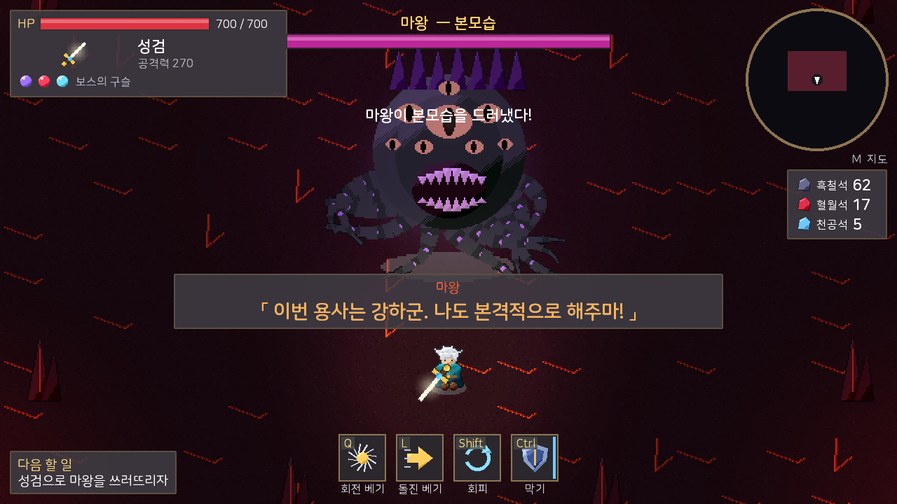

# 용사가 다한다

국립군산대 소프트웨어학과 2026-2 지능형 UI/UX 프로그래밍 · Java 17 · libGDX 1.14.2 (LWJGL3) · Gson · JUnit 5



## 실행

```bash
gradlew lwjgl3:run      # 게임 실행 (Windows: gradlew.bat lwjgl3:run)
gradlew core:test       # 규칙 테스트 (화면 없이)
gradlew lwjgl3:jar      # 실행 파일 하나로 → lwjgl3/build/libs/yongsa-0.3.0.jar
```

처음 실행할 때는 Gradle과 libGDX를 내려받느라 몇 분 걸린다. `gradlew.bat`만 치면 도움말만 나오니 반드시 `lwjgl3:run`까지 붙인다.
IntelliJ에서는 폴더를 열고 오른쪽 Gradle 탭 → `lwjgl3 > Tasks > application > run`.

## 조작

| 동작 | 키 |
|---|---|
| 이동 (8방향, 대각선도 같은 속도) | W A S D / 방향키 |
| 기본 공격 (바라보는 방향 부채꼴, 공격할 때만 범위 표시) | J / Space |
| 회전 베기 (주변 전체 150%, 쿨 6초) | Q |
| 돌진 베기 (앞으로 돌진 200%, 쿨 8초, 돌진 중 무적) | L |
| 회피 (구르기, 무적) | Shift |
| 막기 (누르고 있기, 앞쪽 200°만, 최대 3초) | Ctrl (또는 K) |
| 캐기 · 대장간 · 침대 · 포탈 · 문양 (할 수 있을 때만 안내가 뜸) | E |
| 가방 / 지도 / 메뉴 | I / M / Esc |
| 창 안 버튼 이동·선택 | 방향키·Tab, Enter (마우스도 됨) |

## 이야기

평화롭던 마을 광장의 우물에서 해골의 왕(마왕)이 솟아올라 마을 사람들을 보랏빛 수정에 가둔다.
가보로 물려받은 **봉인된 검**을 지닌 용사가 우물 아래 던전으로 내려가, 세 던전의 주인을 쓰러뜨리고
**성검**을 해방해 마왕을 쓰러뜨린다. 마왕이 무너지면 수정이 부서지고 **속박된 사람들이 풀려난다**.
시작·엔딩은 이야기 그림 3장씩(`assets/story/`)으로 보여 준다.

## 게임 흐름

1. 캠프 → **무너진 갱도**: 잡몹방에 들어가면 문이 잠기고, 다 잡으면 열린다. 광물방에서 흑철석을 캔다(첫 광물방은 8개 이상 보장).
2. 캠프 대장간에서 **흑철검** 제작 → 강화(성공·유지·하락·파괴) → 장착.
3. 보스방 앞에서 확인창 → 보스 처치 → **처음 잡을 때만**: 힘 흡수(최대 체력 증가), **보스의 구슬**, 흡수하지 못한 힘이 던전에 퍼져 잡몹 강화(체력 ×1.3, 공격 ×1.2), **캠프가 한 단계 밝아짐**.
   보스방 가운데에 캠프로 가는 **포탈**이 열린다.
4. 침대로 쉬면 잡몹·광맥과 함께 **보스도 다시 생긴다**(마왕 제외). 다시 잡으면 그 던전 광물 4~5개만 준다.
5. 저주받은 성채(혈월검) → 마왕의 탑(천공검) 순서로 반복.
6. 구슬 셋을 모아 캠프로 → 바닥 문양 앞에서 E: **봉인된 검이 성검으로 해방** → 구슬이 땅에 박히고 → 땅이 갈라져 추락 → **마왕전**.
7. 마왕은 성검으로만 피해를 줄 수 있다. 쓰러뜨리면 엔딩 이야기 → 플레이 기록, "계속하기"로 이어서 플레이할 수 있다.

**캠프 밝기**: 보스를 하나도 못 잡았을 때는 어둡고, 보스(마왕 포함)를 처음 잡을 때마다 밝아진다 (30% → 48 → 66 → 84 → 100%).
**안개**: 던전은 지금 들어가 있는 방과 이미 비운 방만 보인다. 침대를 쓰면 다시 가려진다.
**지도**: 오른쪽 위 원형 미니맵, M 키 큰 지도. 둘 다 "다음 할 일"까지 가는 길을 노란 선으로 보여 준다.

## 검과 성검

| 검 | 공격력 | 흡혈 |
|---|---|---|
| 봉인된 검 (시작) | 10, 강화 불가 | 없음 |
| 흑철검 / 혈월검 / 천공검 | 22+3/강 · 55+5/강 · 110+8/강 | +6 0.5% · +7 0.7% · +8 1% · +9 1.25% · +10 1.5% (적 최대 체력 대비) |
| 성검 (해방 후) | **150 + (종류마다 가장 센 검의 공격력 합) × 0.4** | max(종류마다 최고 흡혈의 절반의 합, 가장 높은 흡혈 하나) |

- 각성 무기를 흡수해서 사라진 검도 그 단계 그대로 성검이 나눠 받는다.
- 흡혈 한 번에 회복하는 양은 용사 최대 체력의 4%까지 (`hero.lifestealCapRatio`, 0이면 제한 없음). 보스 체력이 커서 넣은 안전장치다.
- 최종 공격력에는 흡수한 각성 무기 수 × 10% 보너스가 붙는다.

## 막기 (Ctrl)

- 누르고 있는 동안 앞쪽 200° 안에서 오는 공격(근접·돌진·투사체)을 막는다. 막는 동안은 천천히 걷고 바라보는 방향이 고정된다.
- 게이지 = 3초. 누르고 있으면 초당 1씩, 막을 때마다 0.35(보스 큰 공격 0.7)씩 준다. 바닥나면 **막기 깨짐** → 2초 동안 못 막는다. 손을 떼면 0.6초 뒤부터 초당 1씩 찬다.
- 바닥·하늘에서 오는 공격(내려찍기, 뼈 가시, 번개, 촉수, 독구름)은 막을 수 없다 → 걸어서 피한다.
- 그 대신 잡몹·보스의 공격 예고와 쉬는 시간을 줄였다 (`windup`, `cooldown`).

## 보스

| 보스 | 체력 | 기믹 |
|---|---|---|
| 좀비킹 (갱도) | 2200 | **돌진 3연속**: 방향선 예고 → 달려든다 → 잠깐 숨 고르기 → 다시 조준 |
| 리치 (성채) | 5200 | 원거리 탄. **뼈 가시**: 용사가 있던 자리마다 바닥에 예고가 뜨고 0.9초 뒤 솟는다(따라가지 않음). **소환**: 해골 3마리(최대 5), 리치가 쓰러지면 같이 무너진다 |
| 마룡 (탑) | 12000 | **독**: 아래 보며 포효 → 맵 세 곳에 용사 3배 크기 초록 독구름, 닿으면 초당 최대 체력 1%. **번개**: 위 보며 포효 → 10번 낙뢰, 맞으면 감전(Q·L 봉인, 이동·평타·회피·막기는 됨). **얼음**: 엉덩이를 들고 꼬리에서 얼음 덩이 14개 → 맞으면 3초 빙결. **화염**: 3~5초 회전하며 사방으로 화염, 맞으면 화상(초당 3) |
| 마왕 1페이즈 | 12000 | 리치 왕의 모습. 내려찍기·돌진·사방 탄 |
| 마왕 2페이즈 | 18000 (1.5배) | 크툴루풍 괴물. 촉수(용사 주변 7곳)가 더해지고 더 빠르다 |

- 독·화상·감전은 5초, 걸려 있는 동안 다시 맞으면 5초로 돌아간다. 빙결은 3초, 풀린 직후 1초는 다시 걸리지 않는다.
- 마왕 대사: 2페이즈로 넘어갈 때 "이번 용사는 강하군. 나도 본격적으로 해주마!"(무적 상태로 체력이 다시 참), 죽을 때 "이런 풋내기에게 당하다니!",
  용사가 1페이즈에 죽으면 "한심하긴.", 2페이즈에 죽으면 "꽤나 즐거운 여흥이었다."
  마왕에게 죽고 캠프에서 깨어나면 용사 독백: "검을 더 강화해야겠어. 성검은 다른 검들의 힘을 가질 수 있는 모양이니."
- 난이도 목표: 쉽지 않지만 소울류처럼 가혹하지는 않게. 예고는 모두 0.55~0.9초 이상 보여 주고, 큰 공격 뒤에는 보스가 멈춰 있는 틈이 있다.
  더 쉽게/어렵게 하려면 `balance.json`의 보스 `hp`·`attack`·`patternInterval`만 고치면 된다.

## 명세서 대비 결정 사항

| 항목 | 이번 구현 | 근거 |
|---|---|---|
| 분해 보상 | 4개 + 강화에 쓴 광물의 절반 | 2026-10-10 결정 |
| 강화 비용 | +0~2: 1개, +3~5: 2개, +6~9: 3개 | 명세서 A27 |
| 던전 입장 확인창(UI-07) | 뺌. 보스방 확인창(FR-던전-09)만 둠 | FR-맵-07 "걸어서 이동"과 충돌 |
| 보스 재생성 | 마왕 외 보스는 침대 뒤 다시 생김, 보상은 광물 4~5개만 | 2026-10-10 결정 |
| 최종 보스 위치 | 캠프 문양 아래 심연(별도 전장)으로 추락 | 2026-10-10 결정 |
| 각성 능력 | 흑철 충격파 / 혈월 폭주(처치 시 피의 폭발) / 천공 뇌격(25%로 번개). 흡혈은 강화 단계로 옮겼다 | 2026-10-10 결정 |
| 감전 | Q·L만 봉인. 회피(Shift)·막기(Ctrl)는 된다 | "이동과 평타는 가능"을 넓게 해석 |
| 힘 흡수 장소(7.1) | "바로 흡수": 보스는 처치 즉시, 각성 무기는 대장간 강화 탭의 "힘 흡수" | `AbsorbService` 한곳에 모음 |
| 설정 저장 위치 | 세이브가 아니라 Preferences | 검토 의견 |
| 글꼴 | 나눔스퀘어라운드 (SIL OFL) | 명세서 4.3 |

수치는 모두 `assets/data/balance.json`에 있다.

## 구조

규칙(`config`, `model`, `world`, `combat`, `save`)은 그리기 코드와 분리되어 화면 없이 테스트된다 (NFR-05).
화면은 `GameSession`에 요청만 보내고 결과는 `GameEvent`로 받는다 (구현안 1장).

| 패키지 | 하는 일 |
|---|---|
| `config` | balance.json → `Balance` (Gson) |
| `model` | `GameSession`(조율), 강화·제작·분해·흡수 서비스, `Hero`(영구 능력치), `Inventory`, `Progress`, `Cutscene`, `Goal` |
| `world` | `WorldMap`(TMX 읽기), `Room`·`Door`·`Gate`·`Portal`, `CollisionWorld`, `VeinGenerator`(BFS), `Visibility`(안개), `RoomGraph`(길 안내), `CameraFollow` |
| `combat` | `HeroUnit`(8방향·회피·돌진·막기·상태이상), `Attack`(한 번에 한 대), `Monster`·`MonsterAI`, `Boss`·`BossPattern`(보스 기믹), `Hazard`(바닥 위험 지대), `Projectile` |
| `save` | `SaveData`, `SaveMapper`, `SaveManager`(임시 파일 후 바꿔치기) |
| `render` | `WorldRenderer`(2.5D·안개·예고·컷신), `LightMap`(빛·캠프 밝기), `MapPainter`(지도), `Assets`(manifest.json), `Fonts`, `SoundBank` |
| `ui` | `Hud`, `Minimap`(원형), `ForgeWindow`(탭 3개), `ConfirmDialog`, `BagWindow`, `MapWindow`, `PauseMenu`, `SettingsWindow`, `ResultWindow`, `KeyNav`(키보드 이동) |
| `screen` | `TitleScreen`, `StoryScreen`(이야기 그림), `IntroScreen`, `GameScreen`, `EndingScreen` |

### 팀 분담 (명세서 1.3) — 각자 맡은 파일을 이해하고 직접 커밋할 것 (NFR-12)

| 담당 | 파일 |
|---|---|
| 최해성 (맵·채집·저장) | `world/*`, `save/*`, `Settings`, `render/MapPainter`, `ui/Minimap`, `ui/MapWindow`, `ui/SettingsWindow`, `screen/TitleScreen`, `screen/IntroScreen`, `tools/gen_assets.py`, `MapTest` |
| 박지용 (대장간·각성) | `model/Enhance*`, `SwordPower`(성검·흡혈), `Weapon`, `Inventory`, `CraftService`, `DismantleService`, `AbsorbService`, `AwakenAbility`, `DamageCalc`, `ui/ForgeWindow`, `ui/BagWindow`, `ui/ConfirmDialog`, `EnhanceTest` |
| 김선우 (전투·보스) | `combat/*`, `render/WorldRenderer`, `ui/Hud`, `ui/SkillSlot`, `ui/HpBar`, `ui/ResultWindow`, `screen/EndingScreen`, `SessionTest`, `PowerTest` |
| 공통 | `model/GameSession`, `Progress`, `Goal`, `GameEvent`, `Cutscene`, `YongsaGame`, `screen/GameScreen`, `ui/UiSkin`, `ui/KeyNav`, `ui/GameWindow`, `ui/WindowHost` |

## 에셋 바꾸는 법

지금 게임 안 그림은 `tools/gen_assets.py`(+ `art.py`, `chars.py`, `props.py`)가 그린 픽셀 아트다. `python tools/gen_assets.py`로 다시 만든다.
같은 파일 이름으로 덮어쓰면 바로 바뀐다.

- **프레임 수**는 `assets/sprites/manifest.json`(이름 → 프레임 수)에 적는다. 그림은 프레임을 가로로 이어 붙인 PNG.
- **용사** `hero_down/up/side.png` 32×32 ×3 (대기, 걷기1, 걷기2). 옆모습은 오른쪽을 보게
- **보스** `boss_left`(좀비킹 96×96 ×3: 대기2, 돌진), `boss_right`(리치 96×112 ×3: 대기2, 시전), `boss_top`(마룡 176×144 ×5: 대기2, 아래 포효, 위 포효, 꼬리 들기), `demon_king`(128×128 ×2), `demon_eldritch`(176×176 ×2)
- **장식** `torch`·`brazier*`·`campfire`·`lantern`·`candelabra`(×3 불꽃), `tent`, `barrel`, `crate`, `weapon_rack`, `minecart`, `pillar*`, `bones`, `crystal_*`, `flesh_spike`, `banner`, `bed`(40×70), `forge`(112×96 ×3)
- **이야기 그림** `assets/story/intro1~3.jpg`, `ending1~3.jpg` (1280×720)
- **맵** `assets/maps/world.tmx`: Tiled로 열어서 고친다. `decor` 오브젝트(sprite, flat, solid, light, lightColor)는 장식과 빛을 둔다.
- **소리**: `assets/sounds/README.txt`의 이름으로 파일을 넣으면 바로 재생된다.

## 검증

- JUnit 38개 통과. 기존 항목(강화 확률·파괴·분해·각성, 방 잠금, 광맥, 안개, 저장, 회피 무적, 다음 할 일 등)에 더해:
  보스 재생성(광물 4~5개만, 체력·구슬·캠프 밝기는 한 번만), 잡몹 강화 1.3/1.2, 막기(앞은 막고 뒤는 못 막음, 3초 한도·깨짐·회복),
  감전(스킬만 봉인), 독(초당 1%, 다시 닿으면 5초), 봉인된 검 10, 성검 150 + 40%, 흡혈 표·성검 흡혈, 마왕 2페이즈(1.5배·무적·대사),
  마왕에게 죽으면 대사·독백, 뼈 가시는 예고 자리에서 솟음.
- 개발 환경에서 화면 없이(Mesa 소프트웨어 렌더링) 이야기 → 캠프 → 세 보스의 기믹 → 해방 → 마왕 1·2페이즈 → 엔딩 이야기까지 스크립트로 플레이해 스크린샷으로 확인했다 (`docs/screenshots`).
