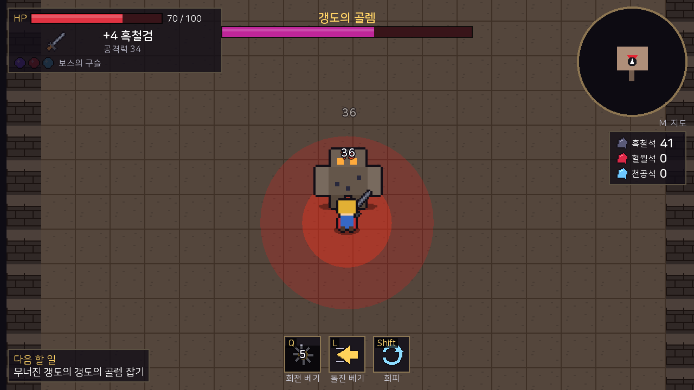

# 용사가 다한다

국립군산대 소프트웨어학과 2026-2 지능형 UI/UX 프로그래밍 · Java 17 · libGDX 1.14.2 (LWJGL3) · Gson · JUnit 5



## 실행

```bash
gradlew lwjgl3:run      # 게임 실행 (Windows: gradlew.bat lwjgl3:run)
gradlew core:test       # 규칙 테스트 (화면 없이)
gradlew lwjgl3:jar      # 실행 파일 하나로 → lwjgl3/build/libs/yongsa-0.2.0.jar
```

처음 실행할 때는 Gradle과 libGDX를 내려받느라 몇 분 걸린다. `gradlew.bat`만 치면 도움말만 나오니 반드시 `lwjgl3:run`까지 붙인다.
IntelliJ에서는 폴더를 열고 오른쪽 Gradle 탭 → `lwjgl3 > Tasks > application > run`.

## 조작

| 동작 | 키 |
|---|---|
| 이동 (8방향, 대각선도 같은 속도) | W A S D / 방향키 |
| 기본 공격 (바라보는 방향 부채꼴, 공격할 때만 범위 표시) | J / Space |
| 회전 베기 (주변 전체 150%, 쿨 6초) | Q |
| 돌진 베기 (앞으로 돌진 200%, 쿨 8초, 돌진 중 무적) | L |
| 회피 (구르기, 무적) | Shift |
| 캐기 · 대장간 · 침대 · 포탈 · 문양 (할 수 있을 때만 안내가 뜸) | E |
| 가방 / 지도 / 메뉴 | I / M / Esc |
| 창 안 버튼 이동·선택 | 방향키·Tab, Enter (마우스도 됨) |

## 게임 흐름

1. 캠프 → **무너진 갱도**: 잡몹방에 들어가면 문이 잠기고, 다 잡으면 열린다. 광물방에서 흑철석을 캔다(첫 광물방은 8개 이상 보장).
2. 캠프 대장간에서 **흑철검** 제작 → 강화(성공·유지·하락·파괴) → 장착.
3. 보스방 앞에서 확인창 → 보스 처치 → **힘 흡수**(최대 체력 증가), **보스의 구슬** 드롭, 보스방 가운데 **포탈**(캠프로) 생성.
   처음 잡을 때만 "힘의 일부를 흡수하지 못해 던전 몬스터가 강해졌다"가 나오고, 그 던전 잡몹이 한 번만 강해진다.
4. 저주받은 성채(혈월검) → 마왕의 탑(천공검) 같은 순서로 반복.
5. 구슬 셋을 모아 캠프로 → 바닥 문양 앞에서 E **성검 해방**: 성검이 깨어나고 → 문양이 빛나고 → 구슬이 땅에 박히고 → 땅이 갈라져 용사가 떨어진다 → **마왕전**.
6. 마왕은 깨어난 성검으로만 피해를 줄 수 있다. 쓰러뜨리면 엔딩(플레이 기록), "계속하기"로 이어서 플레이할 수 있다.

**안개**: 던전은 지금 들어가 있는 방과 이미 비운 방만 보인다. 침대를 쓰면 몬스터·광맥과 함께 다시 가려진다.
**지도**: 오른쪽 위 원형 미니맵, M 키 큰 지도. 둘 다 "다음 할 일"까지 가는 길을 노란 선으로 보여 준다.

## 명세서 대비 결정 사항

| 항목 | 이번 구현 | 근거 |
|---|---|---|
| 분해 보상 | 4개 + 강화에 쓴 광물의 절반 | 2026-10-10 결정 (파괴 4개보다 손해 보지 않게) |
| 강화 비용 | +0~2: 1개, +3~5: 2개, +6~9: 3개 | 명세서 A27 |
| 던전 입장 확인창(UI-07) | 뺌. 보스방 확인창(FR-던전-09)만 둠 | FR-맵-07 "걸어서 이동"과 충돌 |
| 보스 처치 후 | 포탈 + 구슬 + 첫 처치 때만 잡몹 강화(체력 ×1.4, 공격 ×1.25) | 2026-10-10 결정 |
| 최종 보스 위치 | 캠프 문양 아래 심연(별도 전장)으로 추락 | 2026-10-10 결정 (A30 대신) |
| 각성 능력 | 흑철 충격파 / 혈월 탐식(흡혈 4%) / 천공 뇌격(25%로 번개). 셋 다 깨어난 성검(200)보다 약하게 | 2026-10-10 결정 |
| 힘 흡수 장소(7.1) | 1번 "바로 흡수": 보스는 처치 즉시, 각성 무기는 대장간 강화 탭의 "힘 흡수" | 구현안. `AbsorbService` 한곳에 모음 |
| 스킬 키 | Q 회전 베기, L 돌진 베기, Shift 회피 | 2026-10-10 결정 |
| 설정 저장 위치 | 세이브가 아니라 Preferences (새 게임을 해도 남게) | 검토 의견 |
| 글꼴 | 나눔스퀘어라운드 (SIL OFL, `assets/fonts/NanumSquareRound-OFL.txt`) | 명세서 4.3 |

수치는 모두 `assets/data/balance.json`에 있다 (명세서 5장 임시값 그대로).

## 구조

규칙(`config`, `model`, `world`, `combat`, `save`)은 그리기 코드와 분리되어 화면 없이 테스트된다 (NFR-05).
화면은 `GameSession`에 요청만 보내고 결과는 `GameEvent`로 받는다 (구현안 1장).

| 패키지 | 하는 일 |
|---|---|
| `config` | balance.json → `Balance` (Gson) |
| `model` | `GameSession`(조율), 강화·제작·분해·흡수 서비스, `Hero`(영구 능력치), `Inventory`, `Progress`, `Cutscene`, `Goal` |
| `world` | `WorldMap`(TMX 읽기), `Room`·`Door`·`Gate`·`Portal`, `CollisionWorld`, `VeinGenerator`(BFS), `Visibility`(안개), `RoomGraph`(길 안내), `CameraFollow` |
| `combat` | `HeroUnit`(8방향·회피·돌진), `Attack`(한 번에 한 대), `Monster`·`MonsterAI`, `Boss`·`BossPattern`, `Projectile` |
| `save` | `SaveData`, `SaveMapper`, `SaveManager`(임시 파일 후 바꿔치기) |
| `render` | `WorldRenderer`(2.5D·안개·컷신), `MapPainter`(지도), `Assets`, `Fonts`, `SoundBank` |
| `ui` | `Hud`, `Minimap`(원형), `ForgeWindow`(탭 3개), `ConfirmDialog`, `BagWindow`, `MapWindow`, `PauseMenu`, `SettingsWindow`, `ResultWindow`, `KeyNav`(키보드 이동) |
| `screen` | `TitleScreen`, `IntroScreen`, `GameScreen`, `EndingScreen` |

### 팀 분담 (명세서 1.3) — 각자 맡은 파일을 이해하고 직접 커밋할 것 (NFR-12)

| 담당 | 파일 |
|---|---|
| 최해성 (맵·채집·저장) | `world/*`, `save/*`, `Settings`, `render/MapPainter`, `ui/Minimap`, `ui/MapWindow`, `ui/SettingsWindow`, `screen/TitleScreen`, `screen/IntroScreen`, `tools/gen_assets.py`, `MapTest` |
| 박지용 (대장간·각성) | `model/Enhance*`, `Weapon`, `Inventory`, `CraftService`, `DismantleService`, `AbsorbService`, `AwakenAbility`, `DamageCalc`, `ui/ForgeWindow`, `ui/BagWindow`, `ui/ConfirmDialog`, `EnhanceTest` |
| 김선우 (전투·보스) | `combat/*`, `render/WorldRenderer`, `ui/Hud`, `ui/SkillSlot`, `ui/HpBar`, `ui/ResultWindow`, `screen/EndingScreen`, `SessionTest` |
| 공통 | `model/GameSession`, `Progress`, `Goal`, `GameEvent`, `Cutscene`, `YongsaGame`, `screen/GameScreen`, `ui/UiSkin`, `ui/KeyNav`, `ui/GameWindow`, `ui/WindowHost` |

## 에셋 바꾸는 법

지금 그림은 `tools/gen_assets.py`가 만든 **임시 그림**이다. 같은 파일 이름으로 덮어쓰면 바로 바뀐다.

- **타일** `assets/maps/tiles.png`: 32×32 타일 12칸 (빈 공간, 캠프 바닥, 캠프 벽, 갱도 바닥·벽, 성채 바닥·벽, 탑 바닥·벽, 심연 바닥·벽, 캠프 깔개)
- **용사** `hero_down.png`, `hero_up.png`, `hero_side.png`: 32×32 프레임 3개(대기, 걷기1, 걷기2). 옆모습은 오른쪽을 보게
- **몬스터** `mob_left/right/top.png`(32×32 ×2), **보스** `boss_left/right.png`(64×64 ×2), `boss_top.png`(80×64 ×2), `demon_king.png`(96×96 ×2)
- **무기** `weapon_<id>.png`, 각성 `weapon_<id>_aw.png`: 32×32, 오른쪽 위(45°)를 향하고 손잡이가 왼쪽 아래
- **광물·광맥·구슬** `ore_*.png`(24), `vein_*.png`(32), `orb_left/right/top.png`(24)
- **기타** `bed.png`, `forge.png`, `portal.png`(48×48 ×4), `door.png`, `gate.png`, `bolt_*.png`, `skill_*.png`, `shadow.png`
- 프레임 수가 바뀌면 `render/Assets.java`의 `FRAMES`만 고친다.
- **맵** `assets/maps/world.tmx`: Tiled로 열어서 고친다. 오브젝트 Class: `room`(kind, dungeon, parent, entryX/Y, outX/Y), `door`, `corridor`(a, b), `gate`, `monster`, `vein_spot`, `portal`, `camp`, `bed`, `forge`, `sigil`, `spawn`, `arena`, `arena_land`, `final_boss`, `arena_portal`.
- **소리**: `assets/sounds/README.txt`의 이름으로 파일을 넣으면 바로 재생된다.

## 검증

- JUnit 27개 통과: 강화 확률 합 100%와 명세서 표 값, 파괴는 +6 이상만, 파괴·분해 보상, +10 각성, 방 잠금·해제, 공격 한 번에 한 대, 광맥(벽 비겹침, 첫 방 8개 보장, 재입장 시 유지, 침대 초기화), 보스 첫 처치(체력·광물·구슬·포탈·잡몹 강화 1회), 성검 해방→마왕전, 마왕은 성검만 통함, 사망 시 싸우던 방만 초기화, 안개, 저장·불러오기(광맥·비운 방·체력·위치, 전투 중 저장), 회피 무적, 다음 할 일 순서, 봉인된 입구.
- 개발 환경에서 화면 없이(Mesa 소프트웨어 렌더링) 타이틀부터 엔딩까지 스크립트로 플레이해 스크린샷으로 확인했다 (`docs/screenshots`).
